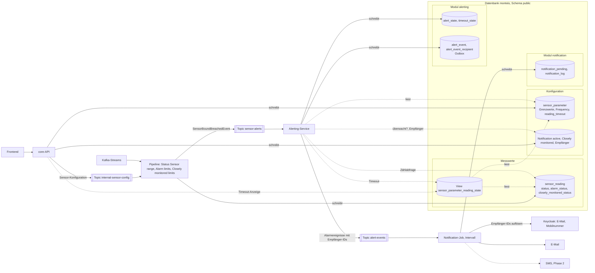

# Zielarchitektur Alarmierung

Messwerte von Notification active oder Closely monitored Sensor-Parametern, die ihre Alarm limits oder Closely monitored limits verletzen, lösen in einem festen Intervall eine Sammelbenachrichtigung an die Empfänger aus, die ein Monteis-Admin oder PI im Frontend festgelegt hat. Zusätzlich werden ausbleibende Daten pro Sensor-Parameter erkannt (Timeout); die Überwachung ganzer Pipelines folgt nach der ersten Phase (R20, R21). Phase 1 benachrichtigt per E-Mail, Phase 2 ergänzt SMS. Dieses Dokument hält den Stand der Vorabklärung fest. Es ersetzt keine ADRs: Die Entscheidungen unten werden im Lauf mit Alternativen begründet und in `documentation/architecture/src/09_architecture_decisions.adoc` festgehalten.

Ticket: TBD (`MON-248`). Abhängigkeit: MON-250 (DB-Fusion).

## Ausgangslage

- Das Frontend ist in detaillierte Stories zerlegt und in Umsetzung. Dort wird festgelegt, wann ein Alarm an welche Personen geht, für welchen Sensor und welches Experiment.
- Heute gibt es pro `sensor_parameter` ein Grenzwertpaar `lower_alarm_limit` / `upper_alarm_limit`. Fachlich ist das die Sensor range, nicht die Alarm limits.
- Die Pipeline stuft jeden Messwert beim Ingest ein und speichert das Ergebnis in `sensor_reading.status` (`range_category`: `too_low | correct | too_high`). Die Grenzwerte erhält sie über die Sensor-Konfiguration aus Kafka, nicht aus den Meta-Tabellen.
- Die Pipeline (`BoundsValidator`) veröffentlicht heute schon bei jeder Verletzung der Sensor range eines neu eingetroffenen Messwerts ein `SensorBoundBreachedEvent` asynchron auf das Topic `sensor-alerts`, bei Reprocessing nicht. Auf `main` konsumiert niemand dieses Topic. Fehler beim Senden werden nur geloggt.
- Bei einer Änderung der Sensor-Konfiguration verarbeitet die Pipeline historische Messwerte neu (`SensorConfigReprocessingListener`, `HistoricalReadingChunkProcessor`) und schreibt dabei auch `status` neu.
- Kontaktdaten werden nie in MONTEIS gespeichert, sondern aus Keycloak gelesen (bisher nur mit dem Token des Aufrufers).
- Geplante Jobs mit Sperre gegen Doppelläufe gibt es bereits: Fulcrum-Synchronisation mit ShedLock.

## Anforderungen

| ID  |                                                                                                                                                                                                                                                                            Anforderung                                                                                                                                                                                                                                                                             |
|-----|--------------------------------------------------------------------------------------------------------------------------------------------------------------------------------------------------------------------------------------------------------------------------------------------------------------------------------------------------------------------------------------------------------------------------------------------------------------------------------------------------------------------------------------------------------------------|
| R1  | Benachrichtigt wird periodisch in einem festen Intervall, z. B. zweimal täglich. Das genaue Intervall ist zu definieren.                                                                                                                                                                                                                                                                                                                                                                                                                                           |
| R2  | Pro `sensor_parameter` gibt es zwei Grenzwertpaare: Alarm limits (unten/oben), Closely monitored limits (unten/oben).                                                                                                                                                                                                                                                                                                                                                                                                                                              |
| R3  | Benachrichtigungen lösen nur Verletzungen der Alarm limits und Closely monitored limits aus, nicht der Sensor range.                                                                                                                                                                                                                                                                                                                                                                                                                                               |
| R4  | Alarme von Closely monitored Sensor-Parametern gehen im selben Intervall raus wie normale Alarme, nicht sofort.                                                                                                                                                                                                                                                                                                                                                                                                                                                    |
| R5  | Die Alarm limits und Closely monitored limits werden am Sensor-Parameter festgelegt (im Frontend gepflegt). Sie sind fix, nicht zeitlich versioniert. Eine Änderung führt zu einer Neuevaluation des gespeicherten Status.                                                                                                                                                                                                                                                                                                                                         |
| R6  | Die Empfänger normaler Alarme legt ein Monteis-Admin oder ein PI des Experiments im Frontend fest (R17). Closely monitored setzt nur ein Monteis-Admin.                                                                                                                                                                                                                                                                                                                                                                                                            |
| R7  | E-Mail-Adressen (und in Phase 2 Telefonnummern) werden pro Benutzer aus Keycloak gelesen.                                                                                                                                                                                                                                                                                                                                                                                                                                                                          |
| R8  | Phase 1: E-Mail. Phase 2: SMS.                                                                                                                                                                                                                                                                                                                                                                                                                                                                                                                                     |
| R9  | Ein normaler Alarm geht nur einmal raus: Ein Sensor-Parameter, der dauerhaft im Alarm bleibt, wird nicht in jedem Intervall erneut gemeldet. Alarme von Closely monitored Sensor-Parametern wiederholen sich.                                                                                                                                                                                                                                                                                                                                                      |
| R10 | Empfänger normaler Alarme werden pro Experiment festgelegt; sie erhalten die Alarme der Notification active Sensor-Parameter dieses Experiments.                                                                                                                                                                                                                                                                                                                                                                                                                   |
| R11 | Ein Alarm wird ausgelöst oder zurückgesetzt, sobald mindestens so viele aufeinanderfolgende Messwerte wieder innerhalb oder ausserhalb des Ranges liegen, wie der Frequency-Wert angibt (ohne Frequency-Wert: default 1).  Das Versandintervall (R1) spielt für die Rücksetzung keine Rolle; es bestimmt nur, wann Alarme an die Empfänger verschickt werden.                                                                                                                                                                                                      |
| R12 | Alarm limits und Closely monitored limits sind zwei voneinander unabhängige Ranges. Jeder wird für sich ausgewertet, gemeldet und zurückgesetzt; einen eigenen Verschärfungsfall („von Alarm limits zu Closely monitored limits“) gibt es nicht. Jeder Messwert wird gegen beide Ranges getrennt geprüft; die Ranges können sich überlappen, ein Wert kann also beide verletzen und für beide Folgen zählen.                                                                                                                                                       |
| R13 | Es gibt keine Entwarnung, wenn ein Sensor-Parameter wieder im Range ist.                                                                                                                                                                                                                                                                                                                                                                                                                                                                                           |
| R15 | Ist für einen Sensor-Parameter kein Frequency-Wert definiert, wird der Alarm beim ersten Auftreten eines Verstosses ausgelöst.                                                                                                                                                                                                                                                                                                                                                                                                                                     |
| R16 | Alarmiert werden nur Sensor-Parameter, die Notification active und/oder Closely monitored sind. Ein Sensor-Parameter im Timeout kann ebenfalls eine Benachrichtigung auslösen, wenn er Notification active ist. Sensor range und Timeout werden zusätzlich im Frontend farblich gekennzeichnet (Story im Backlog).                                                                                                                                                                                                                                                 |
| R17 | Monteis-Admin oder PI legen pro Hauptexperiment fest, welche Sensor-Parameter Notification active sind und welche Empfänger (nur Experimentuser) alarmiert werden.                                                                                                                                                                                                                                                                                                                                                                                                 |
| R18 | Closely monitored setzt nur ein Monteis-Admin, pro Sensor-Parameter; eine Zuordnung pro Experiment ist möglich. Empfänger sind die Benutzer, die der Monteis-Admin für den Closely monitored Sensor-Parameter festlegt (eigene Empfängerliste). TBD: Frage: Wie soll eine Zuordnung pro Experiment für Closely monitored Sensor-Parameter vorgenommen werden? Welche User können ausgewählt werden (welche User sind berechtigt)? Oder geht es hier eher um die Darstellung der Alarme von Closely monitored Sensor-Parametern in den jeweiligen Experiment-Views? |
| R19 | Alarme von Closely monitored Sensor-Parametern können wiederholt ausgelöst werden. In der initialen Umsetzung wird ein bestehender solcher Alarm in jedem Versandintervall (R1) erneut gemeldet; ein eigenes, konfigurierbares Wiederholungsintervall folgt später.                                                                                                                                                                                                                                                                                                |
| R20 | Pipelines werden überwacht. Eine Pipeline ist der Datenfluss eines externen Lieferanten bis in die TimescaleDB. Eine Seite im Adminbereich zeigt eine Übersicht über alle Pipelines (FE-Stories existieren). TBD Out of Scope in erster Phase                                                                                                                                                                                                                                                                                                                      |
| R21 | Pro Pipeline kann ein Timeout definiert werden. Liefert eine Pipeline innerhalb ihres Timeouts keine Daten, wird alarmiert. TBD Out of Scope in erster Phase                                                                                                                                                                                                                                                                                                                                                                                                       |
| R22 | Prio 1 alarmiert ausschliesslich per E-Mail. Eine Kanalwahl (E-Mail und/oder SMS) folgt mit SMS in Phase 2; wo sie konfiguriert wird, ist offen. Das Design hält die Kanal-Schnittstelle offen, legt aber noch kein Konfigurationsfeld an.                                                                                                                                                                                                                                                                                                                         |
| R23 | Fehlende Datensequenzen werden erkannt: Trifft für einen Sensor-Parameter länger als sein Timeout (Feld am Sensor-Parameter) kein Messwert ein, wird eine Datenlücke gemeldet.                                                                                                                                                                                                                                                                                                                                                                                     |
| R24 | Die Pipeline setzt pro Messwert nur den Status gegen Sensor range, Alarm limits und Closely monitored limits, zustandslos wie heute für die Sensor range. Frequency, Auslösen und Rücksetzen eines Alarms sowie das Timeout werden ausserhalb der Pipeline berechnet, damit das Reprocessing und dessen Performance unter keinen Umständen beeinträchtigt werden. Der Versand an die Empfänger erfolgt im Versandintervall (R1).                                                                                                                                   |

## Zielbild

1. **Pipeline: Status pro Messwert (R24, R5)**
   - stuft jeden Messwert wie heute im `BoundsValidator` ein, neu gegen drei Ranges: Sensor range (`status`, bestehend), Alarm limits (`alarm_status`) und Closely monitored limits (`closely_monitored_status`), alle mit dem bestehenden Enum `range_category` (`too_low | correct | too_high`); ohne Grenzwerte bleibt der Status `NULL`;
   - erhält die Grenzwerte wie heute über die Sensor-Konfiguration aus Kafka (`SensorParameterConfig` in `contracts`, um die zwei neuen Grenzwertpaare erweitert);
   - veröffentlicht bei neu eingetroffenen Messwerten wie heute ein `SensorBoundBreachedEvent` auf das bestehende Topic `sensor-alerts`, neu auch für Verletzungen der Alarm limits und Closely monitored limits (E10);
   - stuft bei einer Änderung der Grenzwerte die gespeicherten Messwerte über das bestehende Reprocessing neu ein (R5); pro neu eingestuftem Messwert sendet sie dabei nichts, am Ende eines Reprocessing-Laufs aber ein einziges Ereignis „Reprocessing abgeschlossen“ (Sensor-Parameter) auf `sensor-alerts` (F4);
   - führt keinen Zustand: keine Folgen, kein Auslösen oder Rücksetzen, kein Timeout.
2. **Alerting-Service (Feature-Modul `alerting` in `core`, E1, E12): entscheidet, was ein Alarm ist.**
   - **Auswertung pro Verletzung** (Kafka-Consumer auf `sensor-alerts`):
     - verarbeitet nur Verletzungen der Alarm limits und Closely monitored limits von Notification active bzw. Closely monitored Sensor-Parametern (R3, R16); Verletzungen der Sensor range ignoriert er;
     - führt in eigenen Tabellen pro Sensor-Parameter und Range einen kleinen Zustand: Zeitpunkt der letzten gezählten Verletzung, Anzahl Verletzungen in Folge, Alarm ausgelöst ja/nein (E6);
     - prüft bei jeder Verletzung, ob seit der letzten gezählten Verletzung Messwerte mit Status `correct` für diesen Range gespeichert wurden (Zählabfrage über den bestehenden Index `sensor_reading (sensor_parameter_id, timestamp DESC)`): keine dazwischen, dann läuft die Folge weiter (+1); mindestens einer, dann beginnt sie neu bei 1, und waren es mindestens so viele wie der Frequency-Wert, ist ein ausgelöster Alarm zurückgesetzt (R11);
     - löst den Alarm aus, sobald die Folge den Frequency-Wert erreicht (ohne Frequency: beim ersten Verstoss, R11, R15), und schreibt ein Alarmereignis mit Empfängern (siehe unten);
     - ignoriert Verletzungen, die nicht neuer sind als die zuletzt gezählte (E7); das macht ihn zugleich robust gegen doppelt zugestellte Ereignisse;
     - berechnet nach „Reprocessing abgeschlossen“ den Zustand dieses Sensor-Parameters aus den neu gespeicherten Status neu: Er liest die jüngsten Messwerte rückwärts über den bestehenden Index, bestimmt die aktuelle Folge und löst aus oder setzt zurück (F4). Ältere, inzwischen abgeschlossene Folgen lösen keinen Alarm aus (F8);
     - schreibt Zustand und Alarmereignis in einer Transaktion (Outbox) und bestätigt den Kafka-Offset erst danach.
   - **Periodische Prüfung** (eigener geplanter Lauf mit ShedLock, im Versandintervall R1, einige Minuten vor dem Versand des Notification-Job):
     - setzt ausgelöste Alarme zurück, wenn seither mindestens Frequency Messwerte in Folge im Range lagen (R11); ohne neue Verletzung bemerkt die Auswertung eine Rücksetzung sonst nicht;
     - erkennt neue Timeouts der Notification active Sensor-Parameter über den View aus E11 und schreibt dafür ein Alarmereignis (siehe Punkt 4);
     - schreibt für jeden noch ausgelösten Alarm eines Closely monitored Sensor-Parameters einmal pro Versandintervall ein Wiederholungsereignis (R19).
   - **Empfänger auflösen:** bestimmt beim Schreiben jedes Alarmereignisses die Empfänger als Keycloak-User-IDs: für normale Alarme und Timeouts die Empfänger des Hauptexperiments (R10, R17), für Closely monitored die eigene Empfängerliste (R18). Empfänger ohne Leserecht auf das Experiment lässt er weg. Die Empfänger stehen damit beim Auslösen fest.
   - **Veröffentlichen:** ein Outbox-Relay sendet jedes neue Alarmereignis samt Empfänger-IDs auf das Topic `alert-events` (Schlüssel `sensor_parameter_id`) und markiert es danach als veröffentlicht (E13).
   - Er kennt weder Kontaktdaten noch Kanäle und versendet nichts.
3. **Notification-Job (Feature-Modul `notification` in `core`, E12): entscheidet, wie benachrichtigt wird.**
   - **Empfang:** ein Kafka-Consumer auf `alert-events` legt jedes Alarmereignis samt Empfänger-IDs in der eigenen Tabelle `notification_pending` ab und bestätigt danach den Offset; doppelt zugestellte Ereignisse fallen über den Primärschlüssel weg;
   - **Versand** (geplanter Lauf im Versandintervall R1, ShedLock gegen Doppelläufe mehrerer Instanzen):
     - liest die offenen Einträge aus `notification_pending`;
     - liest keine Konfiguration und keine Empfänger aus der Datenbank, sondern verwendet die Empfänger-IDs aus dem Ereignis;
     - löst die IDs über einen Service-Account in Keycloak in E-Mail-Adressen bzw. Mobilnummern auf (E3);
     - gruppiert pro Empfänger, Experiment und Sensor-Parameter und versendet per E-Mail (R22; SMS in Phase 2 über dieselbe Kanal-Schnittstelle, E5);
     - schreibt das Versandprotokoll (nur Keycloak-User-IDs) und markiert einen Eintrag erst als erledigt, wenn alle Empfänger einen endgültigen Status haben;
   - verschickt keine Entwarnung (R13).
4. **Timeout (R16, R23):**
   - **Aktueller Zustand:** Der View `sensor_parameter_reading_state` (E11) liefert pro Sensor-Parameter den Zeitpunkt des letzten Messwerts und `timed_out` (`now() − letzter Messwert > reading_timeout`). `core` liest ihn für die Anzeige im Frontend, der Alerting-Service für die periodische Prüfung.
   - **Benachrichtigung:** Für Notification active Sensor-Parameter erzeugt der Alerting-Service in seiner periodischen Prüfung bei einem neuen Timeout einmal ein Alarmereignis mit den Empfängern des Experiments, der Notification-Job versendet es. Der Alerting-Service merkt sich, für welchen letzten Messwert der Timeout gemeldet ist. Trifft danach ein neuer Messwert ein (`last_reading_at` ist neuer), ist der Timeout beendet; ein späterer Timeout wird wieder gemeldet. Eine Entwarnung gibt es nicht (R13).
   - **Lücken in der Historie:** Abstand zum vorherigen Messwert grösser als das Timeout. Das Frontend berechnet es selbst aus den geladenen Messreihen, und nur wenn diese nicht heruntergerechnet sind, also beim Hineinzoomen (F6). In heruntergerechneten Ansichten werden keine Lücken markiert; `core` liefert dafür nichts zusätzlich.
   - Eine echte virtuelle Spalte ist dafür nicht möglich; siehe E11.
5. **Konfiguration am Sensor-Parameter:** zwei neue Grenzwertpaare (Alarm limits, Closely monitored limits), Frequency und Timeout als neue Spalten, im Frontend gepflegt; Migration `V2__…` nach MON-250.
6. **Notification active, Closely monitored und Empfänger** (gepflegt über die API von `core`; gelesen nur vom Alerting-Service, der daraus die Überwachung und die Empfänger bestimmt):
   - pro Hauptexperiment: Notification active Sensor-Parameter und Empfänger aus den Experiment-Usern; schreiben dürfen Monteis-Admin und PI (R10, R17);
   - pro Sensor-Parameter: Closely monitored mit eigener Empfängerliste; schreiben darf nur ein Monteis-Admin (R18);
   - die Schreibregeln sind in `Capabilities` und in den RLS-Funktionen gleich und durch Integrationstests abgesichert.
7. **Pipeline-Überwachung (R20, R21):** ausserhalb der ersten Phase.



- Wo wird Interval definiert? SoC ?
- Wie erfahrt AlertService von Timeouts?
- State halten von Anzahl Alerts pro Parameter bzgl. Fequency? oder jedesmal neu berechnen? Thema View vs. Tables

Textfassung: Alle Tabellen liegen nach MON-250 in einer Datenbank `monteis`, Schema `public`; die Gruppen sind nur logisch getrennt, nach dem, wer schreibt.

- **Messwerte:** `sensor_reading` schreibt nur die Pipeline (Ingest und Reprocessing). Der View `sensor_parameter_reading_state` (E11) liest `sensor_reading` und `sensor_parameter` und liefert den letzten Messwert und `timed_out`.
- **Konfiguration:** `sensor_parameter` (Grenzwerte, Frequency, `reading_timeout`) sowie Notification active, Closely monitored und Empfänger schreibt nur die `core`-API (Admin oder PI über das Frontend). Die Pipeline erhält die Grenzwerte nicht aus der Datenbank, sondern über das Topic `internal-sensor-config`.
- **Modul `alerting`:** `alert_state`, `timeout_state` und `alert_event` schreibt nur der Alerting-Service. Er wird durch `sensor-alerts` angestossen, liest `sensor_reading`, den View und die Konfiguration. Er bestimmt auch die Empfänger jedes Alarmereignisses (Keycloak-User-IDs, inklusive Prüfung der Leserechte) und veröffentlicht das Ereignis samt Empfängern über die Outbox auf das Topic `alert-events`.
- **Modul `notification`:** `notification_pending` und `notification_log` schreibt nur der Notification-Job. Die Alarmereignisse samt Empfänger-IDs liest er aus dem Topic `alert-events`, das der Alerting-Service schreibt. Er liest keine Konfiguration; er löst nur die Empfänger-IDs über Keycloak in E-Mail-Adressen bzw. Mobilnummern auf und versendet.
- **Verbindungen zwischen den Gruppen:** Fremdschlüssel nur von `alerting` auf `sensor_parameter` (`ON DELETE CASCADE`). `notification` hat keine Fremdschlüssel auf andere Gruppen; es arbeitet nur mit der Kopie der Ereignisse aus `alert-events`. Durchgezogene Pfeile schreiben, gestrichelte lesen.

## Vorentscheide (Als ADR zu bestätigen)

### E1 Aufteilung: Pipeline setzt Status, Alerting-Service wertet aus, Notification-Job versendet

- **Entscheid (R24):** Die Pipeline stuft jeden Messwert zustandslos gegen drei Ranges ein, wie heute für die Sensor range. Folgen, Auslösen, Rücksetzen und Timeouts übernimmt der Alerting-Service (Feature-Modul `alerting` in `core`), angestossen durch das bestehende Topic `sensor-alerts`. Er bestimmt auch die Empfänger und übergibt jedes Alarmereignis über das Topic `alert-events`. Kontaktdaten, Kanäle und Versand übernimmt der Notification-Job (Feature-Modul `notification` in `core`), E12, E13.
- **Begründung:**
  - Drei Vergleiche statt einem pro Messwert kosten Pipeline und Reprocessing praktisch nichts.
  - Der Zustand (Folgen) liegt ausserhalb der Pipeline. Das Reprocessing muss keinen Zustand nachführen.
  - Gearbeitet wird nur bei Verletzungen: Messwerte im Range erzeugen keine Ereignisse, die Auswertung zählt sie bei Bedarf über den gespeicherten Status nach.
- **Verworfen:**
  - Folgen in der Pipeline (Nachtrag 4): widerspricht R24.
  - Eigenes Topic mit einem Ereignis pro gespeichertem Messwert (Stand vor dieser Überarbeitung): mehr Last auf Kafka und in der Auswertung, und mit den gespeicherten Status nicht mehr nötig.
  - Periodischer Job, der alle Messwerte seit dem letzten Lauf auswertet: grosse Abfragen über `sensor_reading` pro Lauf.

### E2 Status pro Messwert in drei Spalten

- **Entscheid:** `sensor_reading` erhält `alarm_status` und `closely_monitored_status` neben dem bestehenden `status` (Sensor range), alle vom Typ `range_category`.
- **Alternative:** eine einzige Spalte mit kombiniertem Enum. Verworfen, weil sich Alarm limits und Closely monitored limits überlappen können (R12) und ein Wert dann beide verletzt.
- **Grenzwertänderung (R5, F4):** Das bestehende Reprocessing stuft die gespeicherten Messwerte neu ein und sendet pro Lauf nur ein Ereignis „Reprocessing abgeschlossen“ (`SensorReprocessingOrchestrator`, nach der Chunk-Schleife). Der Alerting-Service berechnet daraufhin die aktuelle Folge neu und kann einen Alarm auslösen. Das Reprocessing selbst bleibt dabei so schnell wie heute (R24).
- **Zu entscheiden:**
  - Spaltennamen der Grenzwerte, heute `lower_alarm_limit` / `upper_alarm_limit` für die Sensor range;
  - Speicherbedarf der zwei zusätzlichen Spalten auf der Hypertable bei der Datenmenge aus F1;
  - Komprimierung der Chunks: Das Reprocessing ändert dann komprimierte Chunks, falls die Komprimierung aktiviert ist.

### E6 Tabellen von Alerting-Service und Notification-Job

Beide Module speichern in eigenen Tabellen, die nur sie selbst beschreiben. Der Alerting-Service hält fest, was ein Alarm ist und wer ihn bekommt; der Notification-Job, wem er ihn wie geschickt hat. Verbunden sind die beiden nur über das Topic `alert-events` (E13), nicht über Fremdschlüssel. `core` und das Frontend lesen diese Tabellen in der ersten Phase nicht.

```sql
-- Alerting-Service (Modul alerting) -----------------------------------------

CREATE TYPE alert_kind AS ENUM ('alarm_limits', 'closely_monitored_limits', 'timeout');

-- Zustand je Sensor-Parameter und Range (nur 'alarm_limits', 'closely_monitored_limits')
CREATE TABLE alert_state (
    sensor_parameter_id        uuid        NOT NULL REFERENCES sensor_parameter (id) ON DELETE CASCADE,
    kind                       alert_kind  NOT NULL CHECK (kind <> 'timeout'),
    last_counted_violation_at  timestamptz,          -- Messzeitpunkt der zuletzt gezählten Verletzung (E7)
    consecutive_violations     integer     NOT NULL DEFAULT 0,
    triggered_at               timestamptz,          -- NULL = nicht ausgelöst
    last_event_at              timestamptz,          -- letztes Ereignis, für die Wiederholung (R19)
    version                    integer     NOT NULL DEFAULT 0,
    PRIMARY KEY (sensor_parameter_id, kind)
);

-- Gemeldeter Timeout je Sensor-Parameter (R16)
CREATE TABLE timeout_state (
    sensor_parameter_id      uuid        PRIMARY KEY REFERENCES sensor_parameter (id) ON DELETE CASCADE,
    notified_last_reading_at timestamptz,            -- last_reading_at, für den gemeldet wurde; NULL = nie Daten
    detected_at              timestamptz NOT NULL
);

-- Alarmereignisse (Outbox für das Topic alert-events)
CREATE TABLE alert_event (
    id                  uuid        PRIMARY KEY DEFAULT uuidv7(),
    sensor_parameter_id uuid        NOT NULL REFERENCES sensor_parameter (id) ON DELETE CASCADE,
    kind                alert_kind  NOT NULL,
    measured_at         timestamptz,                 -- auslösender Messwert bzw. letzter Messwert beim Timeout
    value               double precision,            -- auslösender Wert, NULL beim Timeout
    repetition          boolean     NOT NULL DEFAULT false,  -- Wiederholung Closely monitored (R19)
    created_at          timestamptz NOT NULL DEFAULT now(),
    published_at        timestamptz                  -- NULL = noch nicht auf alert-events veröffentlicht
);
CREATE INDEX alert_event_unpublished_idx ON alert_event (created_at) WHERE published_at IS NULL;

-- Empfänger je Alarmereignis, beim Auslösen bestimmt
CREATE TABLE alert_event_recipient (
    alert_event_id    uuid NOT NULL REFERENCES alert_event (id) ON DELETE CASCADE,
    recipient_user_id uuid NOT NULL,                 -- Keycloak-User-ID, keine Kontaktdaten
    experiment_id     uuid,                          -- Hauptexperiment; NULL bei Closely monitored ohne Experiment
    PRIMARY KEY (alert_event_id, recipient_user_id)
);

-- Notification-Job (Modul notification) -------------------------------------

-- Empfangene Alarmereignisse aus alert-events (eigene Kopie, kein Fremdschlüssel auf alerting)
CREATE TABLE notification_pending (
    alert_event_id      uuid        PRIMARY KEY,     -- id aus dem Ereignis; macht den Empfang idempotent
    payload             jsonb       NOT NULL,        -- Ereignis inkl. Empfänger-IDs, wie auf dem Topic
    received_at         timestamptz NOT NULL DEFAULT now(),
    completed_at        timestamptz                  -- NULL = noch nicht vollständig versandt
);
CREATE INDEX notification_pending_open_idx ON notification_pending (received_at) WHERE completed_at IS NULL;

-- Versandprotokoll: nur Keycloak-User-IDs, keine Kontaktdaten
CREATE TABLE notification_log (
    id                uuid        PRIMARY KEY DEFAULT uuidv7(),
    alert_event_id    uuid        NOT NULL REFERENCES notification_pending (alert_event_id) ON DELETE CASCADE,
    recipient_user_id uuid        NOT NULL,
    channel           text        NOT NULL,          -- 'email', ab Phase 2 'sms'
    status            text        NOT NULL,          -- 'sent' | 'failed' | 'no_address'
    attempted_at      timestamptz NOT NULL DEFAULT now(),
    error             text,
    UNIQUE (alert_event_id, recipient_user_id, channel)
);
```

So entstehen die Regeln aus den Anforderungen:

|                      Regel                       |      Modul       |                                                                                                                                   Umsetzung                                                                                                                                    |
|--------------------------------------------------|------------------|--------------------------------------------------------------------------------------------------------------------------------------------------------------------------------------------------------------------------------------------------------------------------------|
| Normaler Alarm nur einmal (R9)                   | Alerting-Service | Ein `alert_event` entsteht nur beim Übergang von `triggered_at IS NULL` auf einen Wert. Solange der Alarm ausgelöst bleibt, entsteht kein weiteres Ereignis.                                                                                                                   |
| Rücksetzen (R11)                                 | Alerting-Service | `triggered_at` und `consecutive_violations` werden zurückgesetzt, bei der nächsten Verletzung oder in der periodischen Prüfung. Ein späteres Auslösen erzeugt wieder ein Ereignis.                                                                                             |
| Closely monitored wiederholen (R19)              | Alerting-Service | Die periodische Prüfung erzeugt für jeden noch ausgelösten `alert_state` mit `kind = 'closely_monitored_limits'` ein Ereignis mit `repetition = true`, wenn `last_event_at` mindestens ein Versandintervall zurückliegt.                                                       |
| Timeout einmal, neuer Messwert beendet ihn (R16) | Alerting-Service | Ist `timed_out` im View wahr und unterscheidet sich `last_reading_at` von `timeout_state.notified_last_reading_at` (`IS DISTINCT FROM`), oder fehlt die Zeile, entsteht ein Ereignis und die Zeile wird geschrieben. Ist `timed_out` nicht mehr wahr, wird die Zeile gelöscht. |
| Empfänger                                        | Alerting-Service | Beim Schreiben des Ereignisses: normale Alarme und Timeouts an die Empfänger des Hauptexperiments, Closely monitored an die eigene Empfängerliste; nur Empfänger mit Leserecht auf das Experiment (`alert_event_recipient`).                                                   |
| Kein Ereignis geht verloren                      | Alerting-Service | Zustand, Ereignis und Empfänger in einer Transaktion; das Outbox-Relay veröffentlicht alles mit `published_at IS NULL` und setzt `published_at` erst nach der Bestätigung durch Kafka.                                                                                         |
| Kein doppelter Empfang                           | Notification-Job | `notification_pending.alert_event_id` ist Primärschlüssel; ein erneut zugestelltes Ereignis wird ignoriert.                                                                                                                                                                    |
| Kein doppelter Versand                           | Notification-Job | `UNIQUE (alert_event_id, recipient_user_id, channel)`; ein Lauf versendet nur, was für diese Kombination noch nicht `sent` ist.                                                                                                                                                |
| Gescheiterter Versand geht nicht verloren        | Notification-Job | `failed` wird im nächsten Lauf erneut versucht; `completed_at` wird erst gesetzt, wenn jeder Empfänger `sent` oder `no_address` hat (F2).                                                                                                                                      |
| Gelöschter Sensor-Parameter                      | Alerting-Service | `ON DELETE CASCADE` räumt Zustand und Ereignisse ab. Bereits übergebene Einträge in `notification_pending` bleiben und werden noch versandt.                                                                                                                                   |

Caveats:

- Die Tabellen haben keine RLS. Jedes Modul schreibt nur seine eigenen Tabellen; der Notification-Job greift auf keine Tabelle von `alerting` zu. ArchUnit stellt das sicher.
- `alert_event`, `notification_pending` und `notification_log` wachsen unbegrenzt; eine Aufbewahrungsfrist ist festzulegen.
- Optimistic Locking über `version` auf `alert_state`, weil die Auswertung (Kafka) und die periodische Prüfung dieselbe Zeile ändern können.
- `failed` wird ohne Obergrenze wiederholt; eine maximale Anzahl Versuche mit endgültigem Status ist noch festzulegen.

### E7 Folge bei zeitnaher Auswertung: Reihenfolge und verspätete Werte

Der Alerting-Service sieht jede Verletzung in dem Moment, in dem ihr Ereignis eintrifft. Bei einem Wert mit Zeitstempel 10:05 weiss er nicht, ob noch ein Wert von 10:03 unterwegs ist (z. B. gepuffert beim Datenlogger). Ein Job, der später auf die gespeicherten Daten schaut, hätte dieses Problem nicht, weil zu diesem Zeitpunkt alle Werte schon da sind.

Beispiel mit Frequency 3:

| Eintreffen | Messzeitpunkt |   Wert   | Folge nach Eintreffen |                 Folge nach Messzeitpunkt                 |
|------------|---------------|----------|-----------------------|----------------------------------------------------------|
| 1          | 10:01         | Verstoss | 1                     | 1                                                        |
| 2          | 10:02         | Verstoss | 2                     | 2                                                        |
| 3          | 10:04         | Verstoss | 3 → **Alarm**         | 3 → Alarm, aber nur vorläufig                            |
| 4          | 10:03         | im Range | 0                     | Folge war 10:01–10:02, danach 10:04 = 1 → **kein Alarm** |

Nach Messzeitpunkt korrekt gezählt, hätte der Alarm nie ausgelöst werden dürfen. Die Auswertung erfährt das aber erst beim vierten Wert, wenn der Alarm schon ausgelöst ist.

Varianten:

1. **Innerhalb eines Kafka-Batches nach Messzeitpunkt sortieren.** Billig; fängt Vertauschungen innerhalb eines Batches ab, nicht über Batchgrenzen hinweg.
2. **Verspätete Werte für die Folge ignorieren.** Ist ein Wert nicht neuer als der zuletzt gezählte dieses Sensor-Parameters, verändert er die Folge nicht (gespeichert ist er durch die Pipeline trotzdem). Einfach und deterministisch; ein verspäteter Wert kann eine Folge weder unterbrechen noch verlängern.
3. **Folge ab dem verspäteten Wert neu berechnen.** Die Auswertung liest die gespeicherten Werte ab dessen Zeitstempel und zählt neu. Korrekt, braucht aber wieder eine Rückwärtsabfrage samt Index; ein bereits ausgelöster Alarm lässt sich nur zurückziehen, solange er noch nicht versandt ist.
4. **Verzögert auswerten.** Die Auswertung wartet eine feste Frist (z. B. 15 Minuten), bevor sie zählt. Korrekt für alle Werte innerhalb der Frist, aber deutlich mehr Komplexität.

- **Entscheid:** 1 + 2. Weil Alarme ohnehin erst im nächsten Versandintervall rausgehen (R1), wiegen seltene Grenzfälle wenig.
- **Folge:** Pro Sensor-Parameter und Range führt der Zustand den Messzeitpunkt des zuletzt gezählten Werts. Das macht die Auswertung zugleich idempotent gegenüber erneut zugestellten Ereignissen. Weil die Auswertung Werte im Range über den gespeicherten Status nachzählt (E1), wirkt ein verspäteter Wert im Range noch, solange die nächste Verletzung danach eintrifft.

### E11 Timeout: View statt virtueller Spalte

Einen Timeout kann nur ein Sensor-Parameter haben, nicht ein einzelner Messwert, weil es für einen ausgebliebenen Messwert keine Zeile in `sensor_reading` gibt, in der man den Timeout speichern könnte.

Eine virtuelle Spalte funktioniert dafür nicht: Generierte Spalten (in PostgreSQL 18 auch virtuelle) dürfen nur Werte derselben Zeile und nur unveränderliche Funktionen verwenden. Für den Timeout braucht es aber den letzten Messwert, also eine andere Tabelle, und `now()`, das nicht unveränderlich ist.

Ein View kann beides, das heisst, er darf andere Tabellen lesen und rechnet bei jedem Lesen mit dem aktuellen `now()`. Voraussetzung ist MON-250 (beide DBs zusammenlegen), das hat grossen Einfluss auf die Performance und ist auch aus anderen Gründen nötig: Über die FDW wird das `LIMIT 1` nicht zur TimescaleDB gepusht, sobald eine lokale Tabelle gejoint wird (`db/meta/schema/V3__create_timescaledb_fdw_mapping.sql`), das heisst, pro Sensor-Parameter würden bis zu 2000 Zeilen übertragen.

```sql
ALTER TABLE sensor_parameter
    ADD COLUMN reading_timeout interval CHECK (reading_timeout > interval '0');

CREATE VIEW sensor_parameter_reading_state WITH (security_invoker = true) AS
SELECT p.id               AS sensor_parameter_id,
       p.reading_timeout,
       r."timestamp"      AS last_reading_at,
       r.status,
       r.alarm_status,
       r.closely_monitored_status,
       CASE
         WHEN p.reading_timeout IS NULL THEN NULL
         ELSE r."timestamp" IS NULL OR r."timestamp" < now() - p.reading_timeout
       END                AS timed_out
FROM sensor_parameter p
LEFT JOIN LATERAL (
    SELECT s."timestamp", s.status, s.alarm_status, s.closely_monitored_status
    FROM sensor_reading s
    WHERE s.sensor_parameter_id = p.id
    ORDER BY s."timestamp" DESC
    LIMIT 1
) r ON true;

REVOKE ALL ON sensor_parameter_reading_state FROM core;
GRANT SELECT ON sensor_parameter_reading_state TO core;
```

Damit können wir die Sensor-Parameter im Timeout in der Webapp anzeigen und im Alerting-Service die Sensor-Parameter und Messwerte lesen, die bestimmen, wann wir Alarme senden. Der View ist auch besser als die Funktion aus E11 (a), weil jOOQ dafür eine normale Tabellenklasse generiert und man ihn wie eine Tabelle joinen und filtern kann.

Caveats:

- `security_invoker = true` ist Pflicht, sonst läuft der View mit den Rechten des Owners und die RLS auf `sensor_parameter` und `sensor_reading` greift nicht. Das sollte ein Integrationstest absichern.
- Der Alerting-Service liest den View ohne Benutzerkontext. Wegen `security_invoker` greift die RLS auch für ihn, und ohne gesetzte Zugriffsrichtlinie sieht er keine Zeilen. Als Modul in `core` setzt er deshalb in seinen Transaktionen den Systemkontext `app.read_all_experiments` (E4, E12); das `GRANT SELECT` an `core` deckt ihn ab. Als eigenes Deployable bräuchte er eine eigene DB-Rolle mit Policy und eigenem `GRANT`.
- Ohne `reading_timeout` ist `timed_out` `NULL`, also keine Timeout-Prüfung. Ein Sensor-Parameter, der noch nie Daten geliefert hat, gilt mit Timeout als `timed_out`. Ist das so gewollt, oder braucht es einen eigenen Zustand "noch keine Daten"?
- Performance: Für einen Sensor-Parameter mit aktuellen Daten reicht der neueste Chunk. Ein Sensor-Parameter im Timeout durchsucht aber die Indizes aller Chunks bis zum Anfang, das wird mit wachsender Historie langsamer. Das müsste man mit `EXPLAIN` und dem Mengengerüst (F1) prüfen. Falls nötig, könnte man nur innerhalb des Timeouts suchen (`AND s."timestamp" > now() - p.reading_timeout`), dann ist `last_reading_at` bei lange toten Sensor-Parametern aber leer.
- Ohne Filter berechnet der View den letzten Messwert für jeden sichtbaren Sensor-Parameter, Abfragen sollten also immer auf die angezeigten Sensor-Parameter filtern.
- Auf komprimierten Chunks ist `ORDER BY ... DESC LIMIT 1` teurer (offener Prüfpunkt Compression aus MON-250).
- Die Default Privileges aus MON-250 geben `core` CRUD auch auf neue Views, deshalb `REVOKE ALL` und nur `SELECT`.
- `alarm_status` und `closely_monitored_status` gibt es erst mit E2.

Wie gespeichert wird, dass für einen Zustand schon ein Alarm erzeugt und versandt wurde: in eigenen Tabellen von Alerting-Service und Notification-Job, verbunden über das Topic `alert-events`; siehe Abschnitte E6 und E13. Wo beide laufen: siehe Abschnitt E12.

### E12 Alerting-Service und Notification-Job als Feature-Module in `core`

- **Entscheid:** Alerting-Service und Notification-Job sind logisch getrennte Services, laufen aber als Feature-Module `alerting` und `notification` im Deployable `core`.
  - **Alerting-Service** (`alerting`): eigene Kafka-Consumer-Group auf `sensor-alerts`, Zustand, Alarmereignisse und Empfänger (E6), eigener geplanter Lauf für Rücksetzung, Timeouts und Wiederholungen, Outbox-Relay auf `alert-events` (E13).
  - **Notification-Job** (`notification`): eigene Kafka-Consumer-Group auf `alert-events`, geplanter Versandlauf im Versandintervall mit ShedLock, Keycloak-Kontaktdaten, Kanal-Schnittstelle (E5) und Versandprotokoll (E6).
  - Die Module kennen sich im Code nicht. Ihre einzige Schnittstelle ist das Topic `alert-events` mit dem Ereignisschema in `contracts`. So lässt sich der Versand später auch durch andere Quellen (z. B. Pipeline-Überwachung, R20) anstossen, und jedes Modul kann einzeln herausgelöst werden.
- **Begründung:**
  - Die Last ist klein: Die Auswertung arbeitet nur bei Verletzungen, der Versand zweimal täglich (R1). Ob das so bleibt, zeigt das Mengengerüst (F1).
  - `core` hat schon alles, was beide brauchen: Datenbankzugang mit jOOQ, die Konfigurationstabellen (Notification active, Closely monitored, Empfänger), ShedLock, die Keycloak-Anbindung und einen Kafka-Client (bisher nur Producer, ein Consumer kommt dazu).
  - Der RLS-Kontext existiert schon: `RlsConnectionProvider` setzt `app.read_all_experiments` pro Transaktion. Der Alerting-Service setzt ihn in seinen eigenen Transaktionen auf `true` (E4). Der Notification-Job braucht ihn nicht, weil er nur seine eigenen Tabellen ohne RLS liest.
  - Kein zusätzliches Image, kein Release-Workflow, keine Manifeste, keine weiteren Secrets und keine weitere DB-Rolle.
- **Grenzen innerhalb von `core`:** ArchUnit stellt sicher, dass andere Module nicht auf `alerting` und `notification` und deren Tabellen zugreifen, dass die beiden Module einander nicht referenzieren, und dass `alerting` die Konfiguration nur über deren `query`-Schicht liest.
- **Verworfen für die erste Phase, eigenes Deployable:** Last und Ausfälle sind von der API getrennt, und der Service lässt sich unabhängig skalieren. Dafür braucht er ein Maven-Modul, ein Image, einen Release-Workflow mit Trivy, Manifeste in `lg-monteis-k8s`/`lg-monteis-gitops`, eine eigene DB-Rolle mit Policy und eigene Secrets. Das lohnt sich, wenn das Mengengerüst (F1) zeigt, dass die Auswertung die API spürbar belastet.
- **Folge für den Betrieb:** Ein Ausfall von `core` stoppt auch Auswertung und Versand. Die Ereignisse bleiben in `sensor-alerts`, in der Outbox und in `alert-events` liegen und werden nach dem Neustart verarbeitet (Rückstau, siehe Risiken).

### E13 Übergabe vom Alerting-Service an den Notification-Job über `alert-events`

- **Entscheid:** Der Alerting-Service veröffentlicht jedes Alarmereignis samt Empfänger-IDs auf das Topic `alert-events`; der Notification-Job konsumiert es und legt es in `notification_pending` ab.
- **Ereignisschema** (`AlertEvent` in `contracts`): `alertEventId`, `sensorParameterId`, `kind` (`alarm_limits`, `closely_monitored_limits`, `timeout`), `measuredAt`, `value`, `repetition`, `recipients` (Liste aus `userId` und `experimentId`). Keine Kontaktdaten, nur Keycloak-User-IDs. Schlüssel ist die `sensorParameterId`.
- **Zuverlässigkeit:** Transactional Outbox im Alerting-Service (`alert_event.published_at`), weil Datenbank-Commit und Kafka-Send keine gemeinsame Transaktion haben. Das Relay sendet mindestens einmal; der Notification-Job entdoppelt über `alert_event_id`.
- **Warum zusätzlich `notification_pending`:** Der Consumer erhält Ereignisse sofort, versandt wird aber nur im Versandintervall (R1). Die Tabelle hält sie bis zum Versand und macht Wiederholversuche möglich, ohne das Topic erneut zu lesen.
- **Verworfen:**
  - Direkter Aufruf zwischen den Modulen mit Lese-Schnittstelle (vorheriger Stand): koppelt die Module im Code und verhindert ein einzelnes Herauslösen.
  - Notification-Job liest das Topic nur zum Versandzeitpunkt: Offsets und Wiederholversuche wären an das Intervall gebunden, ein gescheiterter Versand müsste das Topic erneut lesen.

## ADR-Kandidaten

|  #  |                                    Entscheidung                                     |                                                                                                                                Alternativen                                                                                                                                 |                                                                                                                                               Sicherheit / Compliance                                                                                                                                               |
|-----|-------------------------------------------------------------------------------------|-----------------------------------------------------------------------------------------------------------------------------------------------------------------------------------------------------------------------------------------------------------------------------|---------------------------------------------------------------------------------------------------------------------------------------------------------------------------------------------------------------------------------------------------------------------------------------------------------------------|
| E2  | Status pro Messwert speichern (R24, R5)                                             | drei Spalten `status`, `alarm_status`, `closely_monitored_status` (entschieden) vs. eine Spalte mit kombiniertem Enum                                                                                                                                                       | –                                                                                                                                                                                                                                                                                                                   |
| E3  | Kontaktdaten ohne Benutzer-Token (Notification-Job)                                 | Service-Account (Client Credentials, nur `view-users`) vs. bestehender Admin-Zugang                                                                                                                                                                                         | Erweitert die Entscheidung „Kontaktdaten nur mit dem Token des Aufrufers“; Rechte des Service-Accounts minimal halten, Secret aus der Umgebung                                                                                                                                                                      |
| E4  | Zugriff des Alerting-Service trotz RLS                                              | gesetzter Systemkontext `app.read_all_experiments` in den eigenen Transaktionen (entschieden mit E12, bestehender `RlsConnectionProvider`) vs. eigene DB-Rolle mit eigener Policy (nur bei eigenem Deployable sinnvoll)                                                     | Der Alerting-Service sieht alle Experimente, auch über den View mit `security_invoker` (E11), und prüft die Leserechte der Empfänger selbst; der Notification-Job braucht keinen Systemkontext                                                                                                                      |
| E5  | Kanal-Abstraktion und Provider                                                      | SES vs. SMTP-Relay (E-Mail); SNS vs. externer Provider (SMS, Phase 2)                                                                                                                                                                                                       | Abstimmung mit `lg-monteis-infra`; keine Kontaktdaten im Versandprotokoll                                                                                                                                                                                                                                           |
| E6  | Tabellen von Alerting-Service und Notification-Job (R9, R11, R16, R19)              | `alerting`: `alert_state`, `timeout_state`, `alert_event` (Outbox), `alert_event_recipient`; `notification`: `notification_pending`, `notification_log` (Empfehlung, siehe Abschnitt E6) vs. gemeinsame Tabellen mit Fremdschlüsseln zwischen den Modulen                   | Jedes Modul schreibt nur seine eigenen Tabellen; keine Kontaktdaten gespeichert, nur Keycloak-User-IDs                                                                                                                                                                                                              |
| E7  | Folgen zählen (R11, R15)                                                            | (a) Auswertung pro Verletzungsereignis mit Zählabfrage auf den gespeicherten Status (entschieden); (b) Ereignis pro Messwert, Folge im Speicher; (c) periodischer Job über alle Messwerte                                                                                   | Reihenfolge: nicht neuere Verletzungen ignorieren (siehe E7 oben)                                                                                                                                                                                                                                                   |
| E8  | Lebenszeichen der Pipelines (R20, R21)                                              | ausserhalb der ersten Phase                                                                                                                                                                                                                                                 | –                                                                                                                                                                                                                                                                                                                   |
| E9  | Konfigurationsmodell Notification active, Closely monitored und Empfänger (R16–R19) | eine gemeinsame Tabelle mit Geltungsbereich (Experiment oder Sensor-Parameter) vs. getrennte Tabellen für normale Alarme (pro Experiment) und Closely monitored (pro Sensor-Parameter, eigene Empfängerliste)                                                               | zwei Schreibregeln (Monteis-Admin/PI vs. nur Monteis-Admin) müssen in `Capabilities` und RLS getrennt abgebildet werden                                                                                                                                                                                             |
| E10 | Kanal von der Pipeline zur Auswertung (R24)                                         | (a) bestehendes Topic `sensor-alerts` mit erweitertem `SensorBoundBreachedEvent` (Range-Art, `sensor_parameter_id`, Messzeitpunkt; Empfehlung); (b) neues Topic; (c) Auswertung liest neue Zeilen aus `sensor_reading`                                                      | `AlertPublisher` sendet asynchron und verwirft bei Fehlern; das bleibt so (F3). Schlüssel heute `dasKey`, nötig ist eine Partitionierung pro Sensor-Parameter                                                                                                                                                       |
| E11 | Timeout berechnen (R16, R23)                                                        | (a) View `sensor_parameter_reading_state` mit `security_invoker` (Empfehlung, siehe Abschnitt E11); (b) DB-Funktion `last_reading_at(sensor_parameter)`; (c) Abfrage im Repository mit `LATERAL … ORDER BY timestamp DESC LIMIT 1`; (d) echte generierte (virtuelle) Spalte | (d) ist nicht möglich: generierte Spalten in PostgreSQL 18, auch virtuelle, dürfen nur Werte derselben Zeile und nur unveränderliche Funktionen verwenden. Der View lässt sich mit jOOQ wie eine Tabelle verwenden; RLS greift über `security_invoker`, darum braucht der Alerting-Service den Systemkontext aus E4 |
| E12 | Ort von Alerting-Service und Notification-Job                                       | Feature-Module `alerting` und `notification` in `core` (entschieden, siehe Abschnitt E12) vs. eigene Deployables                                                                                                                                                            | Systemkontext nur für den Alerting-Service (E4); den Keycloak-Service-Account (E3) nutzt nur der Notification-Job; ArchUnit trennt die Module voneinander und vom Rest von `core`                                                                                                                                   |
| E13 | Übergabe Alerting-Service → Notification-Job                                        | Topic `alert-events` mit Outbox und `notification_pending` (entschieden, siehe Abschnitt E13) vs. direkter Aufruf mit Lese-Schnittstelle vs. Lesen des Topics nur zum Versandzeitpunkt                                                                                      | Ereignis enthält nur Keycloak-User-IDs, keine Kontaktdaten                                                                                                                                                                                                                                                          |

## Offene Fragen

| #  |                                                                                                                                                          Frage                                                                                                                                                           |                  Wirkung                   |                                                                                    Stand                                                                                     |
|----|--------------------------------------------------------------------------------------------------------------------------------------------------------------------------------------------------------------------------------------------------------------------------------------------------------------------------|--------------------------------------------|------------------------------------------------------------------------------------------------------------------------------------------------------------------------------|
| F1 | Mengengerüst: Anzahl Sensoren, Messrate, Empfänger pro Experiment                                                                                                                                                                                                                                                        | Machbarkeit der Abfrage pro Lauf, Index    | offen                                                                                                                                                                        |
| F2 | Was passiert, wenn ein Empfänger in Keycloak keine Adresse hat oder deaktiviert ist?                                                                                                                                                                                                                                     | Fehlerbehandlung, Versandprotokoll         | offen                                                                                                                                                                        |
| F3 | Reicht das heutige asynchrone Senden von `AlertPublisher` (Fehler werden nur geloggt)? Ein verlorenes Ereignis verzögert die Auslösung bis zur nächsten Verletzung; folgt keine mehr, bleibt der Alarm aus. Alternative: synchron senden, bevor der Kafka-Offset bestätigt wird                                          | Zuverlässigkeit vs. Durchsatz der Pipeline | beantwortet: asynchron wie heute. Ein verlorenes Ereignis wird als Risiko akzeptiert                                                                                         |
| F4 | Sollen neu eingestufte Messwerte nach einer Grenzwertänderung (R5) Alarme auslösen können? Annahme: nein, nur neue Messwerte lösen aus                                                                                                                                                                                   | Reprocessing, Fehlalarme                   | beantwortet: ja. Umsetzung über ein Ereignis „Reprocessing abgeschlossen“ und Neuberechnung der aktuellen Folge in der Alarm-Auswertung                                      |
| F5 | R23 spricht von „Datenlücke wird gemeldet“, R16 von Anzeige nur im Frontend. Annahme nach Nachtrag: Timeout wird nur angezeigt, nicht verschickt                                                                                                                                                                         | Umfang Versand                             | beantwortet (revidiert durch R16): Timeout wird im Frontend dargestellt und für Notification active Sensor-Parameter einmal gemeldet; ein neuer Messwert beendet den Timeout |
| F6 | Zeigt das Frontend Lücken auch in heruntergerechneten Messreihen (Downsampling) richtig an, oder muss `core` die Lücken vor dem Downsampling ermitteln?                                                                                                                                                                  | E11, Chart-API                             | beantwortet: nein. Lücken werden nur in der nicht heruntergerechneten Ansicht erkannt, also beim Hineinzoomen; `core` liefert keine Lückeninformation                        |
| F7 | Der Kontext nannte ein Topic bzw. eine Tabelle `alert_status`. Im Code gibt es nur das Topic `sensor-alerts`. Ist dieses gemeint?                                                                                                                                                                                        | E10                                        | beantwortet: ja, `sensor-alerts` ist gemeint                                                                                                                                 |
| F8 | Nach einer Grenzwertänderung: Soll nur die aktuelle Folge (die jüngsten Messwerte) einen Alarm auslösen, oder auch Folgen in der Vergangenheit, die nach den neuen Grenzwerten den Frequency-Wert erreicht hätten? Annahme: nur die aktuelle Folge, sonst entsteht eine Flut von Alarmen zu längst vergangenen Messungen | Neuberechnung nach Reprocessing, Alarmflut | offen                                                                                                                                                                        |

## Abhängigkeiten und Reihenfolge

- **MON-250 zuerst:** Neue Tabellen (Konfiguration und Empfänger für `core`; Zustand, Alarmereignisse und Empfänger für den Alerting-Service, `notification_pending` und Versandprotokoll für den Notification-Job, E6), die neuen Spalten an `sensor_parameter` und `sensor_reading` und der View aus E11 kommen als `V2__…` auf `db/schema/V1__baseline.sql`, nicht in die Baseline selbst.
- **Alerting-Service und Notification-Job in `core` (E12):** neue Feature-Module `alerting` und `notification` mit eigenen ArchUnit-Regeln, Kafka-Consumer-Konfiguration in `core` (bisher nur Producer), Ereignisschema `AlertEvent` in `contracts` (E13); bei einem späteren Herauslösen kämen Maven-Modul, Image, Release-Workflow und Manifeste dazu.
- **Glossar:** Sensor range, Alarm limits und Closely monitored limits sind in `CONTEXT.md`, bevor Code und Migrationen sie verwenden. Der heutige Spaltenname `alarm_limit` wird dabei fachlich korrigiert.
- **Frontend:** Die Grenzwert-Erfassung, die Verwaltung von Notification active, Closely monitored und Empfänger und die farbliche Kennzeichnung von Range-Verletzungen und Timeouts (Backlog) brauchen die erweiterte API aus `core`; der REST-Client wird aus der OpenAPI generiert.
- **Pipeline und `contracts`:** `SensorParameterConfig` erhält die zwei neuen Grenzwertpaare; der `BoundsValidator` setzt drei Status; das `SensorBoundBreachedEvent` erhält Range-Art, `sensor_parameter_id` und Messzeitpunkt. `core` muss die neuen Grenzwerte in die Sensor-Konfiguration auf Kafka schreiben, damit Pipeline und Reprocessing sie kennen.
- **Infrastruktur:** `sensor-alerts` und das neue Topic `alert-events` müssen in allen Umgebungen existieren (Partitionen nach erwarteter Last, F1); Mailversand (und später SMS) sowie das Secret des Keycloak-Service-Accounts stellt das Infra-Team in `lg-monteis-infra` bereit.

## Risiken

- **Alarm bleibt unbemerkt bestehen:** Weil ein Alarm nur einmal rausgeht (R9) und es keine Erinnerung oder Entwarnung gibt (R13), sieht niemand per Mail, ob ein Sensor-Parameter seit Wochen ausserhalb des Ranges ist. Das ist so gewollt; der aktuelle Zustand muss dann im Frontend sichtbar sein.
- **Flackern an der Grenze:** Bei Sensor-Parametern ohne Frequency-Wert löst jeder Verstoss aus und jeder Wert im Range setzt zurück (R11, R15). Ein Wert, der um eine Grenze pendelt, kann dann bei jedem Versand neu melden. Ein Frequency-Wert dämpft das in beide Richtungen.
- **Verlorene Alarme:** Fällt ein Versandlauf des Notification-Job aus, versendet der nächste alles, was in `notification_pending` noch offen ist. Fällt das Outbox-Relay aus, bleiben Ereignisse in `alert_event` mit `published_at IS NULL` liegen; das braucht eine Überwachung.
- **Breiter Keycloak-Zugriff:** Ein Service-Account mit Leserecht auf alle Benutzer ist ein neues Angriffsziel; Rechte minimal halten und begründen (E3).
- **Rechte driften:** Die Schreibregel für Empfänger (Monteis-Admin oder PI) und die Leseprüfung des Alerting-Service beim Bestimmen der Empfänger müssen in Java und SQL gleich bleiben; Integrationstests sichern das ab.
- **Empfänger stehen beim Auslösen fest:** Der Alerting-Service bestimmt die Empfänger beim Schreiben des Ereignisses. Wer bis zum Versand entfernt wird oder sein Leserecht verliert, bekommt die Meldung trotzdem; wer neu dazukommt, bekommt sie nicht. Bei einem Versandintervall von bis zu zwölf Stunden ist das vertretbar.
- **Kosten und Lärm durch Wiederholung:** Wiederholte Alarme von Closely monitored Sensor-Parametern (R19) über SMS (Phase 2) erzeugen laufende Kosten und stumpfen Empfänger ab, wenn kein Ende der Wiederholung definiert ist.
- **Verlorene Ereignisse auf `sensor-alerts` (akzeptiert, F3):** Die Pipeline sendet asynchron und verwirft ein Ereignis bei einem Sendefehler. Die Auswertung zählt diese Verletzung dann nicht; eine Folge kann zu kurz erscheinen und ein Alarm ausbleiben oder sich bis zur nächsten Verletzung verzögern. Sendefehler sollten deshalb als Metrik überwacht werden.
- **Rückstau der Auswertung:** Fällt der Alerting-Service aus, wächst der Consumer-Lag auf `sensor-alerts` (fällt der Notification-Job aus, auf `alert-events`); Pipeline und Reprocessing laufen weiter (gewollt nach R24). Der Lag braucht eine eigene Überwachung, sonst gehen Alarme unbemerkt verspätet raus.
- **Hypertable wächst:** Zwei zusätzliche Status-Spalten pro Messwert und ein Reprocessing über drei Status erhöhen Speicher und Laufzeit des Reprocessing leicht (E2, F1).
- **Alerting-Service und Notification-Job teilen sich `core`:** Ein Ausfall oder Rückstau der Module betrifft dieselbe Instanz wie die API, und umgekehrt stoppt ein Ausfall von `core` die Alarmierung. Das Mengengerüst (F1) entscheidet, ob eigene Deployables nötig werden (E12).

