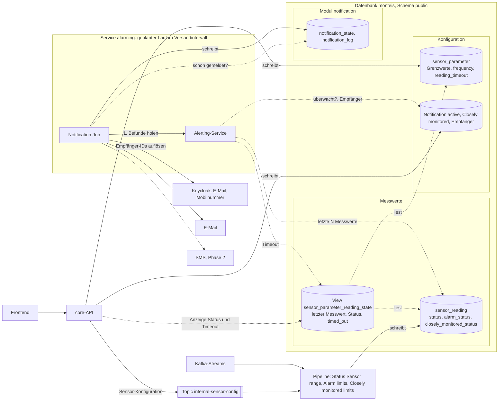

# Zielarchitektur Alarmierung

Messwerte von Notification active oder Closely monitored Sensor-Parametern, die ihre Alarm limits oder Closely monitored limits verletzen, lösen in einem festen Intervall eine Sammelbenachrichtigung über den Zustand zu diesem Zeitpunkt an die Empfänger aus, die ein Monteis-Admin oder PI im Frontend festgelegt hat. Zusätzlich werden ausbleibende Daten pro Sensor-Parameter erkannt (Timeout); die Überwachung ganzer Pipelines folgt nach der ersten Phase (R20, R21). Phase 1 benachrichtigt per E-Mail, Phase 2 ergänzt SMS. Dieses Dokument hält den Stand der Vorabklärung fest. Es ersetzt keine ADRs: Die Entscheidungen unten werden im Lauf mit Alternativen begründet und in `documentation/architecture/src/09_architecture_decisions.adoc` festgehalten.

Ticket: TBD (`MON-248`). Abhängigkeit: MON-250 (DB-Fusion).

## Ausgangslage

- Das Frontend ist in detaillierte Stories zerlegt und in Umsetzung. Dort wird festgelegt, wann ein Alarm an welche Personen geht, für welchen Sensor und welches Experiment.
- Heute gibt es pro `sensor_parameter` ein Grenzwertpaar `lower_alarm_limit` / `upper_alarm_limit`. Fachlich ist das die Sensor range, nicht die Alarm limits.
- Die Pipeline stuft jeden Messwert beim Ingest ein und speichert das Ergebnis in `sensor_reading.status` (`range_category`: `too_low | correct | too_high`). Die Grenzwerte erhält sie über die Sensor-Konfiguration aus Kafka, nicht aus den Meta-Tabellen.
- Die Pipeline (`BoundsValidator`) veröffentlicht heute schon bei jeder Verletzung der Sensor range eines neu eingetroffenen Messwerts ein `SensorBoundBreachedEvent` asynchron auf das Topic `sensor-alerts`, bei Reprocessing nicht. Auf `main` konsumiert niemand dieses Topic. Fehler beim Senden werden nur geloggt. Für die Alarmierung wird es nicht gebraucht (E10).
- Bei einer Änderung der Sensor-Konfiguration verarbeitet die Pipeline historische Messwerte neu (`SensorConfigReprocessingListener`, `HistoricalReadingChunkProcessor`) und schreibt dabei auch `status` neu.
- Kontaktdaten werden nie in MONTEIS gespeichert, sondern aus Keycloak gelesen (bisher nur mit dem Token des Aufrufers).
- Geplante Jobs mit Sperre gegen Doppelläufe gibt es bereits: Fulcrum-Synchronisation mit ShedLock.

## Anforderungen

| ID  |                                                                                                                                                                                                           Anforderung                                                                                                                                                                                                            |
|-----|----------------------------------------------------------------------------------------------------------------------------------------------------------------------------------------------------------------------------------------------------------------------------------------------------------------------------------------------------------------------------------------------------------------------------------|
| R1  | Benachrichtigt wird periodisch in einem festen Intervall, z. B. zweimal täglich. Das genaue Intervall ist zu definieren.                                                                                                                                                                                                                                                                                                         |
| R2  | Pro `sensor_parameter` gibt es zwei Grenzwertpaare: Alarm limits (unten/oben), Closely monitored limits (unten/oben).                                                                                                                                                                                                                                                                                                            |
| R3  | Benachrichtigungen lösen nur Verletzungen der Alarm limits und Closely monitored limits aus, nicht der Sensor range.                                                                                                                                                                                                                                                                                                             |
| R4  | Alarme von Closely monitored Sensor-Parametern gehen im selben Intervall raus wie normale Alarme, nicht sofort.                                                                                                                                                                                                                                                                                                                  |
| R5  | Die Alarm limits und Closely monitored limits werden am Sensor-Parameter festgelegt (im Frontend gepflegt). Sie sind fix, nicht zeitlich versioniert. Eine Änderung führt zu einer Neuevaluation des gespeicherten Status.                                                                                                                                                                                                       |
| R6  | Die Empfänger normaler Alarme legt ein Monteis-Admin oder ein PI des Experiments im Frontend fest (R17). Closely monitored setzt nur ein Monteis-Admin.                                                                                                                                                                                                                                                                          |
| R7  | E-Mail-Adressen (und in Phase 2 Telefonnummern) werden pro Benutzer aus Keycloak gelesen.                                                                                                                                                                                                                                                                                                                                        |
| R8  | Phase 1: E-Mail. Phase 2: SMS.                                                                                                                                                                                                                                                                                                                                                                                                   |
| R9  | Ein normaler Alarm geht nur einmal raus: Ein Sensor-Parameter, der dauerhaft im Alarm bleibt, wird nicht in jedem Intervall erneut gemeldet. Alarme von Closely monitored Sensor-Parametern wiederholen sich.                                                                                                                                                                                                                    |
| R10 | Empfänger normaler Alarme werden pro Experiment festgelegt; sie erhalten die Alarme der Notification active Sensor-Parameter dieses Experiments.                                                                                                                                                                                                                                                                                 |
| R11 | Ein Alarm besteht, sobald mindestens so viele aufeinanderfolgende Messwerte ausserhalb des Ranges liegen, wie der Frequency-Wert angibt (ohne Frequency-Wert: 1). Ein einzelner Messwert im Range beendet ihn. Das Versandintervall (R1) spielt dafür keine Rolle; es bestimmt nur, wann Alarme an die Empfänger verschickt werden.                                                                                              |
| R12 | Alarm limits und Closely monitored limits sind zwei voneinander unabhängige Ranges. Jeder wird für sich ausgewertet, gemeldet und zurückgesetzt; einen eigenen Verschärfungsfall („von Alarm limits zu Closely monitored limits“) gibt es nicht. Jeder Messwert wird gegen beide Ranges getrennt geprüft; die Ranges können sich überlappen, ein Wert kann also beide verletzen und für beide Folgen zählen.                     |
| R13 | Es gibt keine Entwarnung, wenn ein Sensor-Parameter wieder im Range ist.                                                                                                                                                                                                                                                                                                                                                         |
| R15 | Ist für einen Sensor-Parameter kein Frequency-Wert definiert, wird der Alarm beim ersten Auftreten eines Verstosses ausgelöst.                                                                                                                                                                                                                                                                                                   |
| R16 | Alarmiert werden nur Sensor-Parameter, die Notification active und/oder Closely monitored sind. Ein Sensor-Parameter im Timeout kann ebenfalls eine Benachrichtigung auslösen, wenn er Notification active ist. Sensor range und Timeout werden zusätzlich im Frontend farblich gekennzeichnet (Story im Backlog).                                                                                                               |
| R17 | Monteis-Admin oder PI legen pro Hauptexperiment fest, welche Sensor-Parameter Notification active sind und welche Empfänger (nur Experimentuser) alarmiert werden.                                                                                                                                                                                                                                                               |
| R18 | Closely monitored setzt nur ein Monteis-Admin, pro Sensor-Parameter; eine Zuordnung pro Experiment ist möglich. Empfänger sind Admins, die der Monteis-Admin für den Closely monitored Sensor-Parameter festlegt (eigene Empfängerliste). TBD: Frage: Wie soll eine Zuordnung pro Experiment für Closely monitored Sensor-Parameter vorgenommen werden?                                                                          |
| R19 | Alarme von Closely monitored Sensor-Parametern können wiederholt ausgelöst werden. In der initialen Umsetzung wird ein bestehender solcher Alarm in jedem Versandintervall (R1) erneut gemeldet; ein eigenes, konfigurierbares Wiederholungsintervall folgt später.                                                                                                                                                              |
| R20 | Pipelines werden überwacht. Eine Pipeline ist der Datenfluss eines externen Lieferanten bis in die TimescaleDB. Eine Seite im Adminbereich zeigt eine Übersicht über alle Pipelines (FE-Stories existieren). TBD Out of Scope in erster Phase                                                                                                                                                                                    |
| R21 | Pro Pipeline kann ein Timeout definiert werden. Liefert eine Pipeline innerhalb ihres Timeouts keine Daten, wird alarmiert. TBD Out of Scope in erster Phase                                                                                                                                                                                                                                                                     |
| R22 | Prio 1 alarmiert ausschliesslich per E-Mail. Eine Kanalwahl (E-Mail und/oder SMS) folgt mit SMS in Phase 2; wo sie konfiguriert wird, ist offen. Das Design hält die Kanal-Schnittstelle offen, legt aber noch kein Konfigurationsfeld an.                                                                                                                                                                                       |
| R23 | Fehlende Datensequenzen werden erkannt: Trifft für einen Sensor-Parameter länger als sein Timeout (Feld am Sensor-Parameter) kein Messwert ein, wird eine Datenlücke gemeldet.                                                                                                                                                                                                                                                   |
| R24 | Die Pipeline setzt pro Messwert nur den Status gegen Sensor range, Alarm limits und Closely monitored limits, zustandslos wie heute für die Sensor range. Frequency, Auslösen und Rücksetzen eines Alarms sowie das Timeout werden ausserhalb der Pipeline berechnet, damit das Reprocessing und dessen Performance unter keinen Umständen beeinträchtigt werden. Der Versand an die Empfänger erfolgt im Versandintervall (R1). |
| R25 | Ist ein Sensor-Parameter im Timeout, wird für ihn nur der Timeout gemeldet, keine Alarme. Auch ein vorher ausgelöster, noch nicht versandter Alarm wird nicht mehr gemeldet.                                                                                                                                                                                                                                                     |
| R26 | Gemeldet wird immer nur der Zustand zum Versandzeitpunkt. Ein Alarm, der zwischen zwei Versänden entsteht und wieder endet, wird nicht gemeldet.                                                                                                                                                                                                                                                                                 |

## Zielbild

### Warum so

Benachrichtigt wird nur wenige Male am Tag (R1), und gemeldet wird nur, was zum Versandzeitpunkt gilt (R26). Deshalb wird erst kurz vor dem Versand ausgewertet, ob ein Alarm oder ein Timeout besteht, und zwar auf den gespeicherten Messwerten:

- **Alle Daten sind da.** Verspätete Werte sind bis zum Versand meist gespeichert, die Datenbank sortiert nach Messzeitpunkt. Eine Auswertung bei jedem einzelnen Messwert würde dagegen Fehlalarme aus unvollständigen Daten erzeugen (Beispiel in E7).
- **Timeout hat einfach Vorrang** (R25). Ist ein Sensor-Parameter im Timeout, gilt kein Alarm. Es gibt keine bereits verschickten Alarm-Ereignisse, die man zurückholen müsste.
- **Grenzwertänderungen wirken von selbst** (R5). Das Reprocessing hat die Status bis zum Versand neu gesetzt; die Auswertung sieht den aktuellen Stand.
- **Frequency gehört nur zum Versand.** Das Frontend zeigt die Status der Messwerte und den Timeout ohne Frequency an (R16). Ob nach Frequency ein Alarm besteht, rechnet nur der Alerting-Service im Versandlauf. Gemeinsam ist beiden nur der View aus E11 für den letzten Messwert und `timed_out`.

Bewusste Folge: Ein kurzer Alarm zwischen zwei Versänden wird nicht gemeldet (R26).

Damit sind die zentralen Fragen zum Alerting-Service so beantwortet:

|                            Frage                            |                                                                                                    Antwort                                                                                                    |
|-------------------------------------------------------------|---------------------------------------------------------------------------------------------------------------------------------------------------------------------------------------------------------------|
| Wo wird das Intervall definiert?                            | Nur im geplanten Lauf des Notification-Job (Zustellpolitik, R1). Der Alerting-Service kennt kein Intervall; er wertet aus, wenn er aufgerufen wird.                                                           |
| Wie erfährt der Alerting-Service von Timeouts?              | Gar nicht. Er liest beim Aufruf den View, der den Timeout mit `now()` berechnet. Ein Ereignis braucht es nicht, weil ohnehin erst zum Versand ausgewertet wird.                                               |
| Zustand der Folge (Frequency) speichern oder neu berechnen? | Neu berechnen. Der Alerting-Service liest im Versandlauf die letzten N Messwerte über den Index; N = Frequency. Gespeichert wird nur, was zuletzt gemeldet wurde (E6).                                        |
| Modul oder eigenes Deployable?                              | Eigener Service `alarming` mit den Modulen `alerting` und `notification`, verbunden über eine Schnittstelle im Code (E12, E13). Kein Einfluss auf die Threads von `core`, klare Trennung der Zuständigkeiten. |

### Ablauf

1. **Pipeline: Status pro Messwert (R24, R5)**
   - stuft jeden Messwert wie heute im `BoundsValidator` ein, neu gegen drei Ranges: Sensor range (`status`, bestehend), Alarm limits (`alarm_status`) und Closely monitored limits (`closely_monitored_status`), alle mit dem bestehenden Enum `range_category` (`too_low | correct | too_high`); ohne Grenzwerte bleibt der Status `NULL`;
   - erhält die Grenzwerte wie heute über die Sensor-Konfiguration aus Kafka (`SensorParameterConfig` in `contracts`, um die zwei neuen Grenzwertpaare erweitert);
   - stuft bei einer Änderung der Grenzwerte die gespeicherten Messwerte über das bestehende Reprocessing neu ein (R5);
   - sendet nichts für die Alarmierung und führt keinen Zustand: keine Folgen, kein Auslösen, kein Timeout. Das Topic `sensor-alerts` wird nicht gebraucht (E10).
2. **View `sensor_parameter_reading_state` (E11): letzter Messwert und Timeout**
   - liefert pro Sensor-Parameter den letzten Messwert und `timed_out`;
   - wird live berechnet; `core` liest ihn für das Frontend, der Alerting-Service für den Timeout im Versandlauf;
   - enthält keine Frequency-Logik: Das Frontend zeigt die Status ohne Frequency an (R16).
3. **Notification-Job (Service `alarming`, Modul `notification`, geplanter Lauf im Versandintervall R1, ShedLock)**
   1. ruft den Alerting-Service auf und erhält die aktuellen Befunde;
   2. entscheidet pro Befund und Empfänger, ob er gemeldet wird (E6):
      - Timeout: einmal pro letztem Messwert (R16);
      - normaler Alarm: einmal pro Folge, also erst wieder, wenn zwischendurch ein Wert im Range lag (R9);
      - Closely monitored: in jedem Lauf, solange aktiv (R19);
   3. bündelt alles pro Empfänger zu einer E-Mail und versendet sie über AWS SNS (E5, durch Infra vorgegeben); SMS folgt in Phase 2 über dieselbe Kanal-Schnittstelle (R22). Wie die Empfänger bei SNS registriert werden und wie die Mail-Integration aussieht, ist noch nicht definiert (F9);
   4. schreibt pro Empfänger, was gemeldet wurde, und das Versandprotokoll (nur Keycloak-User-IDs);
   5. verschickt keine Entwarnung (R13).
4. **Alerting-Service (Service `alarming`, Modul `alerting`, ohne eigene Tabellen und ohne eigenen Zeitplan)**
   - betrachtet nur Notification active bzw. Closely monitored Sensor-Parameter (R16) und liest mit der DB-Rolle des Service im Systemkontext (E4);
   - Timeout: liest `timed_out` aus dem View;
   - Alarme: liest pro Sensor-Parameter die letzten N Messwerte über den bestehenden Index (N = Frequency, sonst 1). Verletzen alle den Alarm-Range bzw. den Closely-monitored-Range, besteht der Alarm; ein einzelner Wert im Range beendet ihn (R11, R15);
   - Vorrang: Ist der Sensor-Parameter im Timeout, liefert er nur den Timeout, keine Alarme (R25);
   - liefert pro Befund: Sensor-Parameter, Art (`timeout`, `alarm_limits`, `closely_monitored_limits`), letzter Messwert und Wert sowie für normale Alarme die Kennung der laufenden Folge (Zeitpunkt des letzten Werts im Range davor), damit der Notification-Job eine neue Folge erkennt;
   - bestimmt die Empfänger als Keycloak-User-IDs: für normale Alarme und Timeouts die Empfänger des Hauptexperiments (R10, R17), für Closely monitored die eigene Empfängerliste (R18); Empfänger ohne Leserecht auf das Experiment lässt er weg;
   - kennt weder Kontaktdaten noch Kanäle noch das Intervall und versendet nichts.
5. **Lücken in der Historie:** Abstand zum vorherigen Messwert grösser als das Timeout. Das Frontend berechnet es selbst aus den geladenen Messreihen, nur wenn diese nicht heruntergerechnet sind, also beim Hineinzoomen (F6).
6. **Konfiguration am Sensor-Parameter:** zwei neue Grenzwertpaare (Alarm limits, Closely monitored limits), `reading_timeout` als neue Spalte; `frequency` wird bereits pro Sensor-Parameter gespeichert. Alles im Frontend gepflegt; Migration `V2__…` nach MON-250.
7. **Notification active, Closely monitored und Empfänger** (gepflegt über die API von `core`, vom Alerting-Service nur gelesen, direkt aus der Datenbank):
   - pro Hauptexperiment: Notification active Sensor-Parameter und Empfänger aus den Experiment-Usern; schreiben dürfen Monteis-Admin und PI (R10, R17);
   - pro Sensor-Parameter: Closely monitored mit eigener Empfängerliste; schreiben darf nur ein Monteis-Admin (R18);
   - die Schreibregeln sind in `Capabilities` und in den RLS-Funktionen gleich und durch Integrationstests abgesichert.
8. **Pipeline-Überwachung (R20, R21):** ausserhalb der ersten Phase.



Textfassung: Alle Tabellen liegen nach MON-250 in einer Datenbank `monteis`, Schema `public`; die Gruppen sind nur logisch getrennt, nach dem, wer schreibt. Durchgezogene Pfeile schreiben, gestrichelte lesen.

- **Messwerte:** `sensor_reading` schreibt nur die Pipeline (Ingest und Reprocessing). Der View liest `sensor_reading` und `sensor_parameter` und liefert pro Sensor-Parameter den letzten Messwert mit Status und `timed_out`, ohne Frequency.
- **Konfiguration:** `sensor_parameter` (Grenzwerte, `frequency`, `reading_timeout`) sowie Notification active, Closely monitored und Empfänger schreibt nur die `core`-API. Die Pipeline erhält die Grenzwerte über das Topic `internal-sensor-config`.
- **Service `alarming`:** eigenes Deployable neben `core` und Pipeline. Im geplanten Lauf holt der Notification-Job beim Alerting-Service die aktiven Befunde samt Empfänger-IDs. Der Alerting-Service liest dafür den View (Timeout), die letzten N Messwerte aus `sensor_reading` (Alarme) und die Konfiguration, schreibt aber nichts.
- **Modul `notification`:** `notification_state` und `notification_log` schreibt nur der Notification-Job. Er löst die Empfänger-IDs über Keycloak auf und versendet eine E-Mail pro Empfänger.
- **Fremdschlüssel:** nur von `notification_state` auf `sensor_parameter` (`ON DELETE CASCADE`).

## Vorentscheide (Als ADR zu bestätigen)

### E1 Aufteilung: Pipeline setzt Status, Auswertung kurz vor dem Versand

- **Entscheid (R24, R26):** Die Pipeline stuft jeden Messwert zustandslos gegen drei Ranges ein, wie heute für die Sensor range. Ob ein Alarm oder Timeout besteht, wertet der Alerting-Service erst im geplanten Versandlauf aus, auf den gespeicherten Status über den View aus E11 (Timeout) und die letzten N Messwerte (Alarme). Der Notification-Job entscheidet, was davon gemeldet wird, und versendet.
- **Begründung:** Bei wenigen Versänden pro Tag zählt nur der Zustand zum Versandzeitpunkt; eine Auswertung bei jedem Messwert bringt dafür keinen Nutzen, aber viele Grenzfälle.
- **Verworfen:**
  - Folgen in der Pipeline: widerspricht R24.
  - Auswertung bei jeder Verletzung über `sensor-alerts` mit gespeicherter Folge (früherer Stand): verspätete Werte, verlorene und doppelte Ereignisse, Rücksetzung ohne Ereignis und nachträglicher Vorrang des Timeouts machen sie fehleranfällig.
  - Ein Ereignis pro gespeichertem Messwert: viel Last auf Kafka ohne Nutzen.

### E2 Status pro Messwert in drei Spalten

- **Entscheid:** `sensor_reading` erhält `alarm_status` und `closely_monitored_status` neben dem bestehenden `status` (Sensor range), alle vom Typ `range_category`.
- **Grenzwertänderung (R5, F4):** Das bestehende Reprocessing stuft die gespeicherten Messwerte neu ein. Der nächste Versandlauf sieht über den View automatisch den neuen Stand; ein zusätzliches Ereignis braucht es nicht. Das Reprocessing bleibt so schnell wie heute (R24).
- **Zu entscheiden:**
  - Spaltennamen der Grenzwerte, heute `lower_alarm_limit` / `upper_alarm_limit` für die Sensor range;
  - Speicherbedarf der zwei zusätzlichen Spalten auf der Hypertable bei der Datenmenge aus F1;

### E6 Gespeichert wird nur, was gemeldet wurde

Der Alerting-Service hat keine eigenen Tabellen; er berechnet alles aus dem View und den gespeicherten Messwerten. Der Notification-Job speichert nur, was er wem gemeldet hat, damit ein normaler Alarm und ein Timeout nicht in jedem Lauf erneut rausgehen.

```sql
CREATE TYPE alert_kind AS ENUM ('alarm_limits', 'closely_monitored_limits', 'timeout');

-- Was wem zuletzt gemeldet wurde (R9, R16)
CREATE TABLE notification_state (
    sensor_parameter_id uuid        NOT NULL REFERENCES sensor_parameter (id) ON DELETE CASCADE,
    kind                alert_kind  NOT NULL,
    recipient_user_id   uuid        NOT NULL,      -- Keycloak-User-ID, keine Kontaktdaten
    notified_key        timestamptz,               -- alarm_limits: Kennung der gemeldeten Folge; timeout: last_reading_at
    notified_at         timestamptz NOT NULL,
    PRIMARY KEY (sensor_parameter_id, kind, recipient_user_id)
);

-- Versandprotokoll pro Lauf und Empfänger
CREATE TABLE notification_log (
    id                uuid        PRIMARY KEY DEFAULT uuidv7(),
    run_at            timestamptz NOT NULL,
    recipient_user_id uuid        NOT NULL,
    channel           text        NOT NULL,        -- 'email', ab Phase 2 'sms'
    status            text        NOT NULL,        -- 'sent' | 'failed' | 'no_address'
    findings          jsonb       NOT NULL,        -- gemeldete Sensor-Parameter und Arten, ohne Kontaktdaten
    error             text
);
```

Beispiel für R9 mit Frequency 3 und Versand um 12:00 und 24:00:

|    Zeit     |         Messwerte          | Alerting-Service liefert | `notification_state` |                      Handler                       |
|-------------|----------------------------|--------------------------|----------------------|----------------------------------------------------|
| 08:00–09:00 | im Range, letzter um 09:00 | –                        | –                    | –                                                  |
| 10:00–11:00 | 3× Verstoss                |                          |                      |                                                    |
| 12:00 Lauf  |                            | Alarm, Kennung 09:00     | keine Zeile          | **meldet**, speichert Kennung 09:00                |
| 13:00       | im Range → Alarm behoben   |                          |                      |                                                    |
| 14:00–16:00 | 3× Verstoss → neuer Alarm  |                          |                      |                                                    |
| 24:00 Lauf  |                            | Alarm, Kennung **13:00** | Kennung 09:00        | 13:00 ≠ 09:00 → **meldet erneut**, speichert 13:00 |

So entstehen die Regeln aus den Anforderungen:

|                                    Regel                                     |        Wo        |                                                                                                           Umsetzung                                                                                                           |
|------------------------------------------------------------------------------|------------------|-------------------------------------------------------------------------------------------------------------------------------------------------------------------------------------------------------------------------------|
| Alarm besteht nach N Verletzungen, endet nach einem Wert im Range (R11, R15) | Alerting-Service | Die letzten `frequency` Messwerte verletzen alle den Alarm-Range bzw. den Closely-monitored-Range.                                                                                                                            |
| Timeout hat Vorrang (R25)                                                    | Alerting-Service | Ist `timed_out` im View wahr, liefert er nur den Timeout, keine Alarme.                                                                                                                                                       |
| Normaler Alarm nur einmal (R9)                                               | Notification-Job | Gemeldet wird, wenn die Kennung der laufenden Folge sich von `notified_key` unterscheidet. Die Kennung ist der Zeitpunkt des letzten Werts im Range vor der Folge; sie ändert sich erst, wenn der Alarm zwischendurch endete. |
| Closely monitored wiederholen (R19)                                          | Notification-Job | Wird in jedem Lauf gemeldet, solange der Alerting-Service den Closely-monitored-Alarm liefert.                                                                                                                                |
| Timeout einmal, neuer Messwert beendet ihn (R16)                             | Notification-Job | Gemeldet wird, wenn `last_reading_at` sich von `notified_key` unterscheidet.                                                                                                                                                  |
| Nur der Zustand zum Versandzeitpunkt (R26)                                   | beide            | Ausgewertet wird nur, was der View beim Lauf liefert.                                                                                                                                                                         |
| Gescheiterter Versand                                                        | Notification-Job | `notification_state` wird nur bei `sent` geschrieben. Besteht der Zustand im nächsten Lauf noch, wird er erneut versucht; besteht er nicht mehr, entfällt er (R26).                                                           |
| Gelöschter Sensor-Parameter                                                  | Notification-Job | `ON DELETE CASCADE` räumt `notification_state` ab.                                                                                                                                                                            |

Caveats:

- Die Tabellen haben keine RLS. Nur der Service `alarming` liest und schreibt sie; seine DB-Rolle hat als einzige Schreibrechte darauf, `core` keine.
- `notification_log` wächst unbegrenzt; eine Aufbewahrungsfrist ist festzulegen.
- Für Empfänger ohne Adresse (`no_address`) wird `notification_state` nicht geschrieben; sie würden in jedem Lauf erneut versucht. Wie damit umgegangen wird, klärt F2.

### E7 Reihenfolge und verspätete Werte

Würde bei jedem eintreffenden Messwert ausgewertet, sähe die Auswertung nur, was bis dahin eingetroffen ist. Bei einem Wert mit Zeitstempel 10:05 wüsste sie nicht, ob noch ein Wert von 10:03 unterwegs ist (z. B. gepuffert beim Datenlogger).

Beispiel mit Frequency 3:

| Eintreffen | Messzeitpunkt |   Wert   | Folge nach Eintreffen |                 Folge nach Messzeitpunkt                 |
|------------|---------------|----------|-----------------------|----------------------------------------------------------|
| 1          | 10:01         | Verstoss | 1                     | 1                                                        |
| 2          | 10:02         | Verstoss | 2                     | 2                                                        |
| 3          | 10:04         | Verstoss | 3 → **Alarm**         | 3 → Alarm, aber nur vorläufig                            |
| 4          | 10:03         | im Range | 0                     | Folge war 10:01–10:02, danach 10:04 = 1 → **kein Alarm** |

Nach Messzeitpunkt korrekt gezählt, hätte der Alarm nie ausgelöst werden dürfen.

- **Entscheid:** Mit der Auswertung kurz vor dem Versand (E1) liest der Alerting-Service die gespeicherten Werte nach Messzeitpunkt sortiert. Der verspätete Wert von 10:03 ist dann meist schon da, und es entsteht kein Alarm.
- **Restrisiko:** Ein Wert, der erst nach dem Versandlauf eintrifft, wirkt erst im nächsten Lauf. Das ist mit R26 vereinbar.

### E11 Timeout: View statt virtueller Spalte

Einen Timeout kann nur ein Sensor-Parameter haben, nicht ein einzelner Messwert, weil es für einen ausgebliebenen Messwert keine Zeile in `sensor_reading` gibt, in der man den Timeout speichern könnte.

Eine virtuelle Spalte funktioniert dafür nicht: Generierte Spalten (in PostgreSQL 18 auch virtuelle) dürfen nur Werte derselben Zeile und nur unveränderliche Funktionen verwenden. Für den Timeout braucht es aber den letzten Messwert, also eine andere Tabelle, und `now()`, das nicht unveränderlich ist.

Ein View kann beides, das heisst, er darf andere Tabellen lesen und rechnet bei jedem Lesen mit dem aktuellen `now()`. Voraussetzung ist MON-250 (beide DBs zusammenlegen), das hat grossen Einfluss auf die Performance und ist auch aus anderen Gründen nötig: Über die FDW wird das `LIMIT 1` nicht zur TimescaleDB gepusht, sobald eine lokale Tabelle gejoint wird (`db/meta/schema/V3__create_timescaledb_fdw_mapping.sql`), das heisst, pro Sensor-Parameter würden bis zu 2000 Zeilen übertragen.

```sql
ALTER TABLE sensor_parameter
    ADD COLUMN reading_timeout interval CHECK (reading_timeout > interval '0');

CREATE VIEW sensor_parameter_reading_state WITH (security_invoker = true) AS
SELECT p.id               AS sensor_parameter_id,
       p.reading_timeout,
       r."timestamp"      AS last_reading_at,
       r.status,
       r.alarm_status,
       r.closely_monitored_status,
       CASE
         WHEN p.reading_timeout IS NULL THEN NULL
         ELSE r."timestamp" IS NULL OR r."timestamp" < now() - p.reading_timeout
       END                AS timed_out
FROM sensor_parameter p
LEFT JOIN LATERAL (
    SELECT s."timestamp", s.status, s.alarm_status, s.closely_monitored_status
    FROM sensor_reading s
    WHERE s.sensor_parameter_id = p.id
    ORDER BY s."timestamp" DESC
    LIMIT 1
) r ON true;

REVOKE ALL ON sensor_parameter_reading_state FROM core;
GRANT SELECT ON sensor_parameter_reading_state TO core, alarming;
```

Die Frequency-Prüfung gehört nicht in den View, weil das Frontend sie nicht braucht. Der Alerting-Service fragt sie im Versandlauf selbst ab, nur für überwachte Sensor-Parameter, die nicht im Timeout sind:

```sql
-- pro Sensor-Parameter :id mit :frequency (bestehende Spalte am Sensor-Parameter, sonst 1); NULL-Status (keine Grenzwerte) zählt als nicht verletzt
SELECT count(*) = :frequency
         AND bool_and(coalesce(l.alarm_status <> 'correct', false))             AS alarm_active,
       count(*) = :frequency
         AND bool_and(coalesce(l.closely_monitored_status <> 'correct', false)) AS closely_monitored_active
FROM (
    SELECT s.alarm_status, s.closely_monitored_status
    FROM sensor_reading s
    WHERE s.sensor_parameter_id = :id
    ORDER BY s."timestamp" DESC
    LIMIT :frequency
) l;
```

Damit können wir den letzten Messwert, seine Status und den Timeout in der Webapp anzeigen, und der Alerting-Service liest im Versandlauf denselben Timeout. Der View ist auch besser als die Funktion aus E11 (a), weil jOOQ dafür eine normale Tabellenklasse generiert und man ihn wie eine Tabelle joinen und filtern kann.

Caveats:

- `security_invoker = true` ist Pflicht, sonst läuft der View mit den Rechten des Owners und die RLS auf `sensor_parameter` und `sensor_reading` greift nicht. Das sollte ein Integrationstest absichern.
- Der Alerting-Service liest den View ohne Benutzerkontext. Wegen `security_invoker` greift die RLS auch für ihn, und ohne gesetzte Zugriffsrichtlinie sieht er keine Zeilen. Der Service `alarming` setzt deshalb in seinen Transaktionen den bestehenden Systemkontext `app.read_all_experiments` (wie `RlsConnectionProvider` in `core`, E4) und liest mit seiner eigenen DB-Rolle `alarming`, die dafür ein `GRANT SELECT` braucht.
- Ohne `reading_timeout` ist `timed_out` `NULL`, also keine Timeout-Prüfung. Ein Sensor-Parameter, der noch nie Daten geliefert hat, gilt mit Timeout als `timed_out`. Ist das so gewollt, oder braucht es einen eigenen Zustand "noch keine Daten"?
- Performance: Für einen Sensor-Parameter mit aktuellen Daten reicht der neueste Chunk. Ein Sensor-Parameter im Timeout durchsucht aber die Indizes aller Chunks bis zum Anfang, das wird mit wachsender Historie langsamer. Das müsste man mit `EXPLAIN` und dem Mengengerüst (F1) prüfen. Falls nötig, könnte man nur innerhalb des Timeouts suchen (`AND s."timestamp" > now() - p.reading_timeout`), dann ist `last_reading_at` bei lange toten Sensor-Parametern aber leer.
- Die Frequency-Abfrage des Alerting-Service liest pro Sensor-Parameter die letzten `frequency` Messwerte über denselben Index. Bei grossen Frequency-Werten und vielen Sensor-Parametern ist das im Versandlauf zu messen (F1).
- Die Kennung der laufenden Folge für R9 (Zeitpunkt des letzten Werts im Range) ermittelt der Alerting-Service mit einer zusätzlichen Index-Abfrage, nur für aktive normale Alarme.
- Ohne Filter berechnet der View den letzten Messwert für jeden sichtbaren Sensor-Parameter, Abfragen sollten also immer auf die angezeigten Sensor-Parameter filtern.
- Auf komprimierten Chunks ist `ORDER BY ... DESC LIMIT 1` teurer (offener Prüfpunkt Compression aus MON-250).
- Die Default Privileges aus MON-250 geben `core` CRUD auch auf neue Views, deshalb `REVOKE ALL` und nur `SELECT`.
- `alarm_status` und `closely_monitored_status` gibt es erst mit E2.

### E12 Eigener Service `alarming`

- **Entscheid:** Alerting-Service und Notification-Job laufen als eigener Service `alarming`, getrennt von `core` und Pipeline deployt.
  - **Modul `alerting`:** zustandslos, ohne eigene Tabellen und ohne Zeitplan. Liefert auf Aufruf die aktiven Befunde samt Empfänger-IDs aus View, Messwerten und Konfiguration.
  - **Modul `notification`:** geplanter Lauf im Versandintervall mit ShedLock, Entscheidung was gemeldet wird (`notification_state`), Keycloak-Kontaktdaten, Kanal-Schnittstelle (E5) und Versandprotokoll.
  - `notification` ruft `alerting` über eine Schnittstelle im Code auf; `alerting` kennt `notification` nicht (ArchUnit im Service).
- **Begründung:**
  - Kein Einfluss auf `core`: Versandlauf, Datenbankabfragen und Aufrufe an Keycloak und SNS belegen keine Threads und keine Verbindungen der API.
  - Klare Trennung der Zuständigkeiten: `core` pflegt Konfiguration und liefert dem Frontend Daten; `alarming` wertet aus und benachrichtigt. Fehler, Releases und Skalierung beider sind unabhängig.
  - Eigene, minimale Rechte: Die DB-Rolle `alarming` liest nur, was die Auswertung braucht, und schreibt nur ihre eigenen Tabellen. Den Keycloak-Service-Account (E3) und die SNS-Rechte (E5) hat nur `alarming`, nicht `core`.
- **Zugriff auf Daten:**
  - liest direkt aus der gemeinsamen Datenbank (nach MON-250): `sensor_reading`, `sensor_parameter`, den View aus E11 und die Konfigurationstabellen von Notification active, Closely monitored und Empfängern;
  - schreibt nur `notification_state` und `notification_log`;
  - generiert seine jOOQ-Klassen aus demselben Schema wie `core`. Schemaänderungen an den gelesenen Tabellen betreffen damit beide Services; die Migrationen bleiben zentral in `db/schema` und im Migration-Image.
- **Was dazukommt:**
  - Maven-Modul `alarming` im Reactor, Image über Buildpacks, eigener `build-and-release`-Workflow mit Trivy und Versions-Tag `alarming-vX.Y.Z`, Tests im PR-Gate;
  - Manifeste in `lg-monteis-k8s`/`lg-monteis-gitops`;
  - DB-Rolle `alarming` mit Grants und Secret, Keycloak-Service-Account, IAM-Rechte für SNS;
  - eine eigene ShedLock-Tabelle bzw. ein eigener Lock-Name, damit mehrere Instanzen nicht doppelt versenden.
- **Folge für den Betrieb:** Fällt `alarming` zum Versandzeitpunkt aus, entfällt dieser Lauf; der nächste meldet den dann aktuellen Zustand (R26). `core` und das Frontend sind davon nicht betroffen.

### E13 Übergabe vom Alerting-Service an den Notification-Job

- **Entscheid:** direkter Aufruf über eine Schnittstelle im Code, im selben Lauf innerhalb des Service `alarming`.
- **Warum kein Topic `alert-events`:** Der Notification-Job bündelt alle Befunde eines Laufs pro Empfänger zu einer E-Mail. Ein Consumer bekommt Ereignisse einzeln und weiss nicht, wann ein Lauf vollständig ist. Dazu kämen Outbox, Consumer und das Aussortieren doppelter Ereignisse. Mit dem direkten Aufruf liegt das ganze Ergebnis eines Laufs in einer Liste vor.

## ADR-Kandidaten

|  #  |                                    Entscheidung                                     |                                                                                                  Alternativen                                                                                                   |                                                                                                                  Sicherheit / Compliance                                                                                                                   |
|-----|-------------------------------------------------------------------------------------|-----------------------------------------------------------------------------------------------------------------------------------------------------------------------------------------------------------------|------------------------------------------------------------------------------------------------------------------------------------------------------------------------------------------------------------------------------------------------------------|
| E2  | Status pro Messwert speichern (R24, R5)                                             | drei Spalten `status`, `alarm_status`, `closely_monitored_status` (entschieden) vs. eine Spalte mit kombiniertem Enum                                                                                           | –                                                                                                                                                                                                                                                          |
| E3  | Kontaktdaten ohne Benutzer-Token (Notification-Job)                                 | Service-Account (Client Credentials, nur `view-users`) vs. bestehender Admin-Zugang                                                                                                                             | Erweitert die Entscheidung „Kontaktdaten nur mit dem Token des Aufrufers“; Rechte des Service-Accounts minimal halten, Secret aus der Umgebung                                                                                                             |
| E4  | Zugriff des Service `alarming` trotz RLS                                            | eigene DB-Rolle `alarming` mit minimalen Grants, die in ihren Transaktionen den bestehenden Systemkontext `app.read_all_experiments` setzt (entschieden mit E12) vs. eigene RLS-Policy für die Rolle            | Der Service sieht alle Experimente, auch über den View mit `security_invoker` (E11), und prüft die Leserechte der Empfänger selbst; Schreibrechte nur auf `notification_state` und `notification_log`                                                      |
| E5  | Kanal-Abstraktion und Provider                                                      | E-Mail über AWS SNS (durch Infra vorgegeben) vs. SES; SMS über SNS (Phase 2)                                                                                                                                    | SNS stellt E-Mails nur an bestätigte Abonnements zu: Adressen liegen dann als Abonnements in AWS (nicht in der MONTEIS-Datenbank), müssen bei Änderungen in Keycloak nachgeführt werden, und jede Mail enthält einen Abmeldelink (F9)                      |
| E6  | Gespeicherter Zustand (R9, R16, R19)                                                | nur `notification_state` und `notification_log` im Modul `notification` (Empfehlung, siehe Abschnitt E6) vs. gespeicherte Folgen und Alarmereignisse im Alerting-Service (früherer Stand)                       | Nur der Notification-Job schreibt die Tabellen; keine Kontaktdaten gespeichert, nur Keycloak-User-IDs                                                                                                                                                      |
| E7  | Folgen zählen (R11, R15)                                                            | im Alerting-Service über die letzten `frequency` Messwerte zum Versandzeitpunkt (entschieden) vs. im View vs. bei jeder Verletzung mit gespeicherter Folge                                                      | Nicht im View, weil das Frontend ohne Frequency anzeigt; verspätete Werte sind zum Versandzeitpunkt meist gespeichert (siehe E7 oben)                                                                                                                      |
| E8  | Lebenszeichen der Pipelines (R20, R21)                                              | ausserhalb der ersten Phase                                                                                                                                                                                     | –                                                                                                                                                                                                                                                          |
| E9  | Konfigurationsmodell Notification active, Closely monitored und Empfänger (R16–R19) | eine gemeinsame Tabelle mit Geltungsbereich (Experiment oder Sensor-Parameter) vs. getrennte Tabellen für normale Alarme (pro Experiment) und Closely monitored (pro Sensor-Parameter, eigene Empfängerliste)   | zwei Schreibregeln (Monteis-Admin/PI vs. nur Monteis-Admin) müssen in `Capabilities` und RLS getrennt abgebildet werden                                                                                                                                    |
| E10 | Weg von der Pipeline zur Auswertung (R24)                                           | keiner: die Auswertung liest die gespeicherten Status über den View (entschieden) vs. Topic `sensor-alerts` mit erweitertem `SensorBoundBreachedEvent` (früherer Stand)                                         | `sensor-alerts` wird für die Alarmierung nicht gebraucht; Entfernen in eigenem Ticket                                                                                                                                                                      |
| E11 | Letzter Messwert und Timeout berechnen (R16, R23)                                   | (a) View `sensor_parameter_reading_state` mit `security_invoker` (Empfehlung, siehe Abschnitt E11); (b) DB-Funktion; (c) Abfrage im Repository mit `LATERAL … LIMIT 1`; (d) echte generierte (virtuelle) Spalte | (d) ist nicht möglich: generierte Spalten in PostgreSQL 18, auch virtuelle, dürfen nur Werte derselben Zeile und nur unveränderliche Funktionen verwenden. RLS greift über `security_invoker`, darum setzt der Service `alarming` den Systemkontext aus E4 |
| E12 | Ort von Alerting-Service und Notification-Job                                       | eigener Service `alarming` (entschieden, siehe Abschnitt E12) vs. Feature-Module in `core`                                                                                                                      | Eigene DB-Rolle (E4), eigener Keycloak-Service-Account (E3) und SNS-Rechte (E5) nur für `alarming`; `core` erhält keine dieser Rechte                                                                                                                      |
| E13 | Übergabe Alerting-Service → Notification-Job                                        | direkter Aufruf im selben Lauf (entschieden, siehe Abschnitt E13) vs. Topic `alert-events` mit Outbox                                                                                                           | Befunde enthalten nur Keycloak-User-IDs, keine Kontaktdaten                                                                                                                                                                                                |

## Offene Fragen

| #  |                                                                                                                                                          Frage                                                                                                                                                           |                      Wirkung                       |                                                                                    Stand                                                                                     |
|----|--------------------------------------------------------------------------------------------------------------------------------------------------------------------------------------------------------------------------------------------------------------------------------------------------------------------------|----------------------------------------------------|------------------------------------------------------------------------------------------------------------------------------------------------------------------------------|
| F1 | Mengengerüst: Anzahl Sensoren, Messrate, Empfänger pro Experiment                                                                                                                                                                                                                                                        | Machbarkeit der Abfrage pro Lauf, Index            | offen                                                                                                                                                                        |
| F2 | Was passiert, wenn ein Empfänger in Keycloak keine Adresse hat oder deaktiviert ist?                                                                                                                                                                                                                                     | Fehlerbehandlung, Versandprotokoll                 | offen                                                                                                                                                                        |
| F3 | Reicht das heutige asynchrone Senden von `AlertPublisher` (Fehler werden nur geloggt)? Ein verlorenes Ereignis verzögert die Auslösung bis zur nächsten Verletzung; folgt keine mehr, bleibt der Alarm aus. Alternative: synchron senden, bevor der Kafka-Offset bestätigt wird                                          | Zuverlässigkeit vs. Durchsatz der Pipeline         | entfällt: `sensor-alerts` wird für die Alarmierung nicht mehr gebraucht (E10)                                                                                                |
| F4 | Sollen neu eingestufte Messwerte nach einer Grenzwertänderung (R5) Alarme auslösen können? Annahme: nein, nur neue Messwerte lösen aus                                                                                                                                                                                   | Reprocessing, Fehlalarme                           | beantwortet: ja. Ergibt sich von selbst, weil der Versandlauf die neu eingestuften Status über den View liest (E2)                                                           |
| F5 | R23 spricht von „Datenlücke wird gemeldet“, R16 von Anzeige nur im Frontend. Annahme nach Nachtrag: Timeout wird nur angezeigt, nicht verschickt                                                                                                                                                                         | Umfang Versand                                     | beantwortet (revidiert durch R16): Timeout wird im Frontend dargestellt und für Notification active Sensor-Parameter einmal gemeldet; ein neuer Messwert beendet den Timeout |
| F6 | Zeigt das Frontend Lücken auch in heruntergerechneten Messreihen (Downsampling) richtig an, oder muss `core` die Lücken vor dem Downsampling ermitteln?                                                                                                                                                                  | E11, Chart-API                                     | beantwortet: nein. Lücken werden nur in der nicht heruntergerechneten Ansicht erkannt, also beim Hineinzoomen; `core` liefert keine Lückeninformation                        |
| F7 | Der Kontext nannte ein Topic bzw. eine Tabelle `alert_status`. Im Code gibt es nur das Topic `sensor-alerts`. Ist dieses gemeint?                                                                                                                                                                                        | E10                                                | beantwortet: ja; das Topic wird für die Alarmierung aber nicht mehr gebraucht (E10)                                                                                          |
| F8 | Nach einer Grenzwertänderung: Soll nur die aktuelle Folge (die jüngsten Messwerte) einen Alarm auslösen, oder auch Folgen in der Vergangenheit, die nach den neuen Grenzwerten den Frequency-Wert erreicht hätten? Annahme: nur die aktuelle Folge, sonst entsteht eine Flut von Alarmen zu längst vergangenen Messungen | Neuberechnung nach Reprocessing, Alarmflut         | entfällt: gemeldet wird nur der Zustand zum Versandzeitpunkt (R26)                                                                                                           |
| F9 | Registrierungsprozess der Empfänger bei AWS SNS und Mail-Integration: Wie kommen die Adressen aus Keycloak zu SNS, wie werden Bestätigung, Abmeldung und Adressänderungen behandelt, und welche Rechte braucht `core` dafür?                                                                                             | Versand, Empfängerverwaltung, Abstimmung mit Infra | TBD: noch nicht definiert. Fest steht nur: Versand über AWS SNS (E5)                                                                                                         |

## Abhängigkeiten und Reihenfolge

- **MON-250 zuerst:** Neue Tabellen (Konfiguration und Empfänger für `core`; `notification_state` und `notification_log` für den Notification-Job, E6), die neuen Spalten an `sensor_parameter` und `sensor_reading` und der View aus E11 kommen als `V2__…` auf `db/schema/V1__baseline.sql`, nicht in die Baseline selbst.
- **Neuer Service `alarming` (E12):** Maven-Modul, Image, `build-and-release`-Workflow mit Trivy, Tests im PR-Gate, Manifeste in `lg-monteis-k8s`/`lg-monteis-gitops`; DB-Rolle `alarming` mit Grants in der Migration. Von Infra (`lg-monteis-infra`): Secrets von `alarming` (DB-Rolle, Keycloak-Service-Account) und IAM-Rechte für SNS (Umfang abhängig von F9). Kein Kafka-Consumer und kein neues Topic nötig.
- **Glossar:** Sensor range, Alarm limits und Closely monitored limits sind in `CONTEXT.md`, bevor Code und Migrationen sie verwenden. Der heutige Spaltenname `alarm_limit` wird dabei fachlich korrigiert.
- **Frontend:** Die Grenzwert-Erfassung, die Verwaltung von Notification active, Closely monitored und Empfänger und die farbliche Kennzeichnung von Range-Verletzungen und Timeouts (Backlog) brauchen die erweiterte API aus `core`; der REST-Client wird aus der OpenAPI generiert.
- **Pipeline und `contracts`:** `SensorParameterConfig` erhält die zwei neuen Grenzwertpaare; der `BoundsValidator` setzt drei Status. `core` muss die neuen Grenzwerte in die Sensor-Konfiguration auf Kafka schreiben, damit Pipeline und Reprocessing sie kennen. `AlertPublisher`, `SensorBoundBreachedEvent` und das Topic `sensor-alerts` werden nicht gebraucht und können in einem eigenen Ticket entfernt werden.

## Risiken

- **Kurze Alarme werden nicht gemeldet (gewollt, R26):** Ein Alarm, der zwischen zwei Versänden entsteht und wieder endet, erreicht niemanden per Mail.
- **Alarm bleibt unbemerkt bestehen:** Weil ein normaler Alarm nur einmal rausgeht (R9) und es keine Erinnerung oder Entwarnung gibt (R13), sieht niemand per Mail, ob ein Sensor-Parameter seit Wochen ausserhalb des Ranges ist. Das ist so gewollt; der aktuelle Zustand muss dann im Frontend sichtbar sein.
- **Flackern an der Grenze:** Ein Wert im Range beendet einen Alarm (R11). Pendelt ein Sensor-Parameter um eine Grenze, ist bei jedem Versand eine neue Folge aktiv und wird erneut gemeldet. Ein Frequency-Wert dämpft das.
- **Ausgefallener Versandlauf:** Fällt ein Lauf aus, meldet der nächste den dann aktuellen Zustand. Was dazwischen begann und endete, wird nicht gemeldet. Der Lauf braucht deshalb ein Monitoring (z. B. Zeitpunkt des letzten erfolgreichen Laufs).
- **Laufzeit des Versandlaufs:** Pro überwachtem Sensor-Parameter liest der Alerting-Service die letzten `frequency` Messwerte. Bei vielen Sensor-Parametern und grossen Frequency-Werten ist das zu messen (F1).
- **Breiter Keycloak-Zugriff:** Ein Service-Account mit Leserecht auf alle Benutzer ist ein neues Angriffsziel; Rechte minimal halten und begründen (E3).
- **Rechte driften:** Die Schreibregel für Empfänger (Monteis-Admin oder PI) und die Leseprüfung des Alerting-Service beim Bestimmen der Empfänger müssen in Java und SQL gleich bleiben; Integrationstests sichern das ab.
- **Kosten und Lärm durch Wiederholung:** Wiederholte Alarme von Closely monitored Sensor-Parametern (R19) über SMS (Phase 2) erzeugen laufende Kosten und stumpfen Empfänger ab, wenn kein Ende der Wiederholung definiert ist.
- **Hypertable wächst:** Zwei zusätzliche Status-Spalten pro Messwert und ein Reprocessing über drei Status erhöhen Speicher und Laufzeit des Reprocessing leicht (E2, F1).
- **Ein weiteres Deployable:** `alarming` bringt eigenen Betrieb mit (Release, Monitoring, Secrets, DB-Rolle). Weil er die Tabellen von `core` direkt liest, müssen Schemaänderungen an diesen Tabellen beide Services berücksichtigen; jOOQ-Codegen und Tests von `alarming` fangen Brüche im PR-Gate ab.
- **E-Mail über SNS (E5, F9):** SNS stellt E-Mails nur an bestätigte Abonnements zu. Solange Registrierung und Mail-Integration nicht definiert sind, ist offen, wie sichergestellt wird, dass jeder Empfänger tatsächlich erreichbar ist, auch nach einer Adressänderung oder Abmeldung.

