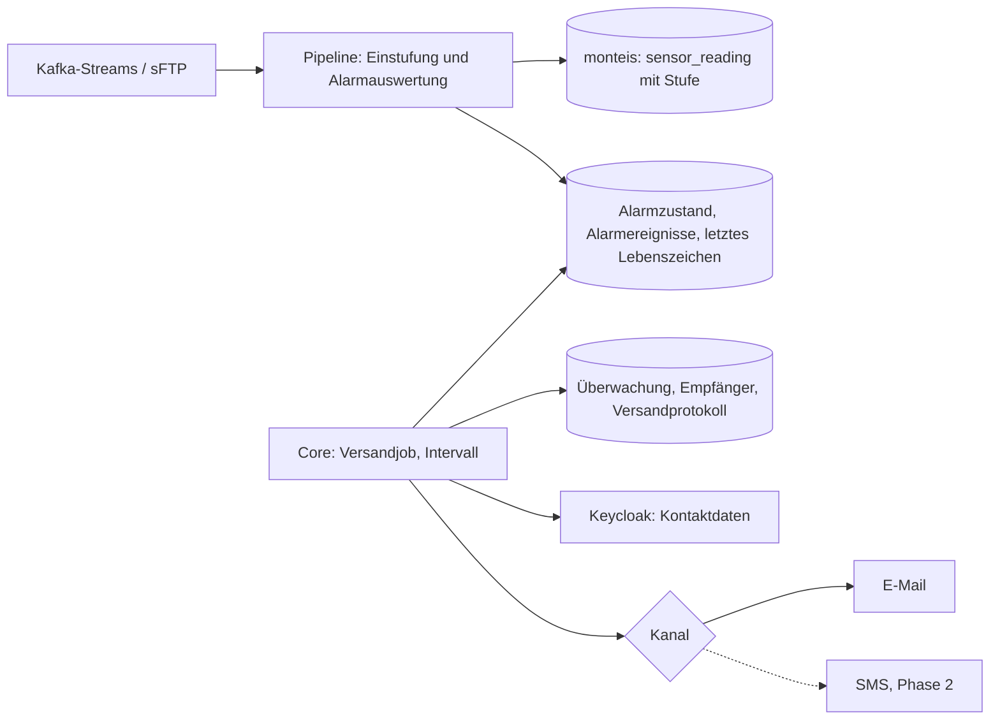

# Zielarchitektur Alarmierung

Messwerte überwachter Sensoren, die eine Alarm- oder Spezialalarm-Grenze verletzen, lösen in einem festen Intervall eine Sammelbenachrichtigung an die Empfänger aus, die ein Admin oder PI im Frontend festgelegt hat. Zusätzlich werden ausbleibende Daten erkannt: pro Sensor-Parameter (Datenlücke) und pro Pipeline (Kafka-Streams, sFTP). Phase 1 benachrichtigt per E-Mail, Phase 2 ergänzt SMS. Dieses Dokument hält den Stand der Vorabklärung fest. Es ersetzt keine ADRs: Die Entscheidungen unten werden im Lauf mit Alternativen begründet und in `documentation/architecture/src/09_architecture_decisions.adoc` festgehalten.

Ticket: TBD (`MON-248`). Abhängigkeit: MON-250 (DB-Fusion).

## Ausgangslage

- Das Frontend ist in detaillierte Stories zerlegt und in Umsetzung. Dort wird festgelegt, wann ein Alarm an welche Personen geht, für welchen Sensor und welches Experiment.
- Heute gibt es pro `sensor_parameter` ein Grenzwertpaar `lower_alarm_limit` / `upper_alarm_limit`. Fachlich ist das der Sensor Range, nicht die Alarmgrenze.
- Die Pipeline stuft jeden Messwert beim Ingest ein und speichert das Ergebnis in `sensor_reading.status` (`range_category`: `too_low | correct | too_high`). Die Grenzwerte erhält sie über die Sensor-Konfiguration aus Kafka, nicht aus den Meta-Tabellen.
- Kontaktdaten werden nie in MONTEIS gespeichert, sondern aus Keycloak gelesen (bisher nur mit dem Token des Aufrufers).
- Geplante Jobs mit Sperre gegen Doppelläufe gibt es bereits: Fulcrum-Synchronisation mit ShedLock.

## Anforderungen

| ID  |                                                                                                                                                                                                    Anforderung                                                                                                                                                                                                    |          Quelle          |
|-----|-------------------------------------------------------------------------------------------------------------------------------------------------------------------------------------------------------------------------------------------------------------------------------------------------------------------------------------------------------------------------------------------------------------------|--------------------------|
| R1  | Benachrichtigt wird periodisch in einem festen Intervall, z. B. zweimal täglich. Das genaue Intervall ist TBD.                                                                                                                                                                                                                                                                                                    | Vorabklärung             |
| R2  | Pro `sensor_parameter` gibt es drei Grenzwertpaare: Sensor Range (unten/oben), Alarm (unten/oben), Spezialalarm (unten/oben).                                                                                                                                                                                                                                                                                     | Vorabklärung             |
| R3  | Benachrichtigungen lösen nur Verletzungen von Alarm- und Spezialalarm-Grenzen aus, nicht des Sensor Range.                                                                                                                                                                                                                                                                                                        | Vorabklärung             |
| R4  | Spezialalarme gehen im selben Intervall raus wie Alarme, nicht sofort.                                                                                                                                                                                                                                                                                                                                            | F1                       |
| R5  | Die Grenzwerte für Sensor Range, Alarm und Spezialalarm werden am Sensor-Parameter festgelegt (im Frontend gepflegt). Sie sind fix, nicht zeitlich versioniert; Grundlage sind die Herstellerangaben. Eine Änderung gilt nur für neu eintreffende Messwerte; bereits gespeicherte Messwerte behalten ihre Stufe.                                                                                                  | F7, Nachtrag 3           |
| R6  | Die Empfänger normaler Alarme legt ein Admin oder der PI des Experiments im Frontend fest (R17). Spezialalarme definiert nur ein Admin (R18).                                                                                                                                                                                                                                                                     | Vorabklärung, Nachtrag 2 |
| R7  | E-Mail-Adressen (und in Phase 2 Telefonnummern) werden pro Benutzer aus Keycloak gelesen.                                                                                                                                                                                                                                                                                                                         | Vorabklärung             |
| R8  | Phase 1: E-Mail. Phase 2: SMS.                                                                                                                                                                                                                                                                                                                                                                                    | Vorabklärung             |
| R9  | Ein normaler Alarm geht nur einmal raus: Ein Sensor-Parameter, der dauerhaft im Alarm bleibt, wird nicht in jedem Intervall erneut gemeldet. Spezialalarme wiederholen sich (R19).                                                                                                                                                                                                                                | F2, Nachtrag 2           |
| R10 | Empfänger normaler Alarme werden pro Experiment festgelegt; sie erhalten die Alarme der überwachten Sensoren dieses Experiments (R16).                                                                                                                                                                                                                                                                            | F9, Nachtrag 2           |
| R11 | Ein ausgelöster Alarm wird zurückgesetzt, sobald mindestens so viele aufeinanderfolgende Messwerte wieder innerhalb des Ranges liegen, wie der Trigger-Wert angibt (ohne Trigger-Wert: ein Messwert). Danach kann er erneut auslösen. Das Versandintervall (R1) spielt für die Rücksetzung keine Rolle; es bestimmt nur, wann Alarme an die Empfänger verschickt werden.                                          | F11, Nachtrag 4          |
| R12 | Alarm und Spezialalarm sind zwei voneinander unabhängige Ranges. Jeder wird für sich ausgewertet, gemeldet und zurückgesetzt; einen eigenen Verschärfungsfall („von Alarm zu Spezialalarm“) gibt es nicht. Jeder Messwert wird gegen beide Ranges getrennt geprüft; die Ranges können sich überlappen, ein Wert kann also beide verletzen und für beide Folgen zählen.                                            | F11, F16                 |
| R13 | Es gibt keine Entwarnung, wenn ein Sensor-Parameter wieder im Range ist.                                                                                                                                                                                                                                                                                                                                          | F11                      |
| R14 | Ein Alarm wird erst ausgelöst, wenn mindestens so viele aufeinanderfolgende Messwerte den Range verletzen, wie der Trigger-Wert angibt. Beispiel: Trigger 10 → der 10. Verstoss in Folge löst aus. Ein Messwert innerhalb des Ranges unterbricht die Folge. Die Folge kann über Intervallgrenzen hinweg laufen; gemeldet wird im nächsten Versandintervall. Der Trigger-Wert wird pro Sensor-Parameter definiert. | Vorabklärung, F13, F14   |
| R15 | Ist für einen Sensor-Parameter kein Trigger-Wert definiert, wird der Alarm beim ersten Auftreten eines Verstosses ausgelöst.                                                                                                                                                                                                                                                                                      | Vorabklärung             |
| R16 | Alarmiert werden nur Sensor-Parameter unter Überwachung (normale Alarme und/oder Spezialalarme). Alle übrigen Sensor-Parameter werden bei Grenzwertverletzungen nur im Frontend farblich gekennzeichnet (Story im Backlog).                                                                                                                                                                                       | Nachtrag 2, F18          |
| R17 | Admin oder PI legen pro Experiment fest, welche Sensor-Parameter mit normalen Alarmen überwacht werden und welche Empfänger alarmiert werden.                                                                                                                                                                                                                                                                     | Nachtrag 2               |
| R18 | Spezialalarme definiert nur ein Admin, pro Sensor-Parameter; eine Zuordnung pro Experiment ist möglich. Empfänger sind die Benutzer, die der Admin für den Spezialalarm festlegt (eigene Empfängerliste, nicht die Empfänger des Experiments).                                                                                                                                                                    | Nachtrag 2, F18, F19     |
| R19 | Spezialalarme können wiederholt ausgelöst werden. In der initialen Umsetzung wird ein bestehender Spezialalarm in jedem Versandintervall (R1) erneut gemeldet; ein eigenes, konfigurierbares Wiederholungsintervall folgt später.                                                                                                                                                                                 | Nachtrag 2, F17          |
| R20 | Pipelines (Kafka-Streams und sFTP) werden überwacht. Eine Pipeline ist der Datenfluss eines externen Lieferanten bis in die TimescaleDB. Eine Seite im Adminbereich zeigt eine Übersicht über alle Pipelines (FE-Stories existieren).                                                                                                                                                                             | Nachtrag 2, F21          |
| R21 | Pro Pipeline kann ein Timeout definiert werden. Liefert eine Pipeline innerhalb ihres Timeouts keine Daten, wird alarmiert.                                                                                                                                                                                                                                                                                       | Nachtrag 2               |
| R22 | Prio 1 alarmiert ausschliesslich per E-Mail. Eine Kanalwahl (E-Mail und/oder SMS) folgt mit SMS in Phase 2; wo sie konfiguriert wird, ist offen. Das Design hält die Kanal-Schnittstelle offen, legt aber noch kein Konfigurationsfeld an.                                                                                                                                                                        | Nachtrag 2, F23          |
| R23 | Fehlende Datensequenzen werden erkannt: Trifft für einen Sensor-Parameter länger als sein Timeout (Feld am Sensor-Parameter) kein Messwert ein, wird eine Datenlücke gemeldet.                                                                                                                                                                                                                                    | Nachtrag 2               |
| R24 | Ob ein Sensor-Parameter einen Alarm (Alarm, Spezialalarm) auslöst oder zurücksetzt, wird bereits beim Eingang der Daten in der Pipeline ausgewertet, analog zur heutigen Einstufung gegen den Sensor Range, und als Zustand gespeichert. Der Versand an die Empfänger erfolgt davon getrennt im Versandintervall (R1).                                                                                            | Nachtrag 4               |

## Zielbild

1. **Pipeline, Auswertung beim Ingest (R24):**
   - stuft jeden Messwert gegen die drei Grenzwertpaare ein und speichert die Stufe in `sensor_reading`; die Stufe ersetzt die heutige `range_category` durch eine Abstufung je Range und Richtung (Werte siehe E2);
   - führt pro Sensor-Parameter und Range (Alarm, Spezialalarm) die laufende Folge mit: Anzahl Verstösse in Folge bzw. Werte im Range in Folge (R12, R14); sortiert dazu jeden Batch nach Messzeitpunkt und lässt Werte, die älter sind als der zuletzt gezählte, für die Folge aus (E7);
   - setzt den Alarmzustand auf „ausgelöst“, sobald die Verstossfolge den Trigger-Wert erreicht (ohne Trigger: beim ersten Verstoss, R15), und zurück, sobald die Folge der Werte im Range den Trigger-Wert erreicht (R11);
   - schreibt beim Auslösen ein Alarmereignis (Sensor-Parameter, Range, Zeitpunkt, auslösender Wert) und aktualisiert pro Sensor-Parameter und Pipeline den Zeitpunkt des letzten gespeicherten Messwerts (für R21, R23);
   - schreibt Messwerte, Folgen, Zustand und Ereignis in derselben Transaktion, damit eine erneut zugestellte Kafka-Nachricht nicht doppelt zählt (F25);
   - wertet nur neu eintreffende Messwerte mit `sensor_parameter_id` aus; Backfill und Reprocessing ändern weder Folgen noch Alarmzustand (F24);
   - wertet alle Sensor-Parameter mit Grenzwerten aus, unabhängig von der Überwachung; den Zustand nicht überwachter Sensor-Parameter kann das Frontend für die farbliche Kennzeichnung nutzen (R16).
2. **Core, geplanter Versandjob** (Intervall aus R1, ShedLock gegen Doppelläufe):
   - liest die noch nicht versandten Alarmereignisse und filtert auf überwachte Sensor-Parameter (R16): normale Alarme gemäss Experiment-Konfiguration (R17), Spezialalarme gemäss Admin-Konfiguration (R18);
   - meldet einen normalen Alarm einmal (R9) und einen noch ausgelösten Spezialalarm in jedem Lauf erneut (R19, initial = Versandintervall);
   - prüft je überwachtem Sensor-Parameter, ob der letzte Messwert älter ist als sein Timeout (Datenlücke, R23), und je Pipeline, ob ihr letztes Lebenszeichen älter ist als ihr Timeout (R21); das Ausbleiben von Daten erzeugt kein Ereignis beim Ingest und braucht deshalb den zeitgesteuerten Lauf;
   - verschickt keine Entwarnung (R13);
   - gruppiert die Meldungen pro Empfänger, Experiment und Sensor-Parameter (Range, auslösender Wert, Zeitpunkt);
   - prüft beim Versand, ob der Empfänger das Experiment noch lesen darf; wer es nicht mehr darf, bekommt keine Meldung dazu;
   - liest die Kontaktdaten über einen Service-Account aus Keycloak;
   - versendet über eine Kanal-Schnittstelle (R22; Prio 1 nur E-Mail, Kanalwahl später); Phase 1 hat einen E-Mail-Adapter (z. B. AWS SES), Phase 2 ergänzt einen SMS-Adapter.
3. **Alarmzustand und Alarmereignisse:** Der Zustand pro Sensor-Parameter und Range (ausgelöst ja/nein, seit wann, laufende Folgen, letzter Messwert) gehört der Pipeline. Die Ereignisse sind die Schnittstelle zum Versandjob: die Pipeline schreibt sie, `core` markiert sie erst nach erfolgreichem Versand als versandt, damit ein gescheiterter Versand keinen Alarm verschluckt. Zustände für Datenlücken und Pipeline-Timeouts führt `core`.
4. **Versandprotokoll:** speichert pro Lauf das Zeitfenster und pro Empfänger den Versandstatus, nur mit Keycloak-User-IDs. Ein gescheiterter Versand wird wiederholt, ohne doppelt zu senden, und ein ausgefallener Lauf hinterlässt eine sichtbare Lücke statt verlorener Alarme.
5. **Trigger-Wert und Timeout:** optionale Felder am Sensor-Parameter, neben den Grenzwertpaaren, im Frontend gepflegt. Trigger leer heisst „beim ersten Verstoss auslösen“ (R14, R15). Das Timeout ist ein Attribut des Sensor-Parameters und steuert die Erkennung von Datenlücken (R23); die Einheit ist TBD. Im Schema existiert das Feld noch auf keinem Branch und kommt als Migration `V2__…` dazu (F22).
6. **Überwachungs- und Empfängerkonfiguration:**
   - pro Experiment: überwachte Sensoren für normale Alarme, Empfänger mit Keycloak-User-IDs (R10, R17); schreiben dürfen Admin und PI des Experiments;
   - pro Sensor-Parameter (optional mit Experiment): Spezialalarm-Überwachung, eigene Empfängerliste (R18), später das Wiederholungsintervall (R19) und die Kanalwahl (R22); schreiben darf nur ein Admin;
   - die Schreibregeln sind in `Capabilities` und in den RLS-Funktionen gleich und durch Integrationstests abgesichert.
7. **Pipeline-Überwachung:** Verzeichnis aller Pipelines (Kafka-Streams, sFTP) mit Timeout und Zeitpunkt des letzten Lebenszeichens (R20, R21). Die Admin-Seite liest daraus die Übersicht; der Alarmierungsjob prüft die Timeouts. Weil eine Pipeline bis in die TimescaleDB reicht (R20), zählt als Lebenszeichen der letzte erfolgreich geschriebene Messwert, nicht der letzte empfangene; woher der Zeitpunkt kommt, entscheidet E8.

Textfassung: Die Pipeline stuft Messwerte aus Kafka-Streams und sFTP ein, entscheidet beim Ingest, ob ein Alarm ausgelöst oder zurückgesetzt wird, und schreibt Messwerte, Alarmzustand, Alarmereignisse und das letzte Lebenszeichen in die Datenbank. Der Versandjob in `core` liest im Intervall die offenen Ereignisse, prüft die Timeouts von Sensor-Parametern und Pipelines, filtert auf überwachte Sensor-Parameter, liest Empfänger und Versandprotokoll, holt die Kontaktdaten aus Keycloak und versendet per E-Mail (Phase 2 zusätzlich SMS).

## Vorentscheide (Als ADR zu bestätigen)

### E1 Aufteilung: Auswertung in der Pipeline, Versand als geplanter Job in `core`

- **Entscheid (R24):** Ob ein Alarm ausgelöst oder zurückgesetzt wird, entscheidet die Pipeline beim Ingest. `core` versendet im Intervall und prüft die Timeouts.
- **Begründung:** Die Auswertung folgt dem bestehenden Muster der Range-Einstufung, braucht keine Rückwärtsabfragen über `sensor_reading` und liefert den aktuellen Zustand sofort, auch für die farbliche Kennzeichnung im Frontend. Der Versand bleibt periodisch (R1, R4). Datenlücken und Pipeline-Timeouts sind das *Ausbleiben* von Ereignissen und brauchen in jedem Fall einen zeitgesteuerten Lauf.
- **Verworfen:** C' (der Job wertet die gespeicherten Stufen periodisch aus, ursprüngliche Empfehlung) widerspricht R24. B (ein separater Kafka-Consumer wertet aus) bringt gegenüber der Auswertung im bestehenden Pipeline-Consumer nur einen zusätzlichen Consumer.
- **Schnittstelle:** Alarmereignisse in der gemeinsamen Datenbank (nach MON-250), kein zusätzliches Kafka-Topic. Ein Topic bleibt möglich, wenn später Echtzeit-Alarme gefordert sind.

### E2 Stufe beim Ingest speichern statt beim Lauf berechnen

- **Empfehlung:** speichern. Die Grenzwerte sind fix und nicht versioniert (R5); eine Änderung am Sensor-Parameter gilt nur für neue Messwerte (R5), die gespeicherte Stufe bleibt also gültig und ist zugleich der Nachweis, nach welchen Grenzen ein Wert eingestuft wurde. Der Lauf liest nur gespeicherte Stufen über einen Index, statt jeden Messwert gegen die Grenzen zu rechnen.
- **Alternative:** Stufe im Lauf gegen die aktuellen Grenzen berechnen; immer aktuell, aber teurer pro Lauf.
- **Grenzwertänderung:** Bestehende Messwerte werden nicht neu eingestuft (R5). Weil die Grenzwerte nicht versioniert sind, muss ein Reprocessing aus anderen Gründen (z. B. Backfill von Messwerten mit unbekannter Konfiguration) eine bereits gesetzte Stufe unverändert lassen; neu eingestuft werden nur Messwerte ohne Stufe. Sonst entstehen nachträglich Fehlalarme.
- **Trigger:** Die Folgen werden beim Ingest fortgeschrieben (E1, E7); der Versandjob muss Messwerte nicht neu lesen oder einstufen.
- **Zu entscheiden:** Werte des neuen Enums, Umbenennung der heutigen `*_alarm_limit`-Spalten in Sensor Range, Migration der bestehenden `status`-Werte.

### E7 Folge beim Ingest: Reihenfolge und verspätete Werte

Die Pipeline sieht jeden Messwert nur in dem Moment, in dem er eintrifft. Bei einem Wert mit Zeitstempel 10:05 weiss sie nicht, ob noch ein Wert von 10:03 unterwegs ist (z. B. gepuffert beim Datenlogger). Ein Job, der später auf die gespeicherten Daten schaut, hätte dieses Problem nicht, weil zu diesem Zeitpunkt alle Werte schon da sind.

Beispiel mit Trigger 3:

| Eintreffen | Messzeitpunkt |   Wert   | Folge nach Eintreffen |                 Folge nach Messzeitpunkt                 |
|------------|---------------|----------|-----------------------|----------------------------------------------------------|
| 1          | 10:01         | Verstoss | 1                     | 1                                                        |
| 2          | 10:02         | Verstoss | 2                     | 2                                                        |
| 3          | 10:04         | Verstoss | 3 → **Alarm**         | 3 → Alarm, aber nur vorläufig                            |
| 4          | 10:03         | im Range | 0                     | Folge war 10:01–10:02, danach 10:04 = 1 → **kein Alarm** |

Nach Messzeitpunkt korrekt gezählt, hätte der Alarm nie ausgelöst werden dürfen. Die Pipeline erfährt das aber erst beim vierten Wert, wenn der Alarm schon ausgelöst ist.

Varianten:

1. **Innerhalb eines Kafka-Batches nach Messzeitpunkt sortieren.** Billig; fängt Vertauschungen innerhalb eines Batches ab, nicht über Batchgrenzen hinweg.
2. **Verspätete Werte für die Folge ignorieren.** Ist ein Wert älter als der zuletzt gezählte dieses Sensor-Parameters, wird er gespeichert und eingestuft, verändert die Folge aber nicht. Einfach und deterministisch; ein verspäteter Wert kann eine Folge weder unterbrechen noch verlängern.
3. **Folge ab dem verspäteten Wert neu berechnen.** Die Pipeline liest die gespeicherten Werte ab dessen Zeitstempel und zählt neu. Korrekt, braucht aber wieder eine Rückwärtsabfrage samt Index; ein bereits ausgelöster Alarm lässt sich nur zurückziehen, solange er noch nicht versandt ist.
4. **Verzögert auswerten.** Die Pipeline wartet eine feste Frist (z. B. 15 Minuten), bevor sie zählt. Korrekt für alle Werte innerhalb der Frist, aber deutlich mehr Komplexität in der Pipeline.

- **Entscheid:** 1 + 2. Weil Alarme ohnehin erst im nächsten Versandintervall rausgehen (R1), wiegen seltene Grenzfälle wenig.
- **Folge:** Pro Sensor-Parameter und Range führt der Zustand den Messzeitpunkt des zuletzt gezählten Werts.

## ADR-Kandidaten

| #  |                              Entscheidung                              |                                                                                                       Alternativen                                                                                                       |                                                                                                                                                                            Sicherheit / Compliance                                                                                                                                                                            |
|----|------------------------------------------------------------------------|--------------------------------------------------------------------------------------------------------------------------------------------------------------------------------------------------------------------------|-------------------------------------------------------------------------------------------------------------------------------------------------------------------------------------------------------------------------------------------------------------------------------------------------------------------------------------------------------------------------------|
| E1 | Aufteilung Auswertung und Versand (R24)                                | Auswertung in der Pipeline + Versandjob in `core` (entschieden) vs. C' (Job wertet periodisch aus) vs. B (separater Consumer)                                                                                            | –                                                                                                                                                                                                                                                                                                                                                                             |
| E2 | Stufe speichern oder berechnen                                         | beim Ingest speichern vs. im Lauf berechnen                                                                                                                                                                              | –                                                                                                                                                                                                                                                                                                                                                                             |
| E3 | Kontaktdaten ohne Benutzer-Token                                       | Service-Account (Client Credentials, nur `view-users`) vs. bestehender Admin-Zugang                                                                                                                                      | Erweitert die Entscheidung „Kontaktdaten nur mit dem Token des Aufrufers“; Rechte des Service-Accounts minimal halten, Secret aus der Umgebung                                                                                                                                                                                                                                |
| E4 | Job-Zugriff trotz RLS                                                  | eigene DB-Rolle mit eigener Policy vs. gesetzter Systemkontext in der Transaktion                                                                                                                                        | Der Job sieht alle Experimente; die Leserechte der Empfänger prüft er selbst                                                                                                                                                                                                                                                                                                  |
| E5 | Kanal-Abstraktion und Provider                                         | SES vs. SMTP-Relay (E-Mail); SNS vs. externer Provider (SMS, Phase 2)                                                                                                                                                    | Abstimmung mit `lg-monteis-infra`; keine Kontaktdaten im Versandprotokoll                                                                                                                                                                                                                                                                                                     |
| E6 | Alarmzustand und Alarmereignisse (R9, R11, R12, R19)                   | Zustandstabelle mit Folgen je Sensor-Parameter und Range plus Ereignistabelle (Outbox) vs. nur Zustandstabelle mit Versandmarke                                                                                          | Ereignis erst nach erfolgreichem Versand als versandt markieren; Pipeline und `core` schreiben getrennte Spalten bzw. Tabellen                                                                                                                                                                                                                                                |
| E7 | Wo wird die Folge aufeinanderfolgender Verstösse ermittelt (R11, R14)? | (a) Job rechnet rückwärts; (b) Job führt die Folge von Lauf zu Lauf; (c) Pipeline führt die Folge beim Ingest                                                                                                            | **Entschieden: (c)** nach R24. Reihenfolge: Batch nach Messzeitpunkt sortieren, verspätete Werte für die Folge ignorieren (siehe E7 oben, F15); Idempotenz bei erneuter Zustellung nötig (F25)                                                                                                                                                                                |
| E8 | Lebenszeichen der Pipelines (R20, R21)                                 | (a) Pipeline schreibt pro Quelle den letzten Empfangszeitpunkt in eine Tabelle; (b) `core` leitet es aus dem neuesten `sensor_reading` je Quelle ab; (c) Plattform-Monitoring (Consumer-Lag, CloudWatch) statt Anwendung | (a) erkennt auch eine Pipeline, die läuft, aber nur verworfene Daten liefert, nicht; (b) braucht eine Quellen-Zuordnung in `sensor_reading`; (c) liegt ausserhalb von MONTEIS und speist die Admin-Seite nicht. Nach F21 zählt der erfolgreiche Schreibvorgang in die TimescaleDB. Mit R24 naheliegend: (a), in derselben Transaktion wie die Messwerte, damit erfüllt es F21 |
| E9 | Konfigurationsmodell Überwachung und Empfänger (R16–R19)               | eine gemeinsame Tabelle mit Geltungsbereich (Experiment oder Sensor-Parameter) vs. getrennte Tabellen für normale Alarme (pro Experiment) und Spezialalarme (pro Sensor-Parameter, eigene Empfängerliste)                | zwei Schreibregeln (Admin/PI vs. nur Admin) müssen in `Capabilities` und RLS getrennt abgebildet werden                                                                                                                                                                                                                                                                       |

## Offene Fragen

|  #  |                                                                                                                                                                        Frage                                                                                                                                                                         |                  Wirkung                   |                                                                                                                               Stand                                                                                                                                |
|-----|------------------------------------------------------------------------------------------------------------------------------------------------------------------------------------------------------------------------------------------------------------------------------------------------------------------------------------------------------|--------------------------------------------|--------------------------------------------------------------------------------------------------------------------------------------------------------------------------------------------------------------------------------------------------------------------|
| F1  | Gehen Spezialalarme sofort raus?                                                                                                                                                                                                                                                                                                                     | B vs. C'                                   | beantwortet: nein, selbes Intervall (R4)                                                                                                                                                                                                                           |
| F2  | Wird ein Sensor, der dauerhaft im Alarm ist, in jedem Intervall erneut gemeldet?                                                                                                                                                                                                                                                                     | Alarmzustand speichern ja/nein (E6)        | beantwortet: nein, nur einmal (R9)                                                                                                                                                                                                                                 |
| F3  | Was passiert mit Werten ausserhalb des Sensor Range: verwerfen, markieren, eigene Meldung?                                                                                                                                                                                                                                                           | Abgrenzung Datenqualität                   | offen                                                                                                                                                                                                                                                              |
| F4  | Ist das Intervall global, pro Experiment oder pro Empfänger einstellbar? Fixe Uhrzeiten, welche Zeitzone?                                                                                                                                                                                                                                            | Scheduler-Design                           | offen (R1: Intervall TBD)                                                                                                                                                                                                                                          |
| F5  | Gehören Quittierung, Ruhezeiten oder Eskalation zu Phase 1?                                                                                                                                                                                                                                                                                          | Umfang Phase 1                             | offen                                                                                                                                                                                                                                                              |
| F6  | Mengengerüst: Anzahl Sensoren, Messrate, Empfänger pro Experiment                                                                                                                                                                                                                                                                                    | Machbarkeit der Abfrage pro Lauf, Index    | offen                                                                                                                                                                                                                                                              |
| F7  | Sind die Grenzwerte fix oder zeitlich versioniert?                                                                                                                                                                                                                                                                                                   | E2                                         | beantwortet: fix, am Sensor-Parameter festgelegt (R5). Eine Änderung gilt nur für neue Messwerte, keine Neueinstufung                                                                                                                                              |
| F8  | Ist SMS ebenfalls ein Sammelbericht?                                                                                                                                                                                                                                                                                                                 | Kanalabstraktion, Kosten                   | TBD (Phase 2)                                                                                                                                                                                                                                                      |
| F9  | Werden Empfänger pro Experiment oder pro Sensor-Parameter festgelegt?                                                                                                                                                                                                                                                                                | Datenmodell Empfänger                      | beantwortet: pro Experiment (R10)                                                                                                                                                                                                                                  |
| F10 | Was passiert, wenn ein Empfänger in Keycloak keine Adresse hat oder deaktiviert ist?                                                                                                                                                                                                                                                                 | Fehlerbehandlung, Versandprotokoll         | offen                                                                                                                                                                                                                                                              |
| F11 | Wann darf ein Sensor-Parameter erneut alarmieren? Gibt es eine Verschärfungsmeldung oder eine Entwarnung?                                                                                                                                                                                                                                            | Logik des Alarmzustands (E6)               | beantwortet: Rücksetzen nach N aufeinanderfolgenden Werten im Range, N = Trigger-Wert (R11, Nachtrag 4); zwei unabhängige Ranges statt Verschärfung (R12); keine Entwarnung (R13)                                                                                  |
| F12 | Liegt der Spezialalarm-Range ausserhalb des Alarm-Ranges (verschachtelt), oder können sich die beiden Ranges beliebig überlappen? Bei Verschachtelung verletzt ein Spezialalarm-Wert auch den Alarm-Range; erhalten Empfänger dann zwei Meldungen zum selben Messwert?                                                                               | Einstufung (E2), Inhalt der Sammelmail     | teilweise beantwortet: Ranges werden unabhängig ausgewertet und können sich überlappen (R12). Offen: ob ein Wert, der beide verletzt, in der Sammelmail zweimal oder zusammengefasst erscheint                                                                     |
| F13 | Was zählt der Trigger-Wert genau, und was heisst „überschritten“?                                                                                                                                                                                                                                                                                    | Logik und Zustand des Jobs (E6, E7)        | beantwortet am Beispiel: aufeinanderfolgende Verstösse; Trigger 10 → Alarm beim 10. Verstoss in Folge (R14)                                                                                                                                                        |
| F14 | Gilt der Trigger-Wert pro Sensor oder pro Sensor-Parameter?                                                                                                                                                                                                                                                                                          | Datenmodell Trigger                        | beantwortet: pro Sensor-Parameter (R14). Annahme: derselbe Wert gilt für Alarm und Spezialalarm, gezählt wird je Range getrennt                                                                                                                                    |
| F15 | „Aufeinanderfolgend“ bezieht sich auf den Messzeitpunkt. Was gilt, wenn ein Wert verspätet eintrifft (Pufferung beim Datenlogger, MirrorMaker) und eine bereits ausgewertete Folge nachträglich unterbricht oder vervollständigt? Wird ein schon gemeldeter Alarm dann zurückgenommen, oder zählt nur, was beim Lauf bekannt war?                    | Robustheit von E7                          | beantwortet: Batch nach Messzeitpunkt sortieren, ältere Werte als der zuletzt gezählte zählen nicht für die Folge (E7, Varianten 1 + 2). Ein gemeldeter Alarm wird nie zurückgenommen                                                                              |
| F16 | Unterbricht eine Datenlücke (z. B. Sensor sendet stundenlang nichts) die Folge, oder zählen nur die tatsächlich eingetroffenen Messwerte? Zählt bei verschachtelten Ranges (F12) ein Spezialalarm-Wert auch für die Alarm-Folge?                                                                                                                     | Logik der Folge                            | teilweise beantwortet: jeder Range wird unabhängig ausgewertet; ein Wert zählt für jede Folge, deren Range er verletzt (R12). Datenlücken werden nach R23 als eigene Meldung erkannt. Offen: ob eine Datenlücke zugleich die Folge unterbricht                     |
| F17 | Wie lange wird ein Spezialalarm wiederholt: solange der Verstoss besteht, bis zur Rücksetzung nach R11 oder bis zu einer Quittierung? Wo wird das Wiederholungsintervall konfiguriert (global, pro Sensor)? Muss es ein Vielfaches des Versandintervalls R1 sein, oder werden Spezialalarme dann doch ausserhalb des Sammelversands verschickt (R4)? | Alarmzustand (E6), Scheduler, ggf. E1      | teilweise beantwortet: initial im gemeinsamen Versandintervall (R19). Offen: Ende der Wiederholung (solange der Verstoss besteht, bis zur Rücksetzung nach R11 oder bis zur Quittierung)                                                                           |
| F18 | Beziehen sich Überwachung, Spezialalarm und Kanalwahl auf den Sensor oder auf den einzelnen Sensor-Parameter? Grenzwerte, Trigger und Timeout hängen am Sensor-Parameter.                                                                                                                                                                            | Datenmodell (E9)                           | beantwortet: pro Sensor-Parameter (R16–R18, R22)                                                                                                                                                                                                                   |
| F19 | Wer erhält Spezialalarme, die pro Sensor und nicht pro Experiment definiert sind: eine eigene Empfängerliste je Sensor, oder die Empfänger der Experimente, denen der Sensor zugeordnet ist?                                                                                                                                                         | Datenmodell (E9), Leseprüfung beim Versand | beantwortet: die vom Admin festgelegten Benutzer, eigene Empfängerliste (R18)                                                                                                                                                                                      |
| F20 | Wer erhält Datenlücken- und Pipeline-Alarme (Experiment-Empfänger, nur Admins, eigene Liste)? Gehen sie im Sammelintervall raus, und werden sie einmalig oder wiederholt gemeldet?                                                                                                                                                                   | Versandlogik                               | TBD                                                                                                                                                                                                                                                                |
| F21 | Was ist eine „Pipeline“ fachlich (Kafka-Topic, Datenquelle/DAS, sFTP-Verzeichnis)? Ein sFTP-Ingest ist im Code auf `main` nicht zu finden. Ist er geplant, und welche Komponente betreibt ihn?                                                                                                                                                       | E8, Umfang                                 | teilweise beantwortet: Datenfluss eines externen Lieferanten bis in die TimescaleDB (R20). Offen: ob der sFTP-Ingest schon existiert, und wie Sensor-Parameter ihrer Pipeline zugeordnet werden (für die Unterdrückung von Datenlücken)                            |
| F22 | Das Timeout-Feld am Sensor-Parameter existiert im Schema auf `main` noch nicht. Kommt es aus einer FE-Story? Welche Einheit, und heisst leer „keine Lückenerkennung“?                                                                                                                                                                                | Datenmodell, Migration                     | teilweise beantwortet: Attribut des Sensor-Parameters (R23). Offen: Einheit (TBD) und ob leer „keine Lückenerkennung“ heisst                                                                                                                                       |
| F23 | Wird die Kanalwahl (E-Mail/SMS) pro Sensor, pro Experiment oder pro Empfänger getroffen?                                                                                                                                                                                                                                                             | Datenmodell (E9), Kanal-Abstraktion        | offen gelassen: Prio 1 nur E-Mail (R22); Kanalwahl kommt mit SMS in Phase 2                                                                                                                                                                                        |
| F24 | Messwerte mit unbekannter Konfiguration (`sensor_parameter_id` = `NULL`) können beim Ingest nicht ausgewertet werden. Werden sie beim Backfill in die Folge eingerechnet oder nur eingestuft? Und darf das bestehende Reprocessing bei Konfigurationsänderungen (`SensorConfigReprocessingListener`) Stufen und Alarmzustand verändern (R5)?         | Pipeline-Logik, Fehlalarme                 | beantwortet: In die Auswertung gehen nur neu eintreffende Messwerte mit `sensor_parameter_id`. Backfill und Reprocessing stufen höchstens ein, verändern aber weder Folgen noch Alarmzustand und lösen keine Alarme aus (R5)                                       |
| F25 | Die Pipeline verarbeitet Kafka-Batches mit Upsert. Ist garantiert, dass alle Messwerte eines Sensor-Parameters über dieselbe Partition und damit geordnet und von nur einer Instanz verarbeitet werden? Und zählt ein erneut zugestellter (upserteter) Wert nicht doppelt?                                                                           | Korrektheit der Folgen, Nebenläufigkeit    | teilweise beantwortet: Ein erneut zugestellter Wert hat keinen neueren Messzeitpunkt als der zuletzt gezählte und wird deshalb nach E7 (Variante 2) nicht doppelt gezählt; Bedingung: „älter oder gleich“ zählt nicht. Offen: Partitionierung pro Sensor-Parameter |

## Abhängigkeiten und Reihenfolge

- **MON-250 zuerst:** Neue Tabellen (Empfänger, Versandprotokoll) und die Spalten für die drei Grenzwertpaare kommen als `V2__…` auf `db/schema/V1__baseline.sql`, nicht in die Baseline selbst.
- **Glossar:** Sensor Range, Alarm-Grenze und Spezialalarm-Grenze kommen in `CONTEXT.md`, bevor Code und Migrationen sie verwenden. Der heutige Spaltenname `alarm_limit` wird dabei fachlich korrigiert.
- **Frontend:** Die Grenzwert-Erfassung, die Überwachungs- und Empfängerverwaltung, die farbliche Kennzeichnung nicht überwachter Sensoren (Backlog) und die Pipeline-Übersicht im Adminbereich brauchen die erweiterte API aus `core`; der REST-Client wird aus der OpenAPI generiert.
- **Infrastruktur:** Mailversand (und später SMS) sowie das Secret des Keycloak-Service-Accounts stellt das Infra-Team in `lg-monteis-infra` bereit.

## Risiken

- **Alarm bleibt unbemerkt bestehen:** Weil ein Alarm nur einmal rausgeht (R9) und es keine Erinnerung oder Entwarnung gibt (R13), sieht niemand per Mail, ob ein Sensor-Parameter seit Wochen ausserhalb des Ranges ist. Das ist so gewollt; der aktuelle Zustand muss dann im Frontend sichtbar sein.
- **Flackern an der Grenze:** Bei Sensor-Parametern ohne Trigger-Wert löst jeder Verstoss aus und jeder Wert im Range setzt zurück (R11, R15). Ein Wert, der um eine Grenze pendelt, kann dann bei jedem Versand neu melden. Ein Trigger-Wert dämpft das in beide Richtungen.
- **Verlorene Alarme:** Fällt ein Lauf aus, muss der nächste das ganze Zeitfenster seit dem letzten erfolgreichen Lauf abdecken; das Versandprotokoll muss das sicherstellen.
- **Breiter Keycloak-Zugriff:** Ein Service-Account mit Leserecht auf alle Benutzer ist ein neues Angriffsziel; Rechte minimal halten und begründen (E3).
- **Rechte driften:** Die Schreibregel für Empfänger (Admin oder PI) und die Leseprüfung beim Versand müssen in Java und SQL gleich bleiben; Integrationstests sichern das ab.
- **Alarmflut bei Pipeline-Ausfall:** Fällt eine Pipeline aus, laufen auch die Timeouts aller ihrer Sensor-Parameter ab. Ohne Unterdrückung erhalten Empfänger dann hunderte Datenlücken-Meldungen statt einer Pipeline-Meldung. Der Job sollte Datenlücken von Sensor-Parametern einer Pipeline im Timeout unterdrücken; das setzt die Zuordnung Sensor-Parameter → Pipeline voraus (F21).
- **Kosten und Lärm durch Wiederholung:** Wiederholte Spezialalarme (R19) über SMS (Phase 2) erzeugen laufende Kosten und stumpfen Empfänger ab, wenn kein Ende der Wiederholung definiert ist (F17).
- **Mehr Logik und Zustand in der Pipeline:** Mit R24 hat die Pipeline neben der Einstufung einen Zustand pro Sensor-Parameter, den sie konsistent, idempotent und in der richtigen Reihenfolge fortschreiben muss (F24, F25). Fehler dort sind schwerer zu korrigieren als in einem Job, der aus den gespeicherten Messwerten neu rechnen kann.

