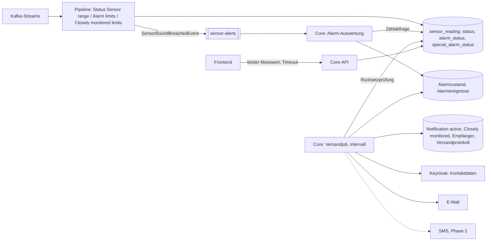

# Zielarchitektur Alarmierung

Messwerte von Notification active oder Closely monitored Sensor-Parametern, die ihre Alarm limits oder Closely monitored limits verletzen, lösen in einem festen Intervall eine Sammelbenachrichtigung an die Empfänger aus, die ein Monteis-Admin oder PI im Frontend festgelegt hat. Zusätzlich werden ausbleibende Daten erkannt: pro Sensor-Parameter (Timeout) und pro Pipeline (Kafka-Streams). Phase 1 benachrichtigt per E-Mail, Phase 2 ergänzt SMS. Dieses Dokument hält den Stand der Vorabklärung fest. Es ersetzt keine ADRs: Die Entscheidungen unten werden im Lauf mit Alternativen begründet und in `documentation/architecture/src/09_architecture_decisions.adoc` festgehalten.

Ticket: TBD (`MON-248`). Abhängigkeit: MON-250 (DB-Fusion).

## Ausgangslage

- Das Frontend ist in detaillierte Stories zerlegt und in Umsetzung. Dort wird festgelegt, wann ein Alarm an welche Personen geht, für welchen Sensor und welches Experiment.
- Heute gibt es pro `sensor_parameter` ein Grenzwertpaar `lower_alarm_limit` / `upper_alarm_limit`. Fachlich ist das die Sensor range, nicht die Alarm limits.
- Die Pipeline stuft jeden Messwert beim Ingest ein und speichert das Ergebnis in `sensor_reading.status` (`range_category`: `too_low | correct | too_high`). Die Grenzwerte erhält sie über die Sensor-Konfiguration aus Kafka, nicht aus den Meta-Tabellen.
- Die Pipeline (`BoundsValidator`) veröffentlicht heute schon bei jeder Verletzung der Sensor range eines neu eingetroffenen Messwerts ein `SensorBoundBreachedEvent` asynchron auf das Topic `sensor-alerts`, bei Reprocessing nicht. Auf `main` konsumiert niemand dieses Topic. Fehler beim Senden werden nur geloggt.
- Bei einer Änderung der Sensor-Konfiguration verarbeitet die Pipeline historische Messwerte neu (`SensorConfigReprocessingListener`, `HistoricalReadingChunkProcessor`) und schreibt dabei auch `status` neu.
- Kontaktdaten werden nie in MONTEIS gespeichert, sondern aus Keycloak gelesen (bisher nur mit dem Token des Aufrufers).
- Geplante Jobs mit Sperre gegen Doppelläufe gibt es bereits: Fulcrum-Synchronisation mit ShedLock.

## Anforderungen

| ID  |                                                                                                                                                                                                                                                                            Anforderung                                                                                                                                                                                                                                                                             |
|-----|--------------------------------------------------------------------------------------------------------------------------------------------------------------------------------------------------------------------------------------------------------------------------------------------------------------------------------------------------------------------------------------------------------------------------------------------------------------------------------------------------------------------------------------------------------------------|
| R1  | Benachrichtigt wird periodisch in einem festen Intervall, z. B. zweimal täglich. Das genaue Intervall ist zu definieren.                                                                                                                                                                                                                                                                                                                                                                                                                                           |
| R2  | Pro `sensor_parameter` gibt es zwei Grenzwertpaare: Alarm limits (unten/oben), Closely monitored limits (unten/oben).                                                                                                                                                                                                                                                                                                                                                                                                                                              |
| R3  | Benachrichtigungen lösen nur Verletzungen der Alarm limits und Closely monitored limits aus, nicht der Sensor range.                                                                                                                                                                                                                                                                                                                                                                                                                                               |
| R4  | Alarme von Closely monitored Sensor-Parametern gehen im selben Intervall raus wie normale Alarme, nicht sofort.                                                                                                                                                                                                                                                                                                                                                                                                                                                    |
| R5  | Die Alarm limits und Closely monitored limits werden am Sensor-Parameter festgelegt (im Frontend gepflegt). Sie sind fix, nicht zeitlich versioniert. Eine Änderung führt zu einer Neuevaluation des gespeicherten Status.                                                                                                                                                                                                                                                                                                                                         |
| R6  | Die Empfänger normaler Alarme legt ein Monteis-Admin oder ein PI des Experiments im Frontend fest (R17). Closely monitored setzt nur ein Monteis-Admin.                                                                                                                                                                                                                                                                                                                                                                                                            |
| R7  | E-Mail-Adressen (und in Phase 2 Telefonnummern) werden pro Benutzer aus Keycloak gelesen.                                                                                                                                                                                                                                                                                                                                                                                                                                                                          |
| R8  | Phase 1: E-Mail. Phase 2: SMS.                                                                                                                                                                                                                                                                                                                                                                                                                                                                                                                                     |
| R9  | Ein normaler Alarm geht nur einmal raus: Ein Sensor-Parameter, der dauerhaft im Alarm bleibt, wird nicht in jedem Intervall erneut gemeldet. Alarme von Closely monitored Sensor-Parametern wiederholen sich.                                                                                                                                                                                                                                                                                                                                                      |
| R10 | Empfänger normaler Alarme werden pro Experiment festgelegt; sie erhalten die Alarme der Notification active Sensor-Parameter dieses Experiments.                                                                                                                                                                                                                                                                                                                                                                                                                   |
| R11 | Ein Alarm wird ausgelöst oder zurückgesetzt, sobald mindestens so viele aufeinanderfolgende Messwerte wieder innerhalb oder ausserhalb des Ranges liegen, wie der Frequency-Wert angibt (ohne Frequency-Wert: default 1).  Das Versandintervall (R1) spielt für die Rücksetzung keine Rolle; es bestimmt nur, wann Alarme an die Empfänger verschickt werden.                                                                                                                                                                                                      |
| R12 | Alarm limits und Closely monitored limits sind zwei voneinander unabhängige Ranges. Jeder wird für sich ausgewertet, gemeldet und zurückgesetzt; einen eigenen Verschärfungsfall („von Alarm limits zu Closely monitored limits“) gibt es nicht. Jeder Messwert wird gegen beide Ranges getrennt geprüft; die Ranges können sich überlappen, ein Wert kann also beide verletzen und für beide Folgen zählen.                                                                                                                                                       |
| R13 | Es gibt keine Entwarnung, wenn ein Sensor-Parameter wieder im Range ist.                                                                                                                                                                                                                                                                                                                                                                                                                                                                                           |
| R15 | Ist für einen Sensor-Parameter kein Frequency-Wert definiert, wird der Alarm beim ersten Auftreten eines Verstosses ausgelöst.                                                                                                                                                                                                                                                                                                                                                                                                                                     |
| R16 | Alarmiert werden nur Sensor-Parameter, die Notification active und/oder Closely monitored sind. Ein Sensor-Parameter im Timeout kann ebenfalls eine Benachrichtigung auslösen, wenn er Notification active ist. Sensor range und Timeout werden zusätzlich im Frontend farblich gekennzeichnet (Story im Backlog).                                                                                                                                                                                                                                                 |
| R17 | Monteis-Admin oder PI legen pro Hauptexperiment fest, welche Sensor-Parameter Notification active sind und welche Empfänger (nur Experimentuser) alarmiert werden.                                                                                                                                                                                                                                                                                                                                                                                                 |
| R18 | Closely monitored setzt nur ein Monteis-Admin, pro Sensor-Parameter; eine Zuordnung pro Experiment ist möglich. Empfänger sind die Benutzer, die der Monteis-Admin für den Closely monitored Sensor-Parameter festlegt (eigene Empfängerliste). TBD: Frage: Wie soll eine Zuordnung pro Experiment für Closely monitored Sensor-Parameter vorgenommen werden? Welche User können ausgewählt werden (welche User sind berechtigt)? Oder geht es hier eher um die Darstellung der Alarme von Closely monitored Sensor-Parametern in den jeweiligen Experiment-Views? |
| R19 | Alarme von Closely monitored Sensor-Parametern können wiederholt ausgelöst werden. In der initialen Umsetzung wird ein bestehender solcher Alarm in jedem Versandintervall (R1) erneut gemeldet; ein eigenes, konfigurierbares Wiederholungsintervall folgt später.                                                                                                                                                                                                                                                                                                |
| R20 | Pipelines werden überwacht. Eine Pipeline ist der Datenfluss eines externen Lieferanten bis in die TimescaleDB. Eine Seite im Adminbereich zeigt eine Übersicht über alle Pipelines (FE-Stories existieren). TBD Out of Scope in erster Phase                                                                                                                                                                                                                                                                                                                      |
| R21 | Pro Pipeline kann ein Timeout definiert werden. Liefert eine Pipeline innerhalb ihres Timeouts keine Daten, wird alarmiert. TBD Out of Scope in erster Phase                                                                                                                                                                                                                                                                                                                                                                                                       |
| R22 | Prio 1 alarmiert ausschliesslich per E-Mail. Eine Kanalwahl (E-Mail und/oder SMS) folgt mit SMS in Phase 2; wo sie konfiguriert wird, ist offen. Das Design hält die Kanal-Schnittstelle offen, legt aber noch kein Konfigurationsfeld an.                                                                                                                                                                                                                                                                                                                         |
| R23 | Fehlende Datensequenzen werden erkannt: Trifft für einen Sensor-Parameter länger als sein Timeout (Feld am Sensor-Parameter) kein Messwert ein, wird eine Datenlücke gemeldet.                                                                                                                                                                                                                                                                                                                                                                                     |
| R24 | Die Pipeline setzt pro Messwert nur den Status gegen Sensor range, Alarm limits und Closely monitored limits, zustandslos wie heute für die Sensor range. Frequency, Auslösen und Rücksetzen eines Alarms sowie das Timeout werden ausserhalb der Pipeline berechnet, damit das Reprocessing und dessen Performance unter keinen Umständen beeinträchtigt werden. Der Versand an die Empfänger erfolgt im Versandintervall (R1).                                                                                                                                   |

## Zielbild

1. **Pipeline: Status pro Messwert (R24, R5)**
   - stuft jeden Messwert wie heute im `BoundsValidator` ein, neu gegen drei Ranges: Sensor range (`status`, bestehend), Alarm limits (`alarm_status`) und Closely monitored limits (`special_alarm_status`), alle mit dem bestehenden Enum `range_category` (`too_low | correct | too_high`); ohne Grenzwerte bleibt der Status `NULL`;
   - erhält die Grenzwerte wie heute über die Sensor-Konfiguration aus Kafka (`SensorParameterConfig` in `contracts`, um die zwei neuen Grenzwertpaare erweitert);
   - veröffentlicht bei neu eingetroffenen Messwerten wie heute ein `SensorBoundBreachedEvent` auf das bestehende Topic `sensor-alerts`, neu auch für Verletzungen der Alarm limits und Closely monitored limits (E10);
   - stuft bei einer Änderung der Grenzwerte die gespeicherten Messwerte über das bestehende Reprocessing neu ein (R5); pro neu eingestuftem Messwert sendet sie dabei nichts, am Ende eines Reprocessing-Laufs aber ein einziges Ereignis „Reprocessing abgeschlossen“ (Sensor-Parameter) auf `sensor-alerts` (F12);
   - führt keinen Zustand: keine Folgen, kein Auslösen oder Rücksetzen, kein Timeout.
2. **Alarm-Auswertung (`core`, Kafka-Consumer auf `sensor-alerts`, E1):**
   - verarbeitet nur Verletzungen der Alarm limits und Closely monitored limits von Notification active bzw. Closely monitored Sensor-Parametern (R3, R16); Verletzungen der Sensor range ignoriert sie;
   - führt pro Sensor-Parameter und Range einen kleinen Zustand: Zeitpunkt der letzten gezählten Verletzung, Anzahl Verletzungen in Folge, Alarm ausgelöst ja/nein;
   - prüft bei jeder Verletzung, ob seit der letzten gezählten Verletzung Messwerte mit Status `correct` für diesen Range gespeichert wurden (Zählabfrage über den bestehenden Index `sensor_reading (sensor_parameter_id, timestamp DESC)`):
     - keine dazwischen: die Folge läuft weiter (+1);
     - mindestens einer: die Folge beginnt neu bei 1; waren es mindestens so viele wie der Frequency-Wert, ist ein ausgelöster Alarm zurückgesetzt (R11);
   - löst den Alarm aus, sobald die Folge den Frequency-Wert erreicht (ohne Frequency: beim ersten Verstoss, R11, R15), und schreibt ein Alarmereignis;
   - ignoriert Verletzungen, die nicht neuer sind als die zuletzt gezählte (E7); das macht sie zugleich robust gegen doppelt zugestellte Ereignisse;
   - berechnet nach „Reprocessing abgeschlossen“ den Zustand dieses Sensor-Parameters aus den neu gespeicherten Status neu: Sie liest die jüngsten Messwerte rückwärts über den bestehenden Index, bestimmt die aktuelle Folge und löst aus oder setzt zurück (F12). Ältere, inzwischen abgeschlossene Folgen lösen keinen Alarm aus (F16);
   - schreibt Zustand und Alarmereignis in einer Transaktion und bestätigt den Kafka-Offset erst danach.
3. **Versandjob (`core`, Intervall aus R1, ShedLock):**
   - prüft vor dem Versand für jeden ausgelösten Alarm, ob seither mindestens Frequency Messwerte in Folge im Range lagen, und setzt ihn dann zurück (R11); ohne neue Verletzung bemerkt die Auswertung eine Rücksetzung sonst nicht;
   - meldet neue normale Alarme einmal (R9) und noch ausgelöste Alarme von Closely monitored Sensor-Parametern in jedem Lauf erneut (R19);
   - gruppiert pro Empfänger, Experiment und Sensor-Parameter, prüft die Leserechte des Empfängers, liest die Kontaktdaten über einen Service-Account aus Keycloak (E3) und versendet per E-Mail (R22; SMS in Phase 2 über dieselbe Kanal-Schnittstelle);
   - markiert Alarmereignisse erst nach erfolgreichem Versand als versandt und schreibt das Versandprotokoll (nur Keycloak-User-IDs);
   - verschickt keine Entwarnung (R13).
4. **Timeout (R16, R23), nur Anzeige im Frontend, keine Benachrichtigung:**
   - **Aktueller Zustand:** `core` liefert pro Sensor-Parameter den Zeitpunkt des letzten Messwerts und daraus `now() − letzter Messwert > Timeout`. Berechnet wird das in der Datenbank mit einem View über den bestehenden Index (E11).
   - **Lücken in der Historie:** Abstand zum vorherigen Messwert grösser als das Timeout. Das Frontend berechnet es selbst aus den geladenen Messreihen, und nur wenn diese nicht heruntergerechnet sind, also beim Hineinzoomen (F14). In heruntergerechneten Ansichten werden keine Lücken markiert; `core` liefert dafür nichts zusätzlich.
   - Eine echte virtuelle Spalte ist dafür nicht möglich; siehe E11.
5. **Konfiguration am Sensor-Parameter:** zwei neue Grenzwertpaare (Alarm limits, Closely monitored limits), Frequency und Timeout als neue Spalten, im Frontend gepflegt; Migration `V2__…` nach MON-250.
6. **Notification active, Closely monitored und Empfänger:**
   - pro Hauptexperiment: Notification active Sensor-Parameter und Empfänger aus den Experiment-Usern; schreiben dürfen Monteis-Admin und PI (R10, R17);
   - pro Sensor-Parameter: Closely monitored mit eigener Empfängerliste; schreiben darf nur ein Monteis-Admin (R18);
   - die Schreibregeln sind in `Capabilities` und in den RLS-Funktionen gleich und durch Integrationstests abgesichert.
7. **Pipeline-Überwachung (R20, R21):** ausserhalb der ersten Phase.



Textfassung: Die Pipeline setzt pro Messwert drei Status (Sensor range, Alarm limits, Closely monitored limits), speichert sie in `sensor_reading` und veröffentlicht Verletzungen neuer Messwerte auf `sensor-alerts`. Die Alarm-Auswertung in `core` liest diese Ereignisse, zählt mit einer kurzen Abfrage auf den gespeicherten Status, ob die Folge weiterläuft, löst bei Erreichen des Frequency-Werts aus und schreibt ein Alarmereignis. Der Versandjob prüft im Intervall Rücksetzungen, meldet neue Alarme und wiederholt Alarme von Closely monitored Sensor-Parametern per E-Mail. Das Timeout berechnet `core` beim Lesen aus dem letzten Messwert; das Frontend zeigt es nur an.

## Vorentscheide (Als ADR zu bestätigen)

### E1 Aufteilung: Pipeline setzt Status, `core` wertet Folgen aus und versendet

- **Entscheid (R24):** Die Pipeline stuft jeden Messwert zustandslos gegen drei Ranges ein, wie heute für die Sensor range. Folgen, Auslösen und Rücksetzen berechnet eine Alarm-Auswertung in `core`; sie wird durch das bestehende Topic `sensor-alerts` angestossen.
- **Begründung:**
  - Drei Vergleiche statt einem pro Messwert kosten Pipeline und Reprocessing praktisch nichts.
  - Der Zustand (Folgen) liegt ausserhalb der Pipeline. Das Reprocessing muss keinen Zustand nachführen.
  - Gearbeitet wird nur bei Verletzungen: Messwerte im Range erzeugen keine Ereignisse, die Auswertung zählt sie bei Bedarf über den gespeicherten Status nach.
- **Verworfen:**
  - Folgen in der Pipeline (Nachtrag 4): widerspricht R24.
  - Eigenes Topic mit einem Ereignis pro gespeichertem Messwert (Stand vor dieser Überarbeitung): mehr Last auf Kafka und in der Auswertung, und mit den gespeicherten Status nicht mehr nötig.
  - Periodischer Job, der alle Messwerte seit dem letzten Lauf auswertet: grosse Abfragen über `sensor_reading` pro Lauf.

### E2 Status pro Messwert in drei Spalten

- **Entscheid:** `sensor_reading` erhält `alarm_status` und `special_alarm_status` neben dem bestehenden `status` (Sensor range), alle vom Typ `range_category`.
- **Alternative:** eine einzige Spalte mit kombiniertem Enum. Verworfen, weil sich Alarm limits und Closely monitored limits überlappen können (R12) und ein Wert dann beide verletzt.
- **Grenzwertänderung (R5, F12):** Das bestehende Reprocessing stuft die gespeicherten Messwerte neu ein und sendet pro Lauf nur ein Ereignis „Reprocessing abgeschlossen“ (`SensorReprocessingOrchestrator`, nach der Chunk-Schleife). Die Alarm-Auswertung berechnet daraufhin die aktuelle Folge neu und kann einen Alarm auslösen. Das Reprocessing selbst bleibt dabei so schnell wie heute (R24).
- **Zu entscheiden:**
  - Spaltennamen der Grenzwerte, heute `lower_alarm_limit` / `upper_alarm_limit` für die Sensor range;
  - Speicherbedarf der zwei zusätzlichen Spalten auf der Hypertable bei der Datenmenge aus F6;
  - Komprimierung der Chunks: Das Reprocessing ändert dann komprimierte Chunks, falls die Komprimierung aktiviert ist.

### E7 Folge bei zeitnaher Auswertung: Reihenfolge und verspätete Werte

Die Alarm-Auswertung sieht jede Verletzung in dem Moment, in dem ihr Ereignis eintrifft. Bei einem Wert mit Zeitstempel 10:05 weiss sie nicht, ob noch ein Wert von 10:03 unterwegs ist (z. B. gepuffert beim Datenlogger). Ein Job, der später auf die gespeicherten Daten schaut, hätte dieses Problem nicht, weil zu diesem Zeitpunkt alle Werte schon da sind.

Beispiel mit Frequency 3:

| Eintreffen | Messzeitpunkt |   Wert   | Folge nach Eintreffen |                 Folge nach Messzeitpunkt                 |
|------------|---------------|----------|-----------------------|----------------------------------------------------------|
| 1          | 10:01         | Verstoss | 1                     | 1                                                        |
| 2          | 10:02         | Verstoss | 2                     | 2                                                        |
| 3          | 10:04         | Verstoss | 3 → **Alarm**         | 3 → Alarm, aber nur vorläufig                            |
| 4          | 10:03         | im Range | 0                     | Folge war 10:01–10:02, danach 10:04 = 1 → **kein Alarm** |

Nach Messzeitpunkt korrekt gezählt, hätte der Alarm nie ausgelöst werden dürfen. Die Auswertung erfährt das aber erst beim vierten Wert, wenn der Alarm schon ausgelöst ist.

Varianten:

1. **Innerhalb eines Kafka-Batches nach Messzeitpunkt sortieren.** Billig; fängt Vertauschungen innerhalb eines Batches ab, nicht über Batchgrenzen hinweg.
2. **Verspätete Werte für die Folge ignorieren.** Ist ein Wert nicht neuer als der zuletzt gezählte dieses Sensor-Parameters, verändert er die Folge nicht (gespeichert ist er durch die Pipeline trotzdem). Einfach und deterministisch; ein verspäteter Wert kann eine Folge weder unterbrechen noch verlängern.
3. **Folge ab dem verspäteten Wert neu berechnen.** Die Auswertung liest die gespeicherten Werte ab dessen Zeitstempel und zählt neu. Korrekt, braucht aber wieder eine Rückwärtsabfrage samt Index; ein bereits ausgelöster Alarm lässt sich nur zurückziehen, solange er noch nicht versandt ist.
4. **Verzögert auswerten.** Die Auswertung wartet eine feste Frist (z. B. 15 Minuten), bevor sie zählt. Korrekt für alle Werte innerhalb der Frist, aber deutlich mehr Komplexität.

- **Entscheid:** 1 + 2. Weil Alarme ohnehin erst im nächsten Versandintervall rausgehen (R1), wiegen seltene Grenzfälle wenig.
- **Folge:** Pro Sensor-Parameter und Range führt der Zustand den Messzeitpunkt des zuletzt gezählten Werts. Das macht die Auswertung zugleich idempotent gegenüber erneut zugestellten Ereignissen. Weil die Auswertung Werte im Range über den gespeicherten Status nachzählt (E1), wirkt ein verspäteter Wert im Range noch, solange die nächste Verletzung danach eintrifft.

### E11 Timeout: View statt virtueller Spalte

Einen Timeout kann nur ein Sensor-Parameter haben, nicht ein einzelner Messwert, weil es für einen ausgebliebenen Messwert keine Zeile in `sensor_reading` gibt, in der man den Timeout speichern könnte.

Eine virtuelle Spalte funktioniert dafür nicht: Generierte Spalten (in PostgreSQL 18 auch virtuelle) dürfen nur Werte derselben Zeile und nur unveränderliche Funktionen verwenden. Für den Timeout braucht es aber den letzten Messwert, also eine andere Tabelle, und `now()`, das nicht unveränderlich ist.

Ein View kann beides, das heisst, er darf andere Tabellen lesen und rechnet bei jedem Lesen mit dem aktuellen `now()`. Voraussetzung ist MON-250 (beide DBs zusammenlegen), das hat grossen Einfluss auf die Performance und ist auch aus anderen Gründen nötig: Über die FDW wird das `LIMIT 1` nicht zur TimescaleDB gepusht, sobald eine lokale Tabelle gejoint wird (`db/meta/schema/V3__create_timescaledb_fdw_mapping.sql`), das heisst, pro Sensor-Parameter würden bis zu 2000 Zeilen übertragen.

```sql
ALTER TABLE sensor_parameter
    ADD COLUMN reading_timeout interval CHECK (reading_timeout > interval '0');

CREATE VIEW sensor_parameter_reading_state WITH (security_invoker = true) AS
SELECT p.id               AS sensor_parameter_id,
       p.reading_timeout,
       r."timestamp"      AS last_reading_at,
       r.status,
       r.alarm_status,
       r.special_alarm_status,
       CASE
         WHEN p.reading_timeout IS NULL THEN NULL
         ELSE r."timestamp" IS NULL OR r."timestamp" < now() - p.reading_timeout
       END                AS timed_out
FROM sensor_parameter p
LEFT JOIN LATERAL (
    SELECT s."timestamp", s.status, s.alarm_status, s.special_alarm_status
    FROM sensor_reading s
    WHERE s.sensor_parameter_id = p.id
    ORDER BY s."timestamp" DESC
    LIMIT 1
) r ON true;

REVOKE ALL ON sensor_parameter_reading_state FROM core;
GRANT SELECT ON sensor_parameter_reading_state TO core;
```

Damit können wir die Sensor-Parameter im Timeout in der Webapp anzeigen und im Alerting-Service die Sensor-Parameter und Messwerte lesen, die bestimmen, wann wir Alarme senden. Der View ist auch besser als die Funktion aus E11 (a), weil jOOQ dafür eine normale Tabellenklasse generiert und man ihn wie eine Tabelle joinen und filtern kann.

Caveats:

- `security_invoker = true` ist Pflicht, sonst läuft der View mit den Rechten des Owners und die RLS auf `sensor_parameter` und `sensor_reading` greift nicht. Das sollte ein Integrationstest absichern.
- Ohne `reading_timeout` ist `timed_out` `NULL`, also keine Timeout-Prüfung. Ein Sensor-Parameter, der noch nie Daten geliefert hat, gilt mit Timeout als `timed_out`. Ist das so gewollt, oder braucht es einen eigenen Zustand "noch keine Daten"?
- Performance: Für einen Sensor-Parameter mit aktuellen Daten reicht der neueste Chunk. Ein Sensor-Parameter im Timeout durchsucht aber die Indizes aller Chunks bis zum Anfang, das wird mit wachsender Historie langsamer. Das müsste man mit `EXPLAIN` und dem Mengengerüst (F1) prüfen. Falls nötig, könnte man nur innerhalb des Timeouts suchen (`AND s."timestamp" > now() - p.reading_timeout`), dann ist `last_reading_at` bei lange toten Sensor-Parametern aber leer.
- Ohne Filter berechnet der View den letzten Messwert für jeden sichtbaren Sensor-Parameter, Abfragen sollten also immer auf die angezeigten Sensor-Parameter filtern.
- Auf komprimierten Chunks ist `ORDER BY ... DESC LIMIT 1` teurer (offener Prüfpunkt Compression aus MON-250).
- Die Default Privileges aus MON-250 geben `core` CRUD auch auf neue Views, deshalb `REVOKE ALL` und nur `SELECT`.
- `alarm_status` und `special_alarm_status` gibt es erst mit E2.

Offene Frage: Wie speichern wir im Alerting-Service, dass wir für einen Messwert mit ungültigem Zustand schon einen Alarm gesendet haben? In Tabellen in einem eigenen DB-Schema?

## ADR-Kandidaten

|  #  |                                    Entscheidung                                     |                                                                                                                        Alternativen                                                                                                                         |                                                                                                                                                                                                  Sicherheit / Compliance                                                                                                                                                                                                   |
|-----|-------------------------------------------------------------------------------------|-------------------------------------------------------------------------------------------------------------------------------------------------------------------------------------------------------------------------------------------------------------|----------------------------------------------------------------------------------------------------------------------------------------------------------------------------------------------------------------------------------------------------------------------------------------------------------------------------------------------------------------------------------------------------------------------------|
| E2  | Status pro Messwert speichern (R24, R5)                                             | drei Spalten `status`, `alarm_status`, `special_alarm_status` (entschieden) vs. eine Spalte mit kombiniertem Enum                                                                                                                                           | –                                                                                                                                                                                                                                                                                                                                                                                                                          |
| E3  | Kontaktdaten ohne Benutzer-Token                                                    | Service-Account (Client Credentials, nur `view-users`) vs. bestehender Admin-Zugang                                                                                                                                                                         | Erweitert die Entscheidung „Kontaktdaten nur mit dem Token des Aufrufers“; Rechte des Service-Accounts minimal halten, Secret aus der Umgebung                                                                                                                                                                                                                                                                             |
| E4  | Job-Zugriff trotz RLS                                                               | eigene DB-Rolle mit eigener Policy vs. gesetzter Systemkontext in der Transaktion                                                                                                                                                                           | Der Job sieht alle Experimente; die Leserechte der Empfänger prüft er selbst                                                                                                                                                                                                                                                                                                                                               |
| E5  | Kanal-Abstraktion und Provider                                                      | SES vs. SMTP-Relay (E-Mail); SNS vs. externer Provider (SMS, Phase 2)                                                                                                                                                                                       | Abstimmung mit `lg-monteis-infra`; keine Kontaktdaten im Versandprotokoll                                                                                                                                                                                                                                                                                                                                                  |
| E6  | Alarmzustand und Alarmereignisse (R9, R11, R12, R19)                                | Zustand je Sensor-Parameter und Range (letzte gezählte Verletzung, Folge, ausgelöst) plus Ereignistabelle (Outbox) vs. nur Zustandstabelle mit Versandmarke                                                                                                 | Ereignis erst nach erfolgreichem Versand als versandt markieren; Auswertung und Versandjob schreiben getrennte Spalten bzw. Tabellen                                                                                                                                                                                                                                                                                       |
| E7  | Folgen zählen (R11, R15)                                                            | (a) Auswertung pro Verletzungsereignis mit Zählabfrage auf den gespeicherten Status (entschieden); (b) Ereignis pro Messwert, Folge im Speicher; (c) periodischer Job über alle Messwerte                                                                   | Reihenfolge: nicht neuere Verletzungen ignorieren (siehe E7 oben)                                                                                                                                                                                                                                                                                                                                                          |
| E8  | Lebenszeichen der Pipelines (R20, R21)                                              | ausserhalb der ersten Phase                                                                                                                                                                                                                                 | –                                                                                                                                                                                                                                                                                                                                                                                                                          |
| E9  | Konfigurationsmodell Notification active, Closely monitored und Empfänger (R16–R19) | eine gemeinsame Tabelle mit Geltungsbereich (Experiment oder Sensor-Parameter) vs. getrennte Tabellen für normale Alarme (pro Experiment) und Closely monitored (pro Sensor-Parameter, eigene Empfängerliste)                                               | zwei Schreibregeln (Monteis-Admin/PI vs. nur Monteis-Admin) müssen in `Capabilities` und RLS getrennt abgebildet werden                                                                                                                                                                                                                                                                                                    |
| E10 | Kanal von der Pipeline zur Auswertung (R24)                                         | (a) bestehendes Topic `sensor-alerts` mit erweitertem `SensorBoundBreachedEvent` (Range-Art, `sensor_parameter_id`, Messzeitpunkt; Empfehlung); (b) neues Topic; (c) Auswertung liest neue Zeilen aus `sensor_reading`                                      | `AlertPublisher` sendet asynchron und verwirft bei Fehlern; das bleibt so (F11). Schlüssel heute `dasKey`, nötig ist eine Partitionierung pro Sensor-Parameter                                                                                                                                                                                                                                                             |
| E11 | Timeout berechnen (R16, R23)                                                        | (a) DB-Funktion `last_reading_at(sensor_parameter)`, aufrufbar wie eine Spalte (`sp.last_reading_at`), plus View mit `timed_out`; (b) Abfrage im `core`-Repository mit `LATERAL … ORDER BY timestamp DESC LIMIT 1`; (c) echte generierte (virtuelle) Spalte | (c) ist nicht möglich: generierte Spalten in PostgreSQL 18, auch virtuelle, dürfen nur Werte derselben Zeile und nur unveränderliche Funktionen verwenden; `now()` und andere Zeilen sind ausgeschlossen, virtuelle Spalten erlauben zudem keine eigenen Funktionen. (a) und (b) nutzen den bestehenden Index; Empfehlung: View, siehe Abschnitt E11 oben. RLS gilt, weil die Funktion mit den Rechten des Aufrufers läuft |

## Offene Fragen

| #  |                                                                                                                                                          Frage                                                                                                                                                           |                  Wirkung                   |                                                                         Stand                                                                         |
|----|--------------------------------------------------------------------------------------------------------------------------------------------------------------------------------------------------------------------------------------------------------------------------------------------------------------------------|--------------------------------------------|-------------------------------------------------------------------------------------------------------------------------------------------------------|
| F1 | Mengengerüst: Anzahl Sensoren, Messrate, Empfänger pro Experiment                                                                                                                                                                                                                                                        | Machbarkeit der Abfrage pro Lauf, Index    | offen                                                                                                                                                 |
| F2 | Was passiert, wenn ein Empfänger in Keycloak keine Adresse hat oder deaktiviert ist?                                                                                                                                                                                                                                     | Fehlerbehandlung, Versandprotokoll         | offen                                                                                                                                                 |
| F3 | Reicht das heutige asynchrone Senden von `AlertPublisher` (Fehler werden nur geloggt)? Ein verlorenes Ereignis verzögert die Auslösung bis zur nächsten Verletzung; folgt keine mehr, bleibt der Alarm aus. Alternative: synchron senden, bevor der Kafka-Offset bestätigt wird                                          | Zuverlässigkeit vs. Durchsatz der Pipeline | beantwortet: asynchron wie heute. Ein verlorenes Ereignis wird als Risiko akzeptiert                                                                  |
| F4 | Sollen neu eingestufte Messwerte nach einer Grenzwertänderung (R5) Alarme auslösen können? Annahme: nein, nur neue Messwerte lösen aus                                                                                                                                                                                   | Reprocessing, Fehlalarme                   | beantwortet: ja. Umsetzung über ein Ereignis „Reprocessing abgeschlossen“ und Neuberechnung der aktuellen Folge in der Alarm-Auswertung               |
| F5 | R23 spricht von „Datenlücke wird gemeldet“, R16 von Anzeige nur im Frontend. Annahme nach Nachtrag: Timeout wird nur angezeigt, nicht verschickt                                                                                                                                                                         | Umfang Versand                             | beantwortet: Timeout wird nur im Frontend dargestellt, nicht verschickt                                                                               |
| F6 | Zeigt das Frontend Lücken auch in heruntergerechneten Messreihen (Downsampling) richtig an, oder muss `core` die Lücken vor dem Downsampling ermitteln?                                                                                                                                                                  | E11, Chart-API                             | beantwortet: nein. Lücken werden nur in der nicht heruntergerechneten Ansicht erkannt, also beim Hineinzoomen; `core` liefert keine Lückeninformation |
| F7 | Der Kontext nannte ein Topic bzw. eine Tabelle `alert_status`. Im Code gibt es nur das Topic `sensor-alerts`. Ist dieses gemeint?                                                                                                                                                                                        | E10                                        | beantwortet: ja, `sensor-alerts` ist gemeint                                                                                                          |
| F8 | Nach einer Grenzwertänderung: Soll nur die aktuelle Folge (die jüngsten Messwerte) einen Alarm auslösen, oder auch Folgen in der Vergangenheit, die nach den neuen Grenzwerten den Frequency-Wert erreicht hätten? Annahme: nur die aktuelle Folge, sonst entsteht eine Flut von Alarmen zu längst vergangenen Messungen | Neuberechnung nach Reprocessing, Alarmflut | offen                                                                                                                                                 |

## Abhängigkeiten und Reihenfolge

- **MON-250 zuerst:** Neue Tabellen (Alarmzustand, Alarmereignisse, Empfänger, Versandprotokoll), die neuen Spalten an `sensor_parameter` und `sensor_reading` sowie die Timeout-Funktion kommen als `V2__…` auf `db/schema/V1__baseline.sql`, nicht in die Baseline selbst.
- **Glossar:** Sensor range, Alarm limits und Closely monitored limits sind in `CONTEXT.md`, bevor Code und Migrationen sie verwenden. Der heutige Spaltenname `alarm_limit` wird dabei fachlich korrigiert.
- **Frontend:** Die Grenzwert-Erfassung, die Verwaltung von Notification active, Closely monitored und Empfänger und die farbliche Kennzeichnung von Range-Verletzungen und Timeouts (Backlog) brauchen die erweiterte API aus `core`; der REST-Client wird aus der OpenAPI generiert.
- **Pipeline und `contracts`:** `SensorParameterConfig` erhält die zwei neuen Grenzwertpaare; der `BoundsValidator` setzt drei Status; das `SensorBoundBreachedEvent` erhält Range-Art, `sensor_parameter_id` und Messzeitpunkt. `core` muss die neuen Grenzwerte in die Sensor-Konfiguration auf Kafka schreiben, damit Pipeline und Reprocessing sie kennen.
- **Infrastruktur:** `sensor-alerts` muss in allen Umgebungen existieren (Partitionen nach erwarteter Last, F6); Mailversand (und später SMS) sowie das Secret des Keycloak-Service-Accounts stellt das Infra-Team in `lg-monteis-infra` bereit.

## Risiken

- **Alarm bleibt unbemerkt bestehen:** Weil ein Alarm nur einmal rausgeht (R9) und es keine Erinnerung oder Entwarnung gibt (R13), sieht niemand per Mail, ob ein Sensor-Parameter seit Wochen ausserhalb des Ranges ist. Das ist so gewollt; der aktuelle Zustand muss dann im Frontend sichtbar sein.
- **Flackern an der Grenze:** Bei Sensor-Parametern ohne Frequency-Wert löst jeder Verstoss aus und jeder Wert im Range setzt zurück (R11, R15). Ein Wert, der um eine Grenze pendelt, kann dann bei jedem Versand neu melden. Ein Frequency-Wert dämpft das in beide Richtungen.
- **Verlorene Alarme:** Fällt ein Lauf aus, muss der nächste das ganze Zeitfenster seit dem letzten erfolgreichen Lauf abdecken; das Versandprotokoll muss das sicherstellen.
- **Breiter Keycloak-Zugriff:** Ein Service-Account mit Leserecht auf alle Benutzer ist ein neues Angriffsziel; Rechte minimal halten und begründen (E3).
- **Rechte driften:** Die Schreibregel für Empfänger (Monteis-Admin oder PI) und die Leseprüfung beim Versand müssen in Java und SQL gleich bleiben; Integrationstests sichern das ab.
- **Kosten und Lärm durch Wiederholung:** Wiederholte Alarme von Closely monitored Sensor-Parametern (R19) über SMS (Phase 2) erzeugen laufende Kosten und stumpfen Empfänger ab, wenn kein Ende der Wiederholung definiert ist.
- **Verlorene Ereignisse auf `sensor-alerts` (akzeptiert, F11):** Die Pipeline sendet asynchron und verwirft ein Ereignis bei einem Sendefehler. Die Auswertung zählt diese Verletzung dann nicht; eine Folge kann zu kurz erscheinen und ein Alarm ausbleiben oder sich bis zur nächsten Verletzung verzögern. Sendefehler sollten deshalb als Metrik überwacht werden.
- **Rückstau der Auswertung:** Fällt die Alarm-Auswertung aus, wächst der Consumer-Lag auf `sensor-alerts`; Pipeline und Reprocessing laufen weiter (gewollt nach R24). Der Lag braucht eine eigene Überwachung, sonst gehen Alarme unbemerkt verspätet raus.
- **Hypertable wächst:** Zwei zusätzliche Status-Spalten pro Messwert und ein Reprocessing über drei Status erhöhen Speicher und Laufzeit des Reprocessing leicht (E2, F6).

