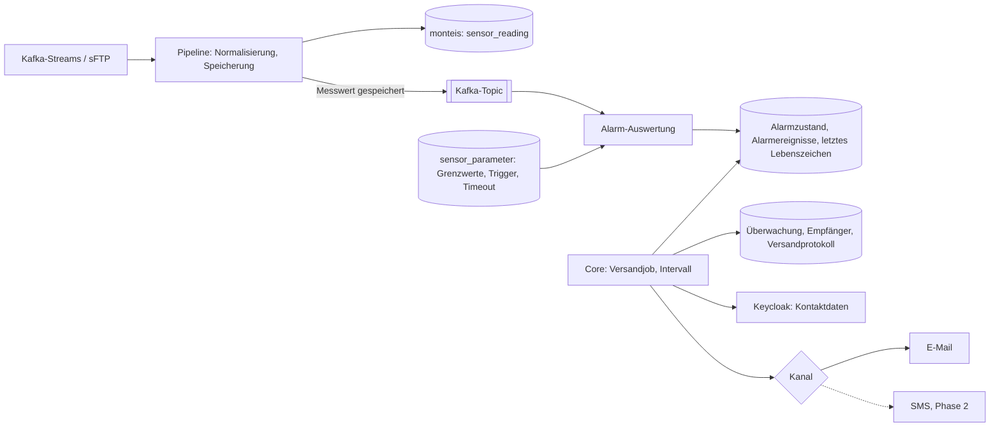

# Zielarchitektur Alarmierung

Messwerte überwachter Sensoren, die eine Alarm- oder Spezialalarm-Grenze verletzen, lösen in einem festen Intervall eine Sammelbenachrichtigung an die Empfänger aus, die ein Admin oder PI im Frontend festgelegt hat. Zusätzlich werden ausbleibende Daten erkannt: pro Sensor-Parameter (Timeout) und pro Pipeline (Kafka-Streams). Phase 1 benachrichtigt per E-Mail, Phase 2 ergänzt SMS. Dieses Dokument hält den Stand der Vorabklärung fest. Es ersetzt keine ADRs: Die Entscheidungen unten werden im Lauf mit Alternativen begründet und in `documentation/architecture/src/09_architecture_decisions.adoc` festgehalten.

Ticket: TBD (`MON-248`). Abhängigkeit: MON-250 (DB-Fusion).

## Ausgangslage

- Das Frontend ist in detaillierte Stories zerlegt und in Umsetzung. Dort wird festgelegt, wann ein Alarm an welche Personen geht, für welchen Sensor und welches Experiment.
- Heute gibt es pro `sensor_parameter` ein Grenzwertpaar `lower_alarm_limit` / `upper_alarm_limit`. Fachlich ist das der Sensor Range, nicht die Alarmgrenze.
- Die Pipeline stuft jeden Messwert beim Ingest ein und speichert das Ergebnis in `sensor_reading.status` (`range_category`: `too_low | correct | too_high`). Die Grenzwerte erhält sie über die Sensor-Konfiguration aus Kafka, nicht aus den Meta-Tabellen.
- Die Pipeline (`BoundsValidator`) veröffentlicht heute schon bei jeder Sensor-Range-Verletzung eines neu eingetroffenen Messwerts ein `SensorBoundBreachedEvent` asynchron auf das Topic `sensor-alerts`, bei Reprocessing nicht. Auf `main` konsumiert niemand dieses Topic. Fehler beim Senden werden nur geloggt.
- Bei einer Änderung der Sensor-Konfiguration verarbeitet die Pipeline historische Messwerte neu (`SensorConfigReprocessingListener`, `HistoricalReadingChunkProcessor`) und schreibt dabei auch `status` neu.
- Kontaktdaten werden nie in MONTEIS gespeichert, sondern aus Keycloak gelesen (bisher nur mit dem Token des Aufrufers).
- Geplante Jobs mit Sperre gegen Doppelläufe gibt es bereits: Fulcrum-Synchronisation mit ShedLock.

## Anforderungen

| ID  |                                                                                                                                                                                                                                                                    Anforderung                                                                                                                                                                                                                                                                    |
|-----|---------------------------------------------------------------------------------------------------------------------------------------------------------------------------------------------------------------------------------------------------------------------------------------------------------------------------------------------------------------------------------------------------------------------------------------------------------------------------------------------------------------------------------------------------|
| R1  | Benachrichtigt wird periodisch in einem festen Intervall, z. B. zweimal täglich. Das genaue Intervall ist zu definieren.                                                                                                                                                                                                                                                                                                                                                                                                                          |
| R2  | Pro `sensor_parameter` gibt es zwei Grenzwertpaare: Alarm (unten/oben), Spezialalarm (unten/oben).                                                                                                                                                                                                                                                                                                                                                                                                                                                |
| R3  | Benachrichtigungen lösen nur Verletzungen von Alarm- und Spezialalarm-Grenzen aus, nicht des Sensor Range.                                                                                                                                                                                                                                                                                                                                                                                                                                        |
| R4  | Spezialalarme gehen im selben Intervall raus wie Alarme, nicht sofort.                                                                                                                                                                                                                                                                                                                                                                                                                                                                            |
| R5  | Die Grenzwerte für Alarm und Spezialalarm werden am Sensor-Parameter festgelegt (im Frontend gepflegt). Sie sind fix, nicht zeitlich versioniert. Eine Änderung führt zu einer Neuevaluation des gespeicherten Status.                                                                                                                                                                                                                                                                                                                            |
| R6  | Die Empfänger normaler Alarme legt ein Admin oder der PI des Experiments im Frontend fest (R17). Spezialalarme definiert nur ein Admin.                                                                                                                                                                                                                                                                                                                                                                                                           |
| R7  | E-Mail-Adressen (und in Phase 2 Telefonnummern) werden pro Benutzer aus Keycloak gelesen.                                                                                                                                                                                                                                                                                                                                                                                                                                                         |
| R8  | Phase 1: E-Mail. Phase 2: SMS.                                                                                                                                                                                                                                                                                                                                                                                                                                                                                                                    |
| R9  | Ein normaler Alarm geht nur einmal raus: Ein Sensor-Parameter, der dauerhaft im Alarm bleibt, wird nicht in jedem Intervall erneut gemeldet. Spezialalarme wiederholen sich.                                                                                                                                                                                                                                                                                                                                                                      |
| R10 | Empfänger normaler Alarme werden pro Experiment festgelegt; sie erhalten die Alarme der überwachten Sensoren dieses Experiments .                                                                                                                                                                                                                                                                                                                                                                                                                 |
| R11 | Ein Alarm wird ausgelöst oder zurückgesetzt, sobald mindestens so viele aufeinanderfolgende Messwerte wieder innerhalb oder ausserhalb des Ranges liegen, wie der Frequency-Wert angibt (ohne Frequency-Wert: default 1).  Das Versandintervall (R1) spielt für die Rücksetzung keine Rolle; es bestimmt nur, wann Alarme an die Empfänger verschickt werden.                                                                                                                                                                                     |
| R12 | Alarm und Spezialalarm sind zwei voneinander unabhängige Ranges. Jeder wird für sich ausgewertet, gemeldet und zurückgesetzt; einen eigenen Verschärfungsfall („von Alarm zu Spezialalarm“) gibt es nicht. Jeder Messwert wird gegen beide Ranges getrennt geprüft; die Ranges können sich überlappen, ein Wert kann also beide verletzen und für beide Folgen zählen.                                                                                                                                                                            |
| R13 | Es gibt keine Entwarnung, wenn ein Sensor-Parameter wieder im Range ist.                                                                                                                                                                                                                                                                                                                                                                                                                                                                          |
| R15 | Ist für einen Sensor-Parameter kein Trigger-Wert definiert, wird der Alarm beim ersten Auftreten eines Verstosses ausgelöst.                                                                                                                                                                                                                                                                                                                                                                                                                      |
| R16 | Alarmiert werden nur Sensor-Parameter unter Überwachung (normale Alarme und/oder Spezialalarme). Range und Timeout werden bei Grenzwertverletzungen nur im Frontend farblich gekennzeichnet (Story im Backlog).                                                                                                                                                                                                                                                                                                                                   |
| R17 | Admin oder PI legen pro Hauptexperiment fest, welche Sensor-Parameter mit normalen Alarmen überwacht werden und welche Empfänger (nur Experimentuser) alarmiert werden.                                                                                                                                                                                                                                                                                                                                                                           |
| R18 | Spezialalarme definiert nur ein Admin, pro Sensor-Parameter; eine Zuordnung pro Experiment ist möglich. Empfänger sind die Benutzer, die der Admin für den Spezialalarm festlegt (eigene Empfängerliste). TBD: Frage: Wie soll eine Zuordnung pro Experiment für Spezialalarme vorgenommen werden? Welche User können ausgewählt werden (welche User sind berechtigt)? Oder geht es hier eher um die Darstellung der Spezialalarme in den jeweiligen Experiment-Views?                                                                            |
| R19 | Spezialalarme können wiederholt ausgelöst werden. In der initialen Umsetzung wird ein bestehender Spezialalarm in jedem Versandintervall (R1) erneut gemeldet; ein eigenes, konfigurierbares Wiederholungsintervall folgt später.                                                                                                                                                                                                                                                                                                                 |
| R20 | Pipelines werden überwacht. Eine Pipeline ist der Datenfluss eines externen Lieferanten bis in die TimescaleDB. Eine Seite im Adminbereich zeigt eine Übersicht über alle Pipelines (FE-Stories existieren). TBD Out of Scope in erster Phase                                                                                                                                                                                                                                                                                                     |
| R21 | Pro Pipeline kann ein Timeout definiert werden. Liefert eine Pipeline innerhalb ihres Timeouts keine Daten, wird alarmiert. TBD Out of Scope in erster Phase                                                                                                                                                                                                                                                                                                                                                                                      |
| R22 | Prio 1 alarmiert ausschliesslich per E-Mail. Eine Kanalwahl (E-Mail und/oder SMS) folgt mit SMS in Phase 2; wo sie konfiguriert wird, ist offen. Das Design hält die Kanal-Schnittstelle offen, legt aber noch kein Konfigurationsfeld an.                                                                                                                                                                                                                                                                                                        |
| R23 | Fehlende Datensequenzen werden erkannt: Trifft für einen Sensor-Parameter länger als sein Timeout (Feld am Sensor-Parameter) kein Messwert ein, wird eine Datenlücke gemeldet.                                                                                                                                                                                                                                                                                                                                                                    |
| R24 | Die Pipeline wertet keine Alarme aus: Ob ein Messwert eine Alarm- oder Spezialalarm-Grenze verletzt, ob ein Trigger-Wert erreicht ist, ob ein Alarm zurückgesetzt wird und ob ein Timeout vorliegt, wird ausserhalb der Pipeline berechnet. So werden das Reprocessing und dessen Performance unter keinen Umständen beeinträchtigt. Die Pipeline stellt nur die verarbeiteten Messwerte bereit. Die Auswertung erfolgt in einer eigenen Komponente möglichst zeitnah nach Eingang; der Versand an die Empfänger bleibt im Versandintervall (R1). |

## Zielbild

1. **Pipeline (unverändert bis auf die Bereitstellung):** normalisiert, standardisiert und speichert Messwerte wie heute. Zur heutigen Sensor-Range-Einstufung in `sensor_reading.status`. Neu veröffentlicht sie nach dem erfolgreichen Speichern eines Batches pro neu eingetroffenem Messwert mit `sensor_parameter_id` ein Ereignis „Messwert gespeichert“ (Sensor-Parameter, Messzeitpunkt, standardisierter Wert, Pipeline) auf ein Kafka-Topic, Schlüssel = Sensor-Parameter. Beim Reprocessing veröffentlicht sie nichts (R24, F24). Keine Alarmgrenzen, keine Folgen, kein Zustand, keine Timeouts in der Pipeline.
2. **Alarm-Auswertung (eigene Komponente, Kafka-Consumer, E1, E10):**
   - konsumiert die Ereignisse „Messwert gespeichert“ mit eigener Consumer-Group; verzögert sie oder fällt sie aus, staut sich nur ihr Topic, Pipeline und Reprocessing laufen ungebremst weiter;
   - liest Grenzwerte und Trigger-Wert aus `sensor_parameter` (mit Cache) und prüft jeden Wert gegen den Alarm- und den Spezialalarm-Range (R2, R12);
   - führt pro Sensor-Parameter und Range die laufenden Folgen (Verstösse in Folge, Werte im Range in Folge), sortiert jeden Batch nach Messzeitpunkt und lässt Werte, die nicht neuer als der zuletzt gezählte sind, für die Folge aus (E7);
   - setzt den Alarmzustand auf „ausgelöst“, sobald die Verstossfolge den Trigger-Wert erreicht (ohne Trigger: beim ersten Verstoss, R14, R15), und zurück, sobald die Folge der Werte im Range ihn erreicht (R11); schreibt beim Auslösen ein Alarmereignis;
   - aktualisiert pro Sensor-Parameter und Pipeline den Zeitpunkt des letzten gespeicherten Messwerts (für R21, R23);
   - schreibt Zustand, Ereignisse und Zeitpunkte in einer Transaktion und bestätigt den Kafka-Offset erst danach; Messwerte schreibt sie nicht;
   - wertet alle Sensor-Parameter mit Grenzwerten aus, unabhängig von der Überwachung; den Zustand nicht überwachter Sensor-Parameter kann das Frontend für die farbliche Kennzeichnung nutzen (R16).
3. **Core, geplanter Versandjob** (Intervall aus R1, ShedLock gegen Doppelläufe):
   - liest die noch nicht versandten Alarmereignisse und filtert auf überwachte Sensor-Parameter (R16): normale Alarme gemäss Experiment-Konfiguration (R17), Spezialalarme gemäss Admin-Konfiguration (R18);
   - meldet einen normalen Alarm einmal (R9) und einen noch ausgelösten Spezialalarm in jedem Lauf erneut (R19, initial = Versandintervall);
   - prüft je überwachtem Sensor-Parameter, ob der letzte gespeicherte Messwert älter ist als sein Timeout (Datenlücke, R23), und je Pipeline, ob ihr letztes Lebenszeichen älter ist als ihr Timeout (R21); das Ausbleiben von Daten erzeugt kein Ereignis und braucht deshalb den zeitgesteuerten Lauf;
   - verschickt keine Entwarnung (R13);
   - gruppiert die Meldungen pro Empfänger, Experiment und Sensor-Parameter (Range, auslösender Wert, Zeitpunkt);
   - prüft beim Versand, ob der Empfänger das Experiment noch lesen darf; wer es nicht mehr darf, bekommt keine Meldung dazu;
   - liest die Kontaktdaten über einen Service-Account aus Keycloak;
   - versendet über eine Kanal-Schnittstelle (R22; Prio 1 nur E-Mail, Kanalwahl später); Phase 1 hat einen E-Mail-Adapter (z. B. AWS SES), Phase 2 ergänzt einen SMS-Adapter;
   - markiert Alarmereignisse erst nach erfolgreichem Versand als versandt, damit ein gescheiterter Versand keinen Alarm verschluckt.
4. **Versandprotokoll:** speichert pro Lauf das Zeitfenster und pro Empfänger den Versandstatus, nur mit Keycloak-User-IDs. Ein gescheiterter Versand wird wiederholt, ohne doppelt zu senden, und ein ausgefallener Lauf hinterlässt eine sichtbare Lücke statt verlorener Alarme.
5. **Trigger-Wert und Timeout:** optionale Felder am Sensor-Parameter, neben den Grenzwertpaaren, im Frontend gepflegt. Trigger leer heisst „beim ersten Verstoss auslösen“ (R14, R15). Das Timeout ist ein Attribut des Sensor-Parameters und steuert die Erkennung von Datenlücken (R23); Im Schema existiert das Feld noch auf keinem Branch und kommt als Migration `V2__…` dazu (F22).
6. **Überwachungs- und Empfängerkonfiguration:**
   - pro Experiment: überwachte Sensoren für normale Alarme, Empfänger mit Keycloak-User-IDs (R10, R17); schreiben dürfen Admin und PI des Experiments;
   - pro Sensor-Parameter (optional mit Experiment): Spezialalarm-Überwachung, eigene Empfängerliste (R18), später das Wiederholungsintervall (R19) und die Kanalwahl (R22); schreiben darf nur ein Admin;
   - die Schreibregeln sind in `Capabilities` und in den RLS-Funktionen gleich und durch Integrationstests abgesichert.
7. **Pipeline-Überwachung:** Verzeichnis aller Pipelines (Kafka-Streams, sFTP) mit Timeout und Zeitpunkt des letzten Lebenszeichens (R20, R21). Die Admin-Seite liest daraus die Übersicht; der Versandjob prüft die Timeouts. Weil eine Pipeline bis in die TimescaleDB reicht (R20), zählt als Lebenszeichen der letzte erfolgreich gespeicherte Messwert, nicht der letzte empfangene. Die Alarm-Auswertung leitet ihn aus den Ereignissen „Messwert gespeichert“ ab, die erst nach dem Speichern veröffentlicht werden (E8).

Textfassung: Die Pipeline verarbeitet Messwerte aus Kafka-Streams und sFTP wie heute, speichert sie und veröffentlicht danach pro neuem Messwert ein Ereignis „Messwert gespeichert“. Die Alarm-Auswertung konsumiert diese Ereignisse, prüft sie gegen die Grenzwerte am Sensor-Parameter, führt Folgen und Alarmzustand und schreibt Alarmereignisse und das letzte Lebenszeichen. Der Versandjob in `core` liest im Intervall die offenen Alarmereignisse, prüft die Timeouts, filtert auf überwachte Sensor-Parameter, holt die Kontaktdaten aus Keycloak und versendet per E-Mail (Phase 2 zusätzlich SMS).

## Vorentscheide (Als ADR zu bestätigen)

### E1 Aufteilung: Pipeline stellt bereit, eigene Komponente wertet aus, `core` versendet

- **Entscheid (R24):** Die Pipeline wertet nichts aus. Eine eigene Alarm-Auswertung konsumiert die gespeicherten Messwerte zeitnah über Kafka und führt Folgen und Alarmzustand. Ein geplanter Job in `core` versendet im Intervall und prüft die Timeouts.
- **Begründung:** Reprocessing und Ingest bleiben frei von Alarm-Logik und Alarm-Datenbankzugriffen; die einzige Mehrarbeit der Pipeline ist ein Kafka-Send pro Batch. Kafka entkoppelt die Last: Ist die Auswertung langsam oder ausgefallen, staut sich nur ihr Topic. Die Auswertung bleibt trotzdem zeitnah, der Zustand ist sofort für das Frontend verfügbar.
- **Verworfen:**
  - Auswertung in der Pipeline (Nachtrag 4): widerspricht R24.
  - C' (der Versandjob wertet die gespeicherten Messwerte periodisch aus): grosse Abfragen über `sensor_reading` pro Lauf konkurrieren mit Ingest und Reprocessing in derselben Datenbank, und die Auswertung ist nicht zeitnah.
- **Ort der Auswertung (zu entscheiden):** als Consumer in `core` (bestehender DB-Zugang, ShedLock, Keycloak-Anbindung) vs. eigenes Deployable (unabhängig skalierbar, isoliert von der API-Last). Empfehlung: in `core` als eigenes Feature-Modul beginnen; ein Herauslösen bleibt möglich, weil die Schnittstelle das Topic ist.

### E2 Keine Alarmstufe pro Messwert speichern

- **Empfehlung:** Die Alarm-Auswertung schreibt keine Stufe in `sensor_reading`. Gespeichert werden nur Alarmzustand, Folgen und Alarmereignisse pro Sensor-Parameter. Updates auf die Hypertable würden mit Ingest und Reprocessing um dieselben Zeilen und Chunks konkurrieren (R24).
- **Alternative:** Alarmstufe als zusätzliche Spalte in `sensor_reading`, von der Auswertung nachgetragen; erlaubt Auswertungen pro Messwert im Frontend, kostet aber ein Update pro Messwert auf der Hypertable.
- **Grenzwertänderung:** Die Auswertung prüft jeden neuen Messwert gegen die aktuell gültigen Grenzwerte; eine Änderung gilt damit automatisch nur für neue Messwerte (R5). Bestehende Alarmzustände bleiben unverändert.
- **Sensor-Range-Status:** `sensor_reading.status` bleibt wie heute Sache der Pipeline. Dass das Reprocessing diesen Status bei einer Konfigurationsänderung neu schreibt, betrifft die Alarmierung nicht mehr (F26).
- **Zu entscheiden:** Umbenennung der heutigen `*_alarm_limit`-Spalten in Sensor Range, neue Spalten für Alarm- und Spezialalarm-Grenzen, Trigger-Wert und Timeout.

### E7 Folge bei zeitnaher Auswertung: Reihenfolge und verspätete Werte

Die Alarm-Auswertung sieht jeden Messwert nur in dem Moment, in dem sein Ereignis eintrifft. Bei einem Wert mit Zeitstempel 10:05 weiss sie nicht, ob noch ein Wert von 10:03 unterwegs ist (z. B. gepuffert beim Datenlogger). Ein Job, der später auf die gespeicherten Daten schaut, hätte dieses Problem nicht, weil zu diesem Zeitpunkt alle Werte schon da sind.

Beispiel mit Trigger 3:

| Eintreffen | Messzeitpunkt |   Wert   | Folge nach Eintreffen |                 Folge nach Messzeitpunkt                 |
|------------|---------------|----------|-----------------------|----------------------------------------------------------|
| 1          | 10:01         | Verstoss | 1                     | 1                                                        |
| 2          | 10:02         | Verstoss | 2                     | 2                                                        |
| 3          | 10:04         | Verstoss | 3 → **Alarm**         | 3 → Alarm, aber nur vorläufig                            |
| 4          | 10:03         | im Range | 0                     | Folge war 10:01–10:02, danach 10:04 = 1 → **kein Alarm** |

Nach Messzeitpunkt korrekt gezählt, hätte der Alarm nie ausgelöst werden dürfen. Die Auswertung erfährt das aber erst beim vierten Wert, wenn der Alarm schon ausgelöst ist.

Varianten:

1. **Innerhalb eines Kafka-Batches nach Messzeitpunkt sortieren.** Billig; fängt Vertauschungen innerhalb eines Batches ab, nicht über Batchgrenzen hinweg.
2. **Verspätete Werte für die Folge ignorieren.** Ist ein Wert nicht neuer als der zuletzt gezählte dieses Sensor-Parameters, verändert er die Folge nicht (gespeichert ist er durch die Pipeline trotzdem). Einfach und deterministisch; ein verspäteter Wert kann eine Folge weder unterbrechen noch verlängern.
3. **Folge ab dem verspäteten Wert neu berechnen.** Die Auswertung liest die gespeicherten Werte ab dessen Zeitstempel und zählt neu. Korrekt, braucht aber wieder eine Rückwärtsabfrage samt Index; ein bereits ausgelöster Alarm lässt sich nur zurückziehen, solange er noch nicht versandt ist.
4. **Verzögert auswerten.** Die Auswertung wartet eine feste Frist (z. B. 15 Minuten), bevor sie zählt. Korrekt für alle Werte innerhalb der Frist, aber deutlich mehr Komplexität.

- **Entscheid:** 1 + 2. Weil Alarme ohnehin erst im nächsten Versandintervall rausgehen (R1), wiegen seltene Grenzfälle wenig.
- **Folge:** Pro Sensor-Parameter und Range führt der Zustand den Messzeitpunkt des zuletzt gezählten Werts. Das macht die Auswertung zugleich idempotent gegenüber erneut zugestellten Ereignissen (F25).

## ADR-Kandidaten

|  #  |                                  Entscheidung                                  |                                                                                                                                      Alternativen                                                                                                                                      |                                                                                                                                                         Sicherheit / Compliance                                                                                                                                                          |
|-----|--------------------------------------------------------------------------------|----------------------------------------------------------------------------------------------------------------------------------------------------------------------------------------------------------------------------------------------------------------------------------------|------------------------------------------------------------------------------------------------------------------------------------------------------------------------------------------------------------------------------------------------------------------------------------------------------------------------------------------|
| E2  | Alarmstufe pro Messwert speichern?                                             | nein, nur Zustand und Ereignisse pro Sensor-Parameter (Empfehlung) vs. zusätzliche Spalte in `sensor_reading`                                                                                                                                                                          | –                                                                                                                                                                                                                                                                                                                                        |
| E3  | Kontaktdaten ohne Benutzer-Token                                               | Service-Account (Client Credentials, nur `view-users`) vs. bestehender Admin-Zugang                                                                                                                                                                                                    | Erweitert die Entscheidung „Kontaktdaten nur mit dem Token des Aufrufers“; Rechte des Service-Accounts minimal halten, Secret aus der Umgebung                                                                                                                                                                                           |
| E4  | Job-Zugriff trotz RLS                                                          | eigene DB-Rolle mit eigener Policy vs. gesetzter Systemkontext in der Transaktion                                                                                                                                                                                                      | Der Job sieht alle Experimente; die Leserechte der Empfänger prüft er selbst                                                                                                                                                                                                                                                             |
| E5  | Kanal-Abstraktion und Provider                                                 | SES vs. SMTP-Relay (E-Mail); SNS vs. externer Provider (SMS, Phase 2)                                                                                                                                                                                                                  | Abstimmung mit `lg-monteis-infra`; keine Kontaktdaten im Versandprotokoll                                                                                                                                                                                                                                                                |
| E6  | Alarmzustand und Alarmereignisse (R9, R11, R12, R19)                           | Zustandstabelle mit Folgen je Sensor-Parameter und Range plus Ereignistabelle (Outbox) vs. nur Zustandstabelle mit Versandmarke                                                                                                                                                        | Ereignis erst nach erfolgreichem Versand als versandt markieren; Auswertung und Versandjob schreiben getrennte Spalten bzw. Tabellen                                                                                                                                                                                                     |
| E7  | Wo und wie wird die Folge aufeinanderfolgender Verstösse ermittelt (R11, R14)? | (a) Versandjob rechnet rückwärts; (b) Versandjob führt die Folge von Lauf zu Lauf; (c) zeitnahe Auswertung führt die Folge pro Ereignis                                                                                                                                                | **Entschieden: (c) in der eigenen Alarm-Auswertung**, nicht in der Pipeline (R24). Reihenfolge: Batch nach Messzeitpunkt sortieren, nicht neuere Werte für die Folge ignorieren (siehe E7 oben, F15)                                                                                                                                     |
| E8  | Lebenszeichen der Pipelines (R20, R21)                                         | (a) Alarm-Auswertung leitet es aus den Ereignissen „Messwert gespeichert“ ab; (b) Versandjob liest den neuesten `sensor_reading` je Quelle; (c) Plattform-Monitoring (Consumer-Lag, CloudWatch)                                                                                        | Empfehlung (a): Ereignisse werden erst nach dem Speichern veröffentlicht und erfüllen damit F21, ohne Pipeline-Logik und ohne Abfragen auf die Hypertable. (b) belastet die Datenbank; (c) speist die Admin-Seite nicht                                                                                                                  |
| E9  | Konfigurationsmodell Überwachung und Empfänger (R16–R19)                       | eine gemeinsame Tabelle mit Geltungsbereich (Experiment oder Sensor-Parameter) vs. getrennte Tabellen für normale Alarme (pro Experiment) und Spezialalarme (pro Sensor-Parameter, eigene Empfängerliste)                                                                              | zwei Schreibregeln (Admin/PI vs. nur Admin) müssen in `Capabilities` und RLS getrennt abgebildet werden                                                                                                                                                                                                                                  |
| E10 | Bereitstellung der Messwerte für die Auswertung (R24)                          | (a) Pipeline veröffentlicht nach dem Speichern ein Ereignis pro neuem Messwert auf ein eigenes Topic (Schlüssel Sensor-Parameter), nur bei Ingest; (b) Auswertung konsumiert `internal-normalized` mit eigener Consumer-Group; (c) Auswertung fragt neue Zeilen in `sensor_reading` ab | Empfehlung (a). (b) müsste Standardisierung und Zuordnung zum Sensor-Parameter duplizieren und sähe Werte vor dem Speichern; (c) braucht eine Eingangsmarke und einen Index auf der Hypertable und verteuert damit jeden Insert. Zuverlässigkeit des Sendens siehe F27; das heutige `sensor-alerts`/`AlertPublisher` kann darin aufgehen |

## Offene Fragen

|  #  |                                        Frage                                         |                 Wirkung                 | Stand |
|-----|--------------------------------------------------------------------------------------|-----------------------------------------|-------|
| F6  | Mengengerüst: Anzahl Sensoren, Messrate, Empfänger pro Experiment                    | Machbarkeit der Abfrage pro Lauf, Index | offen |
| F10 | Was passiert, wenn ein Empfänger in Keycloak keine Adresse hat oder deaktiviert ist? | Fehlerbehandlung, Versandprotokoll      | offen |

## Abhängigkeiten und Reihenfolge

- **MON-250 zuerst:** Neue Tabellen (Empfänger, Versandprotokoll) und die Spalten für die drei Grenzwertpaare kommen als `V2__…` auf `db/schema/V1__baseline.sql`, nicht in die Baseline selbst.
- **Glossar:** Sensor Range, Alarm-Grenze und Spezialalarm-Grenze kommen in `CONTEXT.md`, bevor Code und Migrationen sie verwenden. Der heutige Spaltenname `alarm_limit` wird dabei fachlich korrigiert.
- **Frontend:** Die Grenzwert-Erfassung, die Überwachungs- und Empfängerverwaltung, die farbliche Kennzeichnung nicht überwachter Sensoren (Backlog) und die Pipeline-Übersicht im Adminbereich brauchen die erweiterte API aus `core`; der REST-Client wird aus der OpenAPI generiert.
- **Pipeline und `contracts`:** Einzige Änderung in der Pipeline ist das Veröffentlichen der Ereignisse „Messwert gespeichert“ (E10); das Ereignisschema gehört in `contracts`. Das bisherige `SensorBoundBreachedEvent` / Topic `sensor-alerts` wird abgelöst oder bleibt für den Sensor Range bestehen.
- **Infrastruktur:** neues Kafka-Topic (Partitionen nach erwarteter Last, F6), Mailversand (und später SMS) sowie das Secret des Keycloak-Service-Accounts stellt das Infra-Team in `lg-monteis-infra` bereit.

## Risiken

- **Alarm bleibt unbemerkt bestehen:** Weil ein Alarm nur einmal rausgeht (R9) und es keine Erinnerung oder Entwarnung gibt (R13), sieht niemand per Mail, ob ein Sensor-Parameter seit Wochen ausserhalb des Ranges ist. Das ist so gewollt; der aktuelle Zustand muss dann im Frontend sichtbar sein.
- **Flackern an der Grenze:** Bei Sensor-Parametern ohne Trigger-Wert löst jeder Verstoss aus und jeder Wert im Range setzt zurück (R11, R15). Ein Wert, der um eine Grenze pendelt, kann dann bei jedem Versand neu melden. Ein Trigger-Wert dämpft das in beide Richtungen.
- **Verlorene Alarme:** Fällt ein Lauf aus, muss der nächste das ganze Zeitfenster seit dem letzten erfolgreichen Lauf abdecken; das Versandprotokoll muss das sicherstellen.
- **Breiter Keycloak-Zugriff:** Ein Service-Account mit Leserecht auf alle Benutzer ist ein neues Angriffsziel; Rechte minimal halten und begründen (E3).
- **Rechte driften:** Die Schreibregel für Empfänger (Admin oder PI) und die Leseprüfung beim Versand müssen in Java und SQL gleich bleiben; Integrationstests sichern das ab.
- **Alarmflut bei Pipeline-Ausfall:** Fällt eine Pipeline aus, laufen auch die Timeouts aller ihrer Sensor-Parameter ab. Ohne Unterdrückung erhalten Empfänger dann hunderte Datenlücken-Meldungen statt einer Pipeline-Meldung. Der Job sollte Datenlücken von Sensor-Parametern einer Pipeline im Timeout unterdrücken; das setzt die Zuordnung Sensor-Parameter → Pipeline voraus (F21).
- **Kosten und Lärm durch Wiederholung:** Wiederholte Spezialalarme (R19) über SMS (Phase 2) erzeugen laufende Kosten und stumpfen Empfänger ab, wenn kein Ende der Wiederholung definiert ist (F17).
- **Verlorene Ereignisse zwischen Pipeline und Auswertung:** Sendet die Pipeline ein Ereignis nicht (Broker nicht erreichbar, Absturz zwischen Commit und Send), fehlt der Wert in der Folge; ein Alarm kann ausbleiben. Gegenmittel siehe F27.
- **Rückstau der Auswertung:** Fällt die Alarm-Auswertung aus, wachsen ihr Topic und der Consumer-Lag; Pipeline und Reprocessing laufen weiter (gewollt nach R24). Der Lag braucht eine eigene Überwachung, sonst werden Alarme unbemerkt verspätet, und Datenlücken-Prüfungen des Versandjobs melden fälschlich Lücken, weil das letzte Lebenszeichen veraltet ist. Der Versandjob sollte Timeouts deshalb nicht prüfen, solange die Auswertung im Rückstand ist.

