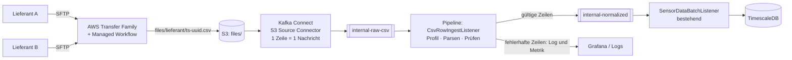

# Zielarchitektur CSV-Ingest über SFTP

Verschiedene Sensor-Lieferanten liefern CSV-Dateien in beliebigen Intervallen per SFTP. Die Dateien sollen ohne manuellen Eingriff übernommen, je nach Lieferant geprüft und als einzelne Messwerte in die bestehende Pipeline (`internal-normalized` → TimescaleDB) eingespeist werden. Dieses Dokument hält die Top-Level-Architektur fest (AWS Transfer Family → S3 → Kafka Connect).

Ticket: MON-268: DAS Anbindung: CSV Import (Konzept)

## Anforderungen

| ID |                                                                 Anforderung                                                                 |        Quelle        |
|----|---------------------------------------------------------------------------------------------------------------------------------------------|----------------------|
| R1 | Mehrere Lieferanten liefern CSV-Dateien in unterschiedlichen Formaten (Trennzeichen, Spalten, Zeitformat, Zeitzone).                        | Vorabklärung         |
| R2 | Die Dateien kommen per SFTP, in beliebigen, unregelmässigen Intervallen.                                                                    | Vorabklärung         |
| R3 | Dateien werden automatisch übernommen und verarbeitet; Kafka Connect übernimmt den Transport.                                               | Vorabklärung         |
| R4 | Dateien werden Zeile für Zeile verarbeitet                                                                                                  | Vorabklärung         |
| R5 | Die Zeilen(Messwerte) fliessen als einzelne Nachrichten in die bestehende Verarbeitung (gleiches Format wie SolExperts).                    | Vorabklärung         |
| R6 | Dateien sind typischerweise bis 4 MB gross; auch Dateien von 100 MB und mehr müssen verarbeitet werden können.                              | Vorabklärung         |
| R7 | Datenlücken innerhalb der Messwerte müssen nicht erkannt werden                                                                             | Vorabklärung         |
| R8 | Fehlerhafte Zeilen werden geloggt und übersprungen; gültige Zeilen derselben Datei werden übernommen. Ganze Dateien werden nicht abgelehnt. | Entscheid 2026-11-18 |

## Lösung im Überblick

Kafka Connect liest jede neue Datei aus S3 **Zeile für Zeile** und schreibt **jede Zeile als eigene Nachricht** auf `internal-raw-csv`. Der `CsvRowIngestListener` der Pipeline wandelt jede Zeile mit dem Profil des Lieferanten in einen Messwert um und sendet ihn auf `internal-normalized`. Fehlerhafte Zeilen werden geloggt und übersprungen. Es gibt keinen Entscheid über die ganze Datei, deshalb auch keinen zweiten Durchgang, keine Transaktion und kein Manifest. Die Dateigrösse spielt keine Rolle, weil jede Nachricht nur eine Zeile trägt.



Textfassung:
1. Lieferanten laden per SFTP auf AWS Transfer Family hoch. Ein Managed Workflow legt die Datei unter `files/<lieferant>/` mit einem eindeutigen, systemvergebenen Namen ab.
2. Ein S3 Source Connector liest jede neue Datei Zeile für Zeile und schreibt jede Zeile als Nachricht auf `internal-raw-csv`. Objektschlüssel und Zeilenindex reisen als Kafka-Header mit.
3. Der `CsvRowIngestListener` der Pipeline bestimmt den Lieferanten aus dem Objektschlüssel, lädt dessen Profil, parst und prüft die Zeile. Gültige Zeilen gehen als `NormalizedSensorData` auf `internal-normalized`, fehlerhafte werden geloggt und gezählt. Ab `internal-normalized` läuft alles wie heute.

## Komponenten

### 1. Annahme: SFTP-Server

Option AWS Transfer Family: Verwalteter Service mit Workflows allerdings hohe Fixkosten
Option SFTPGo im EKS: Günstig, eigener Betrieb, Wartung und Härtung

- Ein Server, ein Benutzer pro Lieferant, Home-Verzeichnis auf `s3://<ingest-bucket>/upload/<lieferant>/` (logisch gemappt).
- Transfer Family schreibt ein Objekt erst nach abgeschlossenem Upload; halbe Dateien gelangen nicht nach `files/`.
- Ein **Managed Workflow** pro Upload, mit einem Custom Step (Lambda):
  1. Datei nach `files/<lieferant>/<yyyyMMddHHmmss>-<uuid>.csv` kopieren. Der vom Lieferanten gewählte Dateiname kommt **nicht** in den Schlüssel (Projektregel), sondern als S3-Objekt-Metadatum `original-name`. Die UUID macht erneute Uploads eindeutig.
  2. Ein Log-Eintrag `event=csv_upload` mit `producer`, `object_key`, `original_name`, `size`. Damit lässt sich ein Objektschlüssel aus den Fehler-Logs dem Originalnamen zuordnen.
  3. Original in `upload/` löschen.
- Eine obere Sicherheitsgrenze (z. B. 500 MB) prüft die Lambda und legt grössere Dateien unter `rejected/` ab.
- Aufbewahrung von `files/` per S3-Lifecycle-Regel (Dauer TBD); die Dateien bleiben damit für Neuverarbeitung verfügbar.
- Files werden zum Schluss in den Cold-Storage verschoben

### 2. Transport: Kafka Connect S3 Source

- Lenses Stream Reactor S3 Source oder FilePulse Connector -> Connector muss nocht fixiert werden (siehe Connector-Auswahl (D5) )
- Ein KCQL-Eintrag pro Lieferant, Quelle `files/<lieferant>/`, Ziel `internal-raw-csv`:
  - `STOREAS CSV_WITHHEADERS` für Lieferanten mit Kopfzeile: Der Connector überspringt die erste Zeile.
  - `STOREAS TEXT` (oder `CSV`) für Lieferanten ohne Kopfzeile.
  - In beiden Fällen ist der Nachrichtenwert die rohe Zeile als String. Der Connector parst und prüft nichts; das macht die Pipeline.
- `connect.s3.source.write.watermark.header=true` schreibt pro Nachricht diese Header (String-Werte, laut Quellcode `SourceWatermark.scala` / `ContextConstants.scala`, nicht in der Doku):
  - `path`: Objektschlüssel, daraus folgt der Lieferant.
  - `line`: 0-basierter Index des Datensatzes im Objekt, ohne Kopfzeile.
  - `last`: markiert die letzte Zeile der Datei.
  - `container`, `prefix`, `ts` (Last-Modified in ms).
    Die Header-Namen sind nicht dokumentiert und im PoC zu bestätigen.
- Reihenfolge: `connect.s3.ordering.type=LastModified` statt des Defaults `AlphaNumeric`. `AlphaNumeric` überspringt laut Doku Objekte, deren Schlüssel vor dem zuletzt verarbeiteten einsortiert wird. `LastModified` listet bei jedem Poll alle Objekte unter dem Präfix; das bleibt billig, weil `post.process.action=MOVE` (`post.process.action.bucket`, `post.process.action.prefix`) jede fertig gelesene Datei nach `files-transferred/<lieferant>/` verschiebt.
- Der Connector merkt sich pro Datei den Offset (Pfad und Zeile). Nach einem Neustart setzt er in der Datei fort; einzelne Zeilen können doppelt kommen (at-least-once).
- Latenz: Der Connector sucht standardmässig alle 5 Minuten nach neuen Dateien (`connect.s3.source.partition.search.interval`, 300000 ms). Der Wert ist konfigurierbar und geht in das Timeout ein (Komponente 5).
- Jede Nachricht trägt eine Zeile (wenige hundert Bytes). Topic-, Producer- und Consumer-Limits bleiben unverändert, auch bei Dateien von 100 MB und mehr (R6).
- Retention von `internal-raw-csv` kurz (z. B. 7 Tage); die Dateien liegen in S3.

### 3. Verarbeitung: `CsvRowIngestListener` in der Pipeline

Neues Paket `pipeline/.../ingress/external/csvfile/`, nach dem Muster von `solexperts/` (`RawSolExpertsSensorDataListener`, `VendorDataNormalizer`): Batch-Listener auf `internal-raw-csv`, Rückgabe der gültigen Messwerte per `@SendTo` auf `internal-normalized`. Die Pipeline braucht keinen S3-Zugriff.

Ablauf pro Nachricht (Zeile):

1. Lieferant aus dem Header `path` (`files/<lieferant>/…`) bestimmen, `ProducerProfile` laden. Unbekannter Lieferant → Zeile loggen (`UNKNOWN_PRODUCER`) und überspringen.
2. Zeile mit dem Format des Profils parsen: Trennzeichen, Spalten nach Position (die Kopfzeile hat der Connector schon entfernt), Zeitformat, Zeitzone, Dezimaltrennzeichen.
3. Prüfen: Syntax (Spaltenzahl, Zahl, Datum) immer, fachliche Regeln nur, wenn im Profil eingeschaltet.
4. Gültig → `NormalizedSensorData` auf `internal-normalized`, Schlüssel `dasKey` (wie heute). Fehlerhaft → Log-Eintrag und Metrik (Komponente 4), Zeile wird übersprungen.

Doppelt zugestellte Zeilen (Connector-Neustart, erneuter Upload) werden beim Speichern per Upsert überschrieben, nicht verdoppelt.

Profil (Beispiel):

```yaml
producers:
  geotest:
    delivery-interval: PT6H                    # erwarteter Lieferzyklus, siehe Komponente 5
    format:
      delimiter: ";"
      header: true                             # muss zum KCQL-Eintrag passen (CSV_WITHHEADERS)
      decimal-separator: ","
      timestamp: { column: 1, pattern: "dd.MM.yyyy HH:mm:ss", zone: "Europe/Zurich" }
      das-key: { column: 2 }
      value: { column: 3 }
    validation:
      rules: [known-das-key, not-in-future]   # leer = nur Syntax
```

### 4. Fehler auswerten: Logs und Metriken

Kein Fehlerbericht und keine eigene Oberfläche. Quelle der Fehler sind die strukturierten Logs des `CsvRowIngestListener`.

- **Strukturierte Logs (JSON):** Spring Boot `logging.structured.format.console` (z. B. `ecs`), Felder als Key-Value (SLF4J Fluent API `addKeyValue`), nicht im Fliesstext. Pro fehlerhafter Zeile ein Eintrag `event=csv_ingest_row_error`, Level WARN, mit:
  - `producer`, `object_key` (Header `path`);
  - `line`: Zeilennummer wie im Editor (1-basiert, Kopfzeile mitgezählt), berechnet aus dem Header `line` plus 1, plus 1 bei Kopfzeile;
  - `column`, `value`, `expected` (Format aus dem Profil);
  - `error_code`, stabil: `INVALID_NUMBER`, `INVALID_TIMESTAMP`, `UNKNOWN_DAS_KEY`, `TIMESTAMP_IN_FUTURE`, `WRONG_COLUMN_COUNT`, `UNKNOWN_PRODUCER`.
- **Metriken (Micrometer → Prometheus → Grafana):** `csv_ingest_rows_total{producer,result}` (`valid | invalid`), `csv_ingest_row_errors_total{producer,error_code}`, `csv_ingest_last_row_timestamp_seconds{producer}` (Zeitpunkt der zuletzt empfangenen Zeile). Keine Dateinamen als Label (Kardinalität). Grafana-Panel „fehlerhafte Zeilen pro Lieferant“ und ein Grafana-Alert bei `increase(csv_ingest_rows_total{result="invalid"}[1h]) > 0`.
- **Suche nach der Zeile:** Vom Alert oder Panel zum Log: filtern nach `event=csv_ingest_row_error` und `producer` bzw. `object_key`, ergibt Datei, Zeile, Spalte, Wert und Fehlercode. Den Originalnamen liefert der Eintrag `event=csv_upload` der Lambda zum selben `object_key`. Wo die Logs landen (Loki in Grafana oder CloudWatch Logs Insights), ist in diesem Repo nicht festgehalten.
- **Grenzen:** Lieferanten haben keinen Zugriff auf Grafana oder Logs; der Admin gibt die Fehler weiter. Die Fehler sind nur so lange auffindbar, wie die Log-Retention reicht. Eine Zusammenfassung pro Datei gibt es nicht, weil die Zeilen einzeln und auf mehrere Partitionen verteilt verarbeitet werden.
- **Korrektur:** Nur die geloggten Zeilen korrigieren und als neue Datei hochladen, oder die ganze Datei erneut; bereits übernommene Messwerte werden per Upsert überschrieben, nicht verdoppelt.
- **Ursache im Stammdatenbestand:** Typisch `UNKNOWN_DAS_KEY` (Sensor-Parameter noch nicht erfasst): Der Admin korrigiert die Stammdaten statt der Datei, danach wird die Datei erneut hochgeladen.

### 5. Auswirkung des Lieferzyklus auf das Timeout

Die Alarmierung meldet einen Timeout, wenn für einen Sensor-Parameter `now() − letzter Messwert > reading_timeout` gilt (R23, View `sensor_parameter_reading_state` in `alarming-architecture.md`). Bei Dateilieferungen treffen Messwerte nicht laufend, sondern schubweise ein: Eine Datei mit Messwerten bis 06:00, die um 06:30 eintrifft, macht 06:00 zum letzten Messwert, und bis zur nächsten Lieferung wächst der Abstand um einen ganzen Lieferzyklus.

- **Regel für `reading_timeout`** bei Sensor-Parametern, die per Datei geliefert werden:
  `reading_timeout ≥ Lieferzyklus + Verzug des Lieferanten (Zeit zwischen letztem Messwert in der Datei und Upload) + Connector-Poll (Standard 5 min) + Verarbeitungsdauer + Reserve`.
  Beispiel: Lieferung alle 6 h, Upload 30 min nach dem letzten Messwert, 5 min Poll, 5 min Verarbeitung, 30 min Reserve → `reading_timeout` mindestens 7 h 10 min. Ein kürzeres Timeout meldet zwischen zwei regulären Lieferungen fälschlich Datenlücken.
- **Lieferzyklus im Profil:** `delivery-interval` im Lieferantenprofil hält den vereinbarten Zyklus fest. Er kann als Vorgabe beim Pflegen von `reading_timeout` im Frontend dienen TBD;
- **Grosse Dateien verlängern die Verarbeitungsdauer:** Eine 100-MB-Datei mit 1 bis 2 Mio. Zeilen braucht im Connector und in der nachgelagerten Verarbeitung Minuten.
- **Ausbleibende Lieferungen pro Lieferant** (Pipeline-Timeout, R21, ausserhalb der ersten Phase): `csv_ingest_last_row_timestamp_seconds{producer}` macht die letzte Lieferung sichtbar; ein Grafana-Alert bei `time() − csv_ingest_last_row_timestamp_seconds > delivery-interval + Reserve` erkennt einen ausgefallenen Lieferanten früher als die Timeouts der einzelnen Sensor-Parameter.

## Entscheidungen

| ID |              Frage               |                                             Entscheid                                             |                                                                                                           Info                                                                                                            |
|----|----------------------------------|---------------------------------------------------------------------------------------------------|---------------------------------------------------------------------------------------------------------------------------------------------------------------------------------------------------------------------------|
| D1 | Annahme der Dateien              | AWS Transfer Family → S3                                                                          | Verwaltet, kein eigener FTP-Server, Datei landet ohne Umweg in S3 (Archiv, Neuverarbeitung). Kein eigener Betrieb und keine eigene Härtung.                                                                               |
| D2 | Was transportiert der Connector? | eine Zeile = eine Nachricht                                                                       | Entspricht R4 und R5 direkt, unabhängig von der Dateigrösse                                                                                                                                                               |
| D3 | Ort von Parsen und Prüfen        | Pipeline (`CsvRowIngestListener`)                                                                 | Formate und Regeln sind Fachlogik, gehören zu den übrigen Normalizern und sind mit Testcontainers testbar.                                                                                                                |
| D4 | Umgang mit fehlerhaften Zeilen   | Zeile loggen und überspringen, Rest übernehmen                                                    |                                                                                                                                                                                                                           |
| D5 | Connector und Laufzeitumgebung   | Vorläufig: Stream Reactor 10.0.x auf MSK Connect 3.9.x; Rückfall FilePulse; Bestätigung durch PoC | MSK Connect bietet nur Kafka Connect 2.7.1, 3.7.x und 3.9.x. Stream Reactor 12.x braucht Kafka 4.0+; 10.0.x ist die einzige Linie auf Kafka 3.9. Details und verworfene Alternativen siehe Abschnitt „Connector-Auswahl“. |

## Connector-Auswahl (D5)

Stand der Recherche 2026-11-20. Gesucht ist ein S3 Source Connector, der jede CSV-Zeile als eigene Nachricht schreibt (R4, R5), den Objektschlüssel pro Nachricht mitgibt (Lieferant, Fehler-Log) und auf MSK Connect läuft.

**Laufzeitumgebung:**
- MSK Connect unterstützt Kafka Connect 2.7.1, 3.7.x und 3.9.x ([AWS-Doku](https://docs.aws.amazon.com/msk/latest/developerguide/msk-connect.html)).
- MirrorMaker 2 läuft heute auf `kafkaconnect_version = "3.7.x"` (`lg-monteis-infra/infrastructure/variables.tf`), das Plugin ist aus Kafka 3.7.2 gebaut. In MSK Connect hat jeder Connector seine eigene Version; der CSV-Connector kann also auf 3.9.x laufen, ohne MirrorMaker 2 anzufassen.
- Lokal laufen Broker und Connect auf `apache/kafka:4.4.0`. Lokal und AWS laufen damit auf unterschiedlichen Connect-Versionen.

**Kandidaten:**

|         Connector          |                                                                 Lizenz / Pflege                                                                 |                  Kafka 3.9                  |                                 Zeile = Nachricht                                 |                Objektschlüssel                |                                                      Bewertung                                                      |
|----------------------------|-------------------------------------------------------------------------------------------------------------------------------------------------|---------------------------------------------|-----------------------------------------------------------------------------------|-----------------------------------------------|---------------------------------------------------------------------------------------------------------------------|
| Stream Reactor 12.x / 11.x | Apache 2.0, aktiv                                                                                                                               | nein, braucht Kafka 4.0+ (Changelog 12.0.0) | ja                                                                                | Header `path` (Quellcode)                     | auf MSK Connect nicht unterstützt                                                                                   |
| **Stream Reactor 10.0.x**  | Apache 2.0, letzter Patch 10.0.5 (April 2026), ausserhalb des regulären Supports (nur aktuelle und vorherige Hauptversion), Fixes nur fallweise | ja (Kafka 3.9.1)                            | ja (`TEXT`, `CSV_WITHHEADERS`)                                                    | Header-Option seit 8.1.23, für 10.x zu prüfen | **gewählt für den PoC**                                                                                             |
| **FilePulse** 2.18         | Apache 2.0, aktiv (Juni 2026)                                                                                                                   | ja, laut Release Notes                      | wahrscheinlich, nicht bestätigt                                                   | nicht bestätigt                               | **Rückfall**                                                                                                        |
| Apache Camel 4.22.0        | Apache 2.0, aktiv (Sept. 2026)                                                                                                                  | unklar, eingebunden ist Kafka 4.3.1         | nein, eine Datei = eine Nachricht; zeilenweise nur mit eigener Kamelet-Definition | ja (`CamelAwsS3Key` als Key oder Header)      | verworfen: ganze Datei im Speicher und als eine Nachricht (100 MB), eigener Bau nötig, Laden auf MSK Connect unklar |
| Aiven S3 Source 3.4.4      | Apache 2.0, aktiv                                                                                                                               | vermutlich                                  | nein, nur `avro`, `parquet`, `jsonl`, `bytes` (feste Blöcke)                      | nicht dokumentiert                            | verworfen                                                                                                           |
| Confluent S3 Source        | kommerziell                                                                                                                                     | ja                                          | ja                                                                                | nicht dokumentiert                            | verworfen: Lizenz                                                                                                   |
| kafka-connect-fs           | Apache 2.0, letztes Release 2021 (Kafka 2.7)                                                                                                    | —                                           | Text-/CSV-Reader                                                                  | —                                             | verworfen: nicht gepflegt                                                                                           |

Für keinen Kandidaten dokumentiert AWS oder der Hersteller den Betrieb auf MSK Connect.

**PoC (MSK Connect 3.9.x, CSV-Datei mit Kopfzeile, Leerzeile und mehreren Lieferanten-Präfixen):**
1. Stream Reactor 10.0.5: Läuft das Plugin? Kommen die Header `path` und `line`? Zählt `line` Leerzeilen mit? Funktionieren `CSV_WITHHEADERS`, `LastModified` und `post.process.action=MOVE`? Neustart mitten in einer Datei: wo setzt der Connector fort?
2. Trivy- und Grant-Prüfung des Plugin-ZIP: Wie viele HIGH/CRITICAL-Funde, welche Lizenzen?
3. Parallel FilePulse mit denselben Fragen, falls Punkt 1 oder 2 scheitert.
4. Scheitern beide: Kafka Connect selbst im EKS betreiben (z. B. Strimzi oder Image `apache/kafka` wie lokal) mit Stream Reactor 12.x. Aktuelle Version und gleiche Umgebung lokal und in AWS, dafür eigener Betrieb (Deployment über ArgoCD, IAM-Anmeldung an MSK, Monitoring). Betrifft `lg-monteis-infra`.

## Risiken und Stolpersteine

- **Header-Namen des Connectors:** `path`, `line` und `last` stammen aus dem Quellcode (Branch `master`), nicht aus der Doku. Ohne `path` kennt die Pipeline weder Lieferant noch Datei. Im PoC mit der eingesetzten Version prüfen. Rückfall: ein Ziel-Topic pro Lieferant (`internal-raw-csv-<lieferant>`), der Listener abonniert per Pattern und leitet den Lieferanten aus dem Topic ab; dann fehlen aber Datei und Zeilennummer im Fehler-Log.
- **Zeilennummer im Log:** Der Header `line` zählt Datensätze, nicht physische Zeilen. Ob leere Zeilen mitgezählt werden, ist im PoC zu prüfen; sonst stimmt die Zeilennummer nach einer Leerzeile nicht mehr mit dem Editor überein.
- **Kopfzeile muss zum Profil passen:** `CSV_WITHHEADERS` im KCQL-Eintrag und `header: true` im Profil müssen übereinstimmen, sonst wird die erste Messzeile verschluckt oder die Kopfzeile als fehlerhafte Zeile geloggt.
- **Reihenfolge im S3 Source Connector:** Mit dem Default `AlphaNumeric` würden spät eintreffende Objekte mit kleinerem Schlüssel übersprungen (in der Doku bestätigt). Gegenmittel: `LastModified` plus `post.process.action=MOVE` (Komponente 2).
- **Live-Daten werden verzögert:** Die 1 bis 2 Mio. Zeilen einer grossen Datei laufen durch dieselbe `internal-normalized`-Verarbeitung wie die Live-Daten. Während eine grosse Datei verarbeitet wird, stauen sich Live-Messwerte und Alarme dahinter. Gegenmittel, falls nötig: den Connector drosseln (Poll-Grösse, im PoC bestimmen) oder Messwerte aus Dateien auf ein eigenes Topic mit eigener Consumer-Group legen.
- **Teilweise sichtbare Datei:** Die Zeilen einer Datei werden laufend gespeichert; während der Verarbeitung ist eine Datei teilweise sichtbar. Das ist mit R8 so gewollt.
- **Doppelte Ereignisse für die Alarmierung:** Doppelt zugestellte Zeilen sieht die Alarm-Auswertung noch einmal. Laut `alarming-architecture.md` (F25) zählt ein erneut zugestellter Wert nicht doppelt; im Test absichern.
- **Lambda im Workflow:** Schlägt der Custom Step fehl, bleibt die Datei in `upload/` und wird nie verarbeitet. Der Workflow braucht einen Exception-Handler, der die Datei nach `rejected/` verschiebt, und einen Alarm.
- **Pflege von Stream Reactor 10.0.x:** Die Linie liegt ausserhalb des regulären Supports; Sicherheitsfixes kommen nur fallweise. Trivy wird mit der Zeit HIGH/CRITICAL-Funde melden und den PR blockieren, bis sie in `.trivyignore` begründet sind. Sobald MSK Connect Kafka Connect 4.x anbietet oder Connect im EKS läuft, auf 12.x wechseln (D5).
- **Lokal und AWS auf verschiedenen Connect-Versionen:** Lokal 4.4.0, in AWS 3.9.x. Ein lokal grüner Test sagt über MSK Connect nur bedingt etwas aus; der PoC muss auf MSK Connect laufen.
- **Lizenz und Pflege des Connectors:** Stream Reactor ist Apache 2.0; das Plugin muss ins Connect-Image (`plugin.path`) und in die Grant-Lizenzprüfung (`.grant.yml`). Renovate erkennt die Version im Plugin-Build nicht; Updates von Hand.

